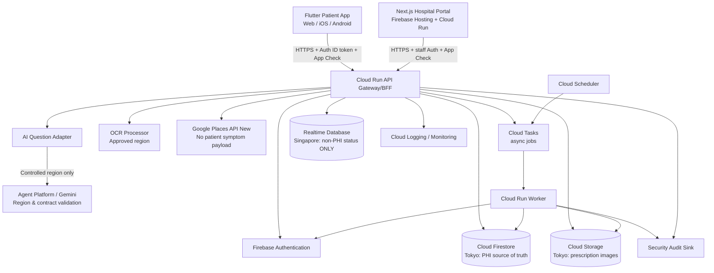
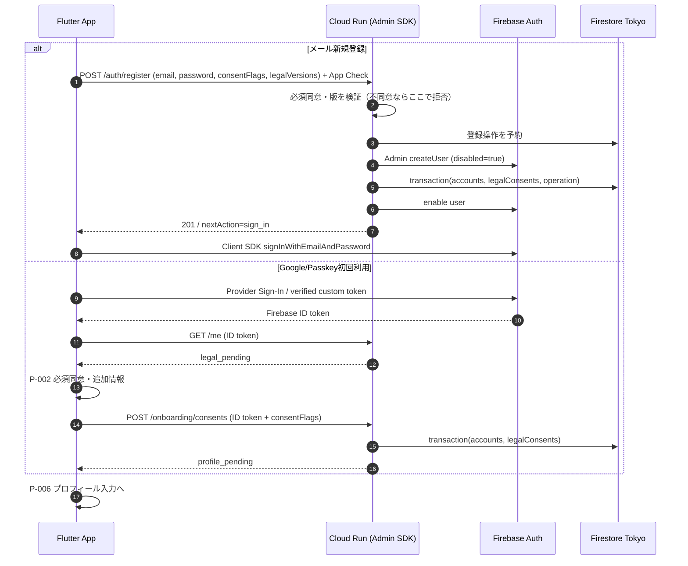
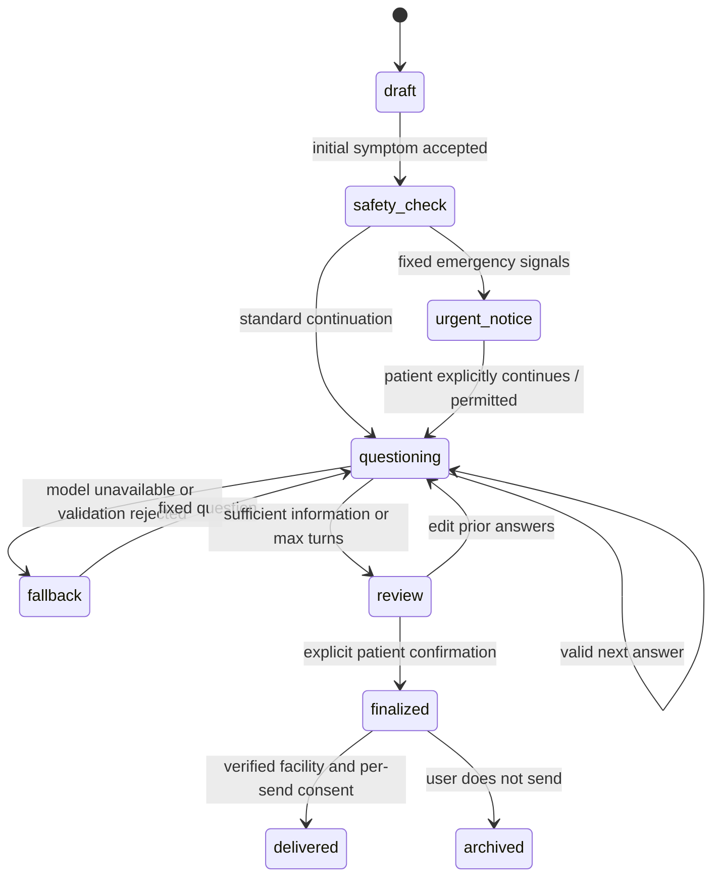
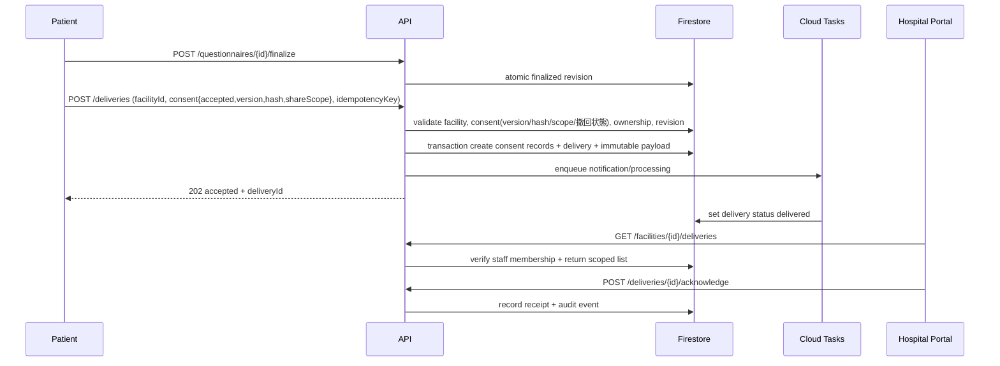
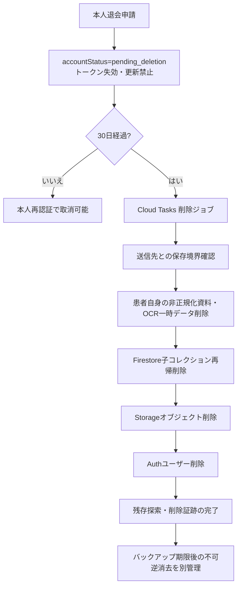

# もしもし問診 — システム基本設計・詳細設計書

- 文書ID：MMR-ARCH-001 / v1.1 / 2026-11-04
- 状態：実装候補設計。機器該当性、法務、医療機関契約、AI処理地域の承認までは本番医療データを投入しない。
- 関連：`01_要件定義書.md`、`03_機能仕様書.md`、`04_DB設計書.md`、`05_コスト試算表.md`

## 1. アーキテクチャ上の決定事項（ADR）

| ADR | 決定 | 理由・犠牲になる点 | 再評価条件 |
|---|---|---|---|
| ADR-001 | 患者UIはFlutter、施設UIはNext.js + TS + Tailwind CSS | 単一患者コードベースと管理画面の開発性を優先。Web固有のSEO不要 | Flutter Webのa11yが不足した時 |
| ADR-002 | Firestore Standardを正本 | サーバレス・柔軟な文書モデル。集計・多条件検索には不向き | 病院横断分析や複雑な関係検索が主になる時 |
| ADR-003 | Realtime DBはPHI以外の一時状態のみ | リージョンがシンガポールであり東京選択不可 [S02] | 越境処理レビューを完了した時 |
| ADR-004 | PHI APIをCloud Runで一元化 | 一貫した認可、検証、監査、レート制御。Firebase直結より実装負荷増 | なし |
| ADR-005 | 病院向け配送は検証済み施設内受信箱 | Places IDだけで送れない。メール/FAX誤配送を避ける | 外部医療システムとの正式契約時 |
| ADR-006 | LLMの出力は構造化JSON＋検証 | ハルシネーション・自由文の暴走を減らすが完全除去不可 | 毎回の評価 |
| ADR-007 | 患者の確定問診票は不変revision | 送信内容の同一性と事後監査を保つ | なし |
| ADR-008 | GCP主拠点は東京 `asia-northeast1` | レイテンシと国内保管。Storage Always Free対象外 [S03] | 契約・セキュリティ上の根拠がある時 |
| ADR-009 | AI使用モデルはアダプタで切替 | モデル寿命・価格・地域の変化が激しい [S04] | PoC/調達時 |
| ADR-010 | App CheckとユーザーAuthを併用 | App Checkはユーザー認証の代替ではない [S05] | なし |
| ADR-011 | PHIをAnalytics/Crashlytics/FCMの本文に載せない | 目的外利用・二次流出を抑える | なし |
| ADR-012 | 医療的判断をしない | 医療機器プログラムの該当性と患者の安全上のリスク [S06] | 事業範囲変更時 |
| ADR-013 | メール新規登録はCloud Runで同意検証後にAdmin SDKでAuth作成 | 同意前のUID発行を防止。AuthとFirestore間の分散失敗は冪等登録・修復処理が必要 | Firebase Auth/API構成変更時 |
| ADR-014 | Google・Passkeyは認証後に初回追加情報・同意ゲート | OAuth/WebAuthnは認証時点でUIDが先行し得る。業務APIを同意完了まで停止 | 認証連携の方式変更時 |

## 2. 主要コンポーネント



### 2.1 プロジェクト分離

- `mmr-dev`：開発用、完全合成データ、低いAPI予算、強制的なデータ削除。
- `mmr-stg`：リリース試験用、匿名化・合成データのみ。障害試験を実施。
- `mmr-prod`：患者データ、本番KMS、限定IAM、アラート、バックアップ。
- 可能なら施設セキュリティ監査用のログ保管先を別プロジェクトに分離し、運用担当と監査担当の権限を分ける。
- 各環境でFirebase Auth・Firestore・Storage・APIキー・サービスアカウント・通知設定を分離。開発環境から本番へコピーしない。

### 2.2 ドメインと公開経路

| FQDN（案） | 用途 | 重要要件 |
|---|---|---|
| `moshimoshimonshin.com` | サービス紹介・規約 | 公開ページ、個人情報なし |
| `app.moshimoshimonshin.com` | Flutter Web | 強いCSP、キャッシュにPHIを置かない |
| `hospital.moshimoshimonshin.com` | Next.js病院UI | 職員MFA、CSRF対策、CSP、管理機能分離 |
| `api.moshimoshimonshin.com` | Cloud Run API | 認証/認可、App Check、Rate limit、サーバ監査 |

- Firebase Hosting配下の静的アセットを配信。Next.jsの動的SSRをCloud Runへ配置する場合はHostingのrewriteを検証。
- `Cloud Armor`はロードバランサ等の対応する構成が必要となる。**Firebase Hostingを使うだけでCloud Armorが自動的に付くわけではない**。WAF適用が必要ならHTTPS LB + Cloud Armor + backend設計と追加課金を別途見積もる [S07]。
- 患者の問診内容をSSR HTMLやCDNキャッシュに含めない。病院用ページの認証後コンテンツに `Cache-Control: no-store`。
- 原則APIでは `Authorization: Bearer <Firebase ID token>` と `X-Firebase-AppCheck`、`X-Request-Id` を利用。**認証前の `POST /auth/register` のみID token不要**で、App Check・レート制御・不正登録対策は必須。CSRF対象のCookie認証系はSameSite/Secure/CSRFトークンで防御。

### 2.3 技術スタック

| 層 | 言語・フレームワーク | デプロイ先 |
|---|---|---|
| 患者アプリ（モバイル） | Flutter（Dart） | Android / iOS（Web版は `app.moshimoshimonshin.com` をFirebase Hostingで配信） |
| 病院ポータル（管理画面・Web） | Next.js + TypeScript + Tailwind CSS | Firebase Hosting（`hospital.moshimoshimonshin.com`）＋動的処理はCloud Run |
| バックエンドAPI / 非同期Worker | Node.js + TypeScript | Cloud Run（`api.moshimoshimonshin.com`） |
| イベント駆動処理（通知・メール・Webhook） | Node.js + TypeScript | Cloud Functions for Firebase（第2世代） |
| 重いバッチ処理 | Node.js + TypeScript | Cloud Run Jobs |
| 定期実行（削除スキャン等） | Cloud Scheduler | → Cloud Run 内部エンドポイント（`/v1/internal/jobs/*`、OIDC） |

- ワークロード区分の詳細は ADR-0005 を参照。Cloud Functions 第2世代はCloud Run上で動作するため、関数ベースで実装する部分も本設計の認可・監査・冪等方針に従う。
- クライアント言語は患者側Dart、病院側・サーバ側はTypeScriptで統一する。

## 3. データ分類と地域配置

| データ分類 | 具体例 | デフォルト保存先 | 備考 |
|---|---|---|---|
| PHI / 高機微 | 主訴、既往、問診回答、薬剤、処方箋、送信票 | Firestore/Storage 東京 | APIのみ操作、監査対象 |
| PII | 氏名、住所、電話、生年月日 | Firestore 東京 | 医療機関へ必要最小限送信 |
| 施設データ | 登録施設・職員所属 | Firestore 東京 | テナント分離 |
| 外部Places返却値 | 医療機関名・Place ID・場所 | UI表示、権利条件に従う | Place ID以外の長期保存を避ける [S08] |
| 非PHIの一時処理状態 | `workerOnline=true`、公開リリース状態 | RTDB シンガポール | 個人・診療・患者UIDとの対応禁止 |
| 運用イベント | `intake_completed`、`delivery_failed` | GA4等 | PHI/直接識別子禁止 |
| セキュリティ監査 | 認可された担当者ID、イベント・対象IDハッシュ | 専用ログ基盤 | 本文を記録しない、アクセス制限 |

**RTDBの位置付け：**Realtime DatabaseはFirestoreの単なる「低遅延版」として患者情報を重複保存しない。東京にDBがないため、初期実装では「全体的なサービス稼働状態」「PHIではない匿名のジョブ数」等に限定する。個別患者のOCR進捗・質問作成進捗は患者APIポーリング、または適切に認証したFirestoreの限定イベント等で返す。将来RTDBで患者別進捗を流す場合は越境データ移転の再審査を要求する。

## 4. システム境界・責任分担

| 領域 | 運営 | 医療機関 | Cloud事業者 |
|---|---|---|---|
| アプリ仕様と問診UI | 設計・更新責任 | 医療面レビュー | - |
| 問診作成時の患者情報 | 目的・アクセス・削除ルールの管理 | 送信後の受領範囲管理 | 契約に沿って処理 |
| 医療機関受信画面 | システムの安全維持 | 職員招待・退職時の失効、診療での利用 | 稼働基盤 |
| 診療上の判断 | 行わない | 医療従事者が責任を持つ | - |
| データ消去と保存 | 運営管理データ削除 | 自院で管理する受信データの保存規程 | バックアップ仕様の開示 |
| セキュリティ事故 | 重大度判定・初動・通知 | 影響確認・連絡体制 | 事象の提供・契約に応じた協力 |

医療情報システム安全管理ガイドライン第7.0版、サービス提供事業者向け第2.0版を適用範囲に応じて照合し、医療機関とのDPA/契約に管理主体・再委託・障害時連絡・監査を明記する [S09][S10]。

## 5. 認証・認可設計

### 5.1 患者認証・初回同意の分岐

- **メール新規登録**：Flutter P-004の同一画面でメール・パスワード・必須同意チェックを表示。未同意の場合はクライアント送信を停止し、**Cloud Runの `POST /auth/register` でも必ず再検証**。規約最新版・医療情報取得目的・同意種別を照合した後に限り、サーバ側Firebase Admin SDK `createUser` を実行。Firestoreへ `accounts/{uid}` と `legalConsents` を記録。クライアントは作成完了後Firebase Authの通常のメール/パスワードサインインを行う。[Firebase Admin: Manage Users](https://firebase.google.com/docs/auth/admin/manage-users)
- **Google初回ログイン**：クライアントの通常のGoogle/Firebase Authフローで認証 → Firebase ID tokenをCloud Runで検証 → 初回/未同意ならP-002追加情報・同意画面 → `POST /onboarding/consents` → P-006プロフィール。既存・同意済みならP-006またはP-007。
- **Passkey初回ログイン**：承認済みWebAuthnブリッジで資格情報検証・Firebase custom token発行→クライアントAuth確立→Googleと同じP-002ゲート。新規Passkey専用登録は本人確認と復旧手段を含む別設計が承認されるまで非公開。
- **既存メールログイン**：Firebase Client SDKの認証後に `GET /me` で同意とプロフィールの完了状態を取得。規約改定等で同意が不足するときだけP-002へ進む。
- 認証成功＝同意完了・プロフィール完了ではない。`accounts/{uid}.onboardingState` とバージョン付き同意履歴を毎回APIで確認。Health/PHI系APIは `active && completed && 必須同意有効` を要求。
- Flutter/Next.jsブラウザで使用するのはFirebase **Client SDK**であり、**Admin SDK・サービスアカウント秘密鍵はCloud Run/専用Workerに限定**する。
- パスワード変更・連携変更・送信前の高リスク操作には再認証。リフレッシュトークンを必要時に無効化。
- Webはトークン保存方式とXSS対策を決める。Next.js病院画面のHttpOnly Session Cookieを使用する場合はFirebase Admin側セッション検証とCSRF対策を実装。
- ユーザーが退会申請した瞬間に `accountStatus=pending_deletion` とし、APIが403で拒否。

### 5.1.1 メール登録の一貫性・障害復旧

1. Cloud Runは `POST /auth/register` に対してApp Check、レート制限、パスワード強度、`Idempotency-Key`、規約の現在版と**必須同意の明示的な肯定**を認証管理API呼出前に検証する。古い文書IDや「同意しない」は400/412で拒否し、Auth UIDを作らない。
2. 同意検証済みの登録要求にだけ、一意の登録操作レコードを予約し、復旧可能なUIDを払い出す（鍵・UIDはサーバ生成、操作レコードは期限付き）。
3. Admin SDKで `createUser({uid, email, password, emailVerified:false, disabled:true})` を実施。**パスワードをFirestore・ログ・キューに保存しない**。TLSで受け、リクエストボディをログ禁止とする。
4. Firestore transactionで `accounts/{uid}`（`onboardingState=profile_pending`、`accountStatus=onboarding_pending`）と必須の `legalConsents`、登録操作結果を原子的に確定。`occurredAt` はサーバ時刻、`documentHash` はサーバの正式版から決定する。プロフィール/健康情報はこの時点では書き込まない。
5. `consents_committed` の再開ではAuth有効化の前にFirestore transactionで台帳所有者・statusとaccount UID・statusを再確認する。再有効化を許すaccount statusは `onboarding_pending` と `active` のみとし、`suspended`/`pending_deletion`/`deleted` はfail-closedにする。Authユーザー有効化成功後もtransactionで同一operationHash/requestHash/UIDの台帳を `enabled` に確定できた場合だけ登録成功を応答する。同一キーの完了済み再送は台帳所有者・enabled状態・accountを読み直して過去の登録結果を返すが、Authを再有効化しない（現在の利用可能状態を示すものではない）。アカウントの進行済みstatusは巻き戻さず、破損値を自動修復しない。AuthとFirestore間に横断transactionはないため、事前確認後の外部状態変更まで原子的に防げるものではない。メール・パスワードサインインとメール検証導線を提供。プロフィール完了・必要な本人確認後に `accountStatus=active`、`onboardingState=completed` にする。
6. AuthとFirestoreは**同一トランザクションにならない**。失敗時は登録操作台帳が残っている間、同一 `Idempotency-Key` と一致するペイロードだけで処理再開し、UID既存なら操作所有関係を確認する。`consents_committed` は期限切れ予約の更新対象にせず、同意/アカウントを再発行しない。TTL等で台帳が物理削除された後の再開は保証せず、既存Authとの競合は拒否する。完了していないAuthユーザーはdisabledのまま業務APIを拒否する。別キーの登録からは、disabledかつaccount未作成という理由だけでAuthユーザーを削除・引継ぎしない。孤児Authの自動回収は行わず、期限・操作所有権を確認する安全な復旧手順も未実装のため、後日担当者確認を伴う復旧設計が必要。復旧時もパスワード等の認証情報を開示・記録しない。Authが有効化されずに成功応答できなかった場合も同じキーで再試行して有効化を完了できるようにする。
7. メール重複は他人の既存アカウントに接続しない。外部向けにはアカウント列挙を助長しない案内を返し、不正試行はレート制限・監査。必須同意が確認されていないGoogle/Passkey由来Authユーザーは独立の `legal_pending` ゲートでPHI APIを遮断する。

### 5.1.2 認証方式別のシーケンス



注意：Google/Passkey初回は認証基盤のユーザー自体を同意前に作成し得るが、同意前に**プロフィール/PHIを永続化しない**ことをサーバで担保する。

### 5.2 Passkey（MUST候補の実装案）

Firebase Authの公式認証プロバイダ一覧にはPasskeyが標準のサインイン方法として列挙されていないため、**WebAuthn/FIDO2実装とFirebase Custom Token連携**を検討 [S11][S12]。これは設計案であり、Firebase標準機能だと断定しない。

- RP ID候補：`moshimoshimonshin.com`。Webは有効なサブドメイン/オリジンを検証。
- iOS：Associated Domains とWebAuthn/passkeysブリッジの検証。
- Android：Digital Asset Links/資格情報マネージャーとバックエンドの整合検証。
- API：challenge発行（ランダム・使い捨て・短寿命）→clientAuthenticator→origin/rpIdHash/署名/challenge/user verification検証→credential ID検索→アカウント照合→Firebase custom token発行。
- 検証サーバに公開鍵・署名カウンタ等のみ保管し、秘密鍵は取得しない。
- 登録・解除・紛失復旧はメール再認証/MFA後に行う。Credential IDの利用者横断重複は防止。
- 初期PoCが不成立なら認証UXの設計変更を承認するまで「Passkey対応済」と表記しない。

### 5.3 施設職員認証・RBAC

- `patient`、`facility_staff`、`facility_clinician`、`facility_admin`、`platform_security_admin` を区別。
- 権限は `facilityMemberships` をサーバが読んで決定し、**Custom ClaimsのRoleだけで施設所属を決めない**。Roleとmembershipをサーバで突合。
- 職員はMFA必須。最小権限、施設管理者による招待、定期棚卸、職員が退職したら即時無効化。
- Patient API：`request.auth.uid == requestedUid`を必ずサーバで判定。
- Delivery API：`delivery.facilityId in staff.activeMemberships`、`facility.status=verified` を満たすこと。
- 複数施設所属の担当者は画面で施設選択後、施設コンテキストを全リクエストで検証。URLパラメータのfacilityIdを信用しない。
- 緊急閲覧（break-glass）が必要な場合は例外申請、監査、事後レビュー付きで別途設計。

### 5.4 署名・トークン

- Firebase ID tokenの `aud/iss/exp/sub` 検証、App Check token検証をCloud Runで実施 [S05]。
- 冪等性HTTPヘッダーの正規名は **`Idempotency-Key`**（`X-Idempotency-Key` は使用しない）。登録 `POST /auth/register`、初回同意 `POST /onboarding/consents`、配送・薬剤登録・画像OCR起動など副作用POSTで要求する。例外として問診回答保存 `POST /intakes/{intakeId}/answers` は既存クライアント互換のため任意（省略時は従来動作）とする。
- Storage画像はサーバによる短命のアクセス権限を使用。第三者に転送できる長寿命の公開URLを使わない。
- Places用APIキーはサーバSecret Managerに保管。Web公開キーが必要な場合はAPI制限・オリジン制限。

## 6. AI問診パイプライン

### 6.1 状態機械



### 6.2 AIによる条件分岐の制約

1. `questionGraphVersion` と `clinicalSafetyRuleVersion` を固定テンプレートとして持つ。
2. ユーザー入力はデータとして扱い、プロンプト命令に昇格させない（プロンプトインジェクション対策）。
3. LLMは既回答、未回答、患者が選択した身体部位、回答候補を基に**次の質問候補を1件**生成する。
4. JSON Schema検証：未知キー拒否、最大文字数、選択肢数、質問重複度、医学的断定の禁止、属性漏えい防止。
5. `UNKNOWN` / `SKIP` はモデル生成選択肢とは独立した固定UIアクション。
6. 緊急症状に関するチェックは構造化した固定ルールで独立実行。**症状を見落とさない保証はなく**、研究・医療監修のゲートを通過しない場合は一般的注意文言に限定。
7. 最大質問回数（暫定12）、最大追質問回数（暫定2）、最大課金額/ユーザー/日をサーバで制御。
8. 応答が遅い・安全検証に失敗・レート超過時は固定質問へ移行。

### 6.3 LLM出力例

```json
{
  "schemaVersion": "1.0",
  "nextAction": "ask",
  "question": {
    "questionId": "q-004",
    "topic": "onset_timing",
    "text": "だるさは、いつごろから感じていますか？",
    "options": [
      {"code": "LT_WEEK", "label": "1週間以内"},
      {"code": "ONE_TO_FOUR_WEEKS", "label": "1〜4週間前"},
      {"code": "GT_MONTH", "label": "1か月以上前"}
    ]
  },
  "basis": ["answer:initial_symptom"],
  "confidenceFlag": "review_required"
}
```

これはUI表示前の構造例。`basis`は内部検証のみ使用し、LLMの信頼度を医学的な確実性として患者に表示しない。

### 6.4 問診票の出力フォーマット

- `chiefComplaint`：患者自身の自由記述を保持。
- `onset`・`frequency`・`location`・`severity`（患者回答があるときのみ）。
- `aggravatingRelievingFactors`・`dailyImpact`・`associatedSymptoms`（該当回答があるときのみ）。
- `medicalHistory`・`allergies`（明示登録分のみ、未登録＝なしではない）。
- `medications`：候補と確認済みを分離し、最終確認日を載せる。
- `unansweredItems`：不明・スキップされた項目。
- `patientReviewedAt`、`summaryVersion`、`answerSnapshotHash`。

### 6.5 モデル調達に関する特別注意

- 2026-11時点では `gemini-2.5-flash` は2026-10-20退役と掲載されるため、新規本番採用しない [S04]。
- `gemini-3.8-flash` はグローバル/US/EUの処理制約が示され、東京リージョンで一般のPayGo利用可能と決めつけない [S13]。
- `gemini-3.5-flash` は東京を可用性に記載する一方、掲載されるStandard PayGoの拠点制限は個別確認が必要 [S14]。**モデルの「東京対応」＝「東京で少量従量課金可能」ではない。**
- 本番採用候補は「東京で必要な使用条件が成立するモデル」「適法な越境処理条件を満たすモデル」「固定質問のみ」の3案を比較。
- 医療情報を外部生成モデルに渡す機能のON/OFFはサーバ側 `aiProcessingApproved` で制御。Remote Configだけを法的ゲートに使わない。

## 7. 処方箋画像OCR詳細設計

```mermaid
sequenceDiagram
    participant U as Patient App
    participant A as Cloud Run API
    participant S as Cloud Storage Tokyo
    participant T as Cloud Tasks
    participant O as OCR approved endpoint
    participant F as Firestore
    U->>A: POST /uploads/init (type, size, hash)
    A->>F: create upload record: pending
    A-->>U: scoped upload instruction
    U->>S: upload private object
    U->>A: POST /uploads/{id}/complete
    A->>T: enqueue OCR job (opaque job ID)
    T->>A: invoke private OCR worker
    A->>S: read image; validate MIME, scan, resize
    A->>O: OCR (allowed residency only)
    O-->>A: text + confidence
    A->>F: persist draft candidates
    U->>A: GET /medications/extractions/{id}
    A-->>U: candidates + warnings
    U->>A: POST /medications/confirm
    A->>F: write confirmed medication items
```

- 対象は処方箋/お薬手帳写真。服用状況はOCRでは判断不能なので患者が別途指定。
- 撮影時に四隅ガイド・再撮影・照明不足警告を用意。背景画像に第三者が写っていれば再撮影を案内。
- ファイル：JPEG/PNG/PDF（PDFのページ上限は暫定5）。ファイル本体でMIMEを判定し、サイズ上限を暫定10MB。ウイルス検査・画像メタデータ削除を行う。
- OCRモデルの「読めた」は「薬剤情報が正しい」ではない。薬剤辞書との整合性、手動修正、誤抽出マーク必須。
- 抽出候補・OCR全文は期限付き。患者が必要とした元画像だけ維持。不要な一時画像はワーカーが削除。
- Document AIの料金は処理ページ数で増加する [S15]。地域やOCR製品ごとに改めて対応状況を確認。

## 8. 病院検索・紹介

### 8.1 Places API リクエスト例

```json
{
  "includedTypes": ["hospital", "doctor"],
  "maxResultCount": 10,
  "rankPreference": "DISTANCE",
  "locationRestriction": {"circle": {"center": {"latitude": 35.68, "longitude": 139.76}, "radius": 5000}},
  "languageCode": "ja"
}
```

ヘッダー案：`X-Goog-FieldMask: places.id,places.displayName,places.formattedAddress,places.location,places.primaryType`。`places.websiteUri`、営業時間、評価等は必要がなければ要求しない。**各フィールドで課金SKUが変化する** [S16]。緯度経度はサーバ側で丸め、問診内容をPlaces APIへ渡さない。

### 8.2 施設検索と参加施設マッチング

1. 患者の位置情報（同意時のみ）または手動住所から検索位置を取得。
2. Cloud RunがPlaces Nearby Searchを実行。
3. Placesの `placeId` を運営が審査した `facilities.placeId` と照合。
4. 一致し、`verified=true`, `receivingEnabled=true` の施設のみ送信可能。
5. その他は「このアプリからは送信できません」と明記。受診可能・専門科対応・予約空き状況は保証しない。
6. Placesの名称・住所等は規約上許される範囲で表示。長期保存できるのは原則Place ID等の例外に限定し、独自に取得した施設契約情報とは分離 [S08]。

## 9. 医療機関への安全な配送



**トランザクション境界：**施設別送信同意（現行 `hospital_disclosure` 文書版/hash・shareScope・撤回状態の検証）、同意 state doc（`legalConsents/fc_{uid}_{facilityId}`）と送信証跡 doc への書き込み、`deliveryId`、送信先 `facilityId`、`questionnaireRevision`、payload hash、予約済み `idempotencyKey` を同一FireStore transactionで一貫管理（#219, ADR-0028）。同意 state doc を tx 内で read するため、本物の backend では撤回の同時書き込みが read→write 競合を起こし tx が再評価される（撤回レースで安全側に倒れる）。外部通知が再試行されても配送スナップショットを複製しない。キューはat-least-once配信として処理し、ワーカー側で冪等化する。

**状態と表現：**`created`（受付済み）→`delivered`（受信箱反映）→`acknowledged`（施設が確認）／`failed`（処理失敗）／`revoked`（取り消し可否は契約と送信先保存規定による）。`delivered`は医師の閲覧・受診確定を意味しない。

## 10. サービス別設計

| サービス | 初期役割 | セキュリティ/運用上の条件 |
|---|---|---|
| Firebase Hosting | 静的Web配信 | HTMLへ医療情報を出さない |
| Cloud Run | 患者API、医療機関API、AI問診チャット、問診票生成、非公開Worker（定期実行・削除ジョブ受け口） | 最小権限サービスアカウント、CPU/Concurrency/Timeout/Max Instances設定 |
| Cloud Functions（第2世代） | Firestore契機の通知、FCM・メール送信、外部Webhook | HTTPS/trigger毎のIAM・同様の認可監査方針（ADR-0005） |
| Cloud Run Jobs | 重いバッチ処理 | 実行SA分離、タイムアウト・再試行回数の設定 |
| Firebase Auth | 患者・職員認証 | 削除・再認証・不審ログイン対策 |
| Firestore | 永続正本 | Tokyo、サーバ経由、複合インデックス管理 |
| Realtime DB | 非PHIリアルタイム運用状態 | Singapore、個別患者識別子を書かない |
| Cloud Storage | 画像・必要に応じてPDF | Tokyo、private、ライフサイクル・署名URLの短命化 |
| Cloud Scheduler | 削除期限スキャン/整合性確認 | 実行IAMと重複実行の制御 |
| Cloud Tasks | OCR/送信/削除リトライ | private target、DLQ相当の失敗管理 |
| Pub/Sub | 監査・分析イベント（必要時） | 匿名化し、初期はTaskのみで代替可能 |
| App Check | 不正クライアント抑制 | 身元認証ではない、SDKごとに検証 |
| Remote Config | フィーチャーフラグ | 医療情報の有無・秘密鍵を入れない |
| FCM | 一般的な完了通知 | PHIをタイトル/本文に載せない |
| Crashlytics/GA4 | 安定性/ファネル | ユーザー原文・薬剤名・住所の送信禁止 |
| Secret Manager | APIキー/接続秘密 | 実行時権限限定、ローテーション |
| Cloud KMS | 必要なCMEK/キー運用 | 使用対象ごとにCMEKサポート確認 |
| Cloud Armor | WAF（必要時） | 対応LBとの構成と別料金が必要 |
| Cloud Logging/Monitoring | ログ・SLO/アラート | payload redaction・短期ログ・アクセス制御 |
| Audit Logs | 管理APIの証跡 | Data Accessの設定・費用・retention確認 |
| Docker | reproducible build | multi-stage、non-root、脆弱性スキャン |
| Sentry/Resend/Stripe/LiveKit/FHIR | 将来 | 初期の接続・データ送信はしない |

## 11. 非機能設計

### 11.1 セキュリティ統制

- STRIDEで患者UI、OCRファイル、LLM Adapter、施設職員、退会Jobを脅威分析。
- `trust boundary` は患者端末・病院ブラウザ・公開API・外部Places・外部AIの間に設定。
- 医療機関IDをクライアントが任意に送れる前提でサーバに認可層を置く。ID列挙対策を行う。
- 既存の認証済みAPIの検証順：認証→App Check→状態・同意→認可→入力検証→業務処理→監査。例外の `POST /auth/register` は **App Check→レート制御→入力/必須同意/版検証→登録操作予約→Admin SDK作成→Firestore確定→Auth有効化→監査**。
- 施設の患者一覧エンドポイントを作らず、自院に配送された `deliveries` だけを起点に表示。
- `X-Request-Id`、監査ID、delivery IDをログに残すが問診自由記述は記録しない。
- Log exclusionsでAuthorization/Storage token/Cloud Tasks payloadの露出を抑える。
- `Content-Security-Policy`, HSTS, CORSの許可元限定、`Referrer-Policy: no-referrer`、`X-Content-Type-Options: nosniff` を適用。
- 重要操作にはIP/利用頻度検知。IPも個人情報になり得るため保持目的・期間を定義。

### 11.2 可用性・レート制御

- Cloud Run：初期 `min-instances=0` でコスト最小化。冷間起動がUXに影響する場合に限り増やす。
- 施設向け/患者向け/Workerでサービスを分割し、想定外負荷時の相互影響を制限。
- LLM APIのタイムアウト、指数バックオフとジッター、Circuit Breaker、日次予算上限を設置。
- Cloud Tasksの最大並行数・再試行回数を設定し、OCR大量投入時の費用急増を防ぐ。
- Firestoreの課金対象は読み書きだけでなくindex entries・転送・ストレージ等も含む [S17]。
- データ同期でFirestore query listenerを広く張りっぱなしにしない。必要な一覧はページング、`limit`とcursorを使用。

### 11.3 バックアップ・削除競合

- FirestoreのPITR/バックアップはデフォルト無料ではなく有料機能 [S18]。バックアップ保存先と保持期間を最初に決める。
- 退会時は新規入力と配送を凍結、30日後にデータ関連ストアを順序付きで削除。
- Firestore親ドキュメント削除だけではサブコレクションは残る [S19]。再帰削除＋インデックス済み関連資産探索＋Storage/RTDB/Auth除去を実行。
- **バックアップに残る情報は「30日で全データ削除」と同義ではない**。バックアップの有効期間、復元時の削除再適用、病院の独立保管をプライバシーポリシーへ明記。
- 削除済みUIDのtombstoneには直接識別子を残さず、復元時に消去済みデータを再有効化しない仕組みが必要。

## 12. 退会後削除のステップ



- ワーカーは `deletionJobs/{jobId}` にステップごとの `pending/running/succeeded/failed` と再試行回数を記録。
- 法的保持が必要な対象を黙って処分しない。送信済み施設保管分は施設の保存方針に依存し、本人に権利行使窓口を案内。
- 完了レポートは保管範囲の削除が成功したことを記録する。成功していないのに「完全削除済み」と表示しない。

## 13. CI/CD・品質・障害対応

### 13.1 開発プロセス

1. trunk-based または短命feature branch。変更はPR承認が必須。
2. Formatter/Analyzer/Type check/Test/SAST/secret scan、依存脆弱性スキャン。
3. Firebase EmulatorでAuth/Firestore/RTDB/Storageのルールテスト。UIのGolden Test/Widget Test/E2E。
4. API契約テスト（OpenAPI）とLLM JSON schemaの回帰テスト。
5. GitHub Actions等からWorkload Identity Federationを使ってDeploy。長寿命SAキーをリポジトリへ保存しない。
6. stgで合成データ負荷試験→手動承認→prod gradual rollout。
7. 変更記録と対応モデルバージョンをリリースごとに保存。安全ルールの更新は医療監修レビュー必須。

### 13.2 運用監視

| SLI | 初期目標（暫定） | アラート例 |
|---|---|---|
| API成功率（非LLM） | 99.5%以上 | 5xx >2% / 5分 |
| Question generation success | 95%以上（固定質問へのfallback含む） | schema reject >5% |
| 配送成功 | 99%以上（検証済み宛先） | pending >15分 |
| 退会削除完了 | 対象期限内100% | 期限超過 1件 |
| PHI誤送信 | 0件 | 1件で重大事故手順 |
| 権限拒否急増 | 既定ベースライン以内 | 不正試行の異常上昇 |

### 13.3 インシデント分類

- SEV1：他患者/他院情報へのアクセス、誤配送、医療情報漏えい、広範な削除失敗。
- SEV2：LLM/問診生成停止、送信機能の継続障害、重大なUX劣化。
- SEV3：限定的な画面/集計障害。
- SEV1時：問題経路遮断→影響の保全→権限失効→法務/病院連携→法定報告・本人通知の要否判定→再発防止。通知期限は事象・法律に応じ専門家が判断。

## 14. 主な検証計画

- Firebase Auth/Passkey：3OSの登録・ログイン・別端末・紛失・復旧・同じメールの重複連携。
- 職員RBAC：同一施設/別施設/招待前/無効職員/削除済みメンバーの全組合せ。
- データ削除：Firestore多段サブコレクション、Storageマルチファイル、失敗後再実行、バックアップ復元後の再適用。
- LLM：重症ワード、曖昧な高齢者表現、指示注入、重複質問、JSON壊れ、モデル停止、低ネットワーク。
- OCR：不鮮明、複数処方箋、旧薬/現薬混在、手書き、鏡像、写真に第三者情報。
- 配送：二重タップ、同時送信、施設無効化中、再認証切れ、編集後再送、同意なし。
- アクセシビリティ：200%拡大、VoiceOver/TalkBack、色覚多様性、片手操作、文字のみで身体図代替。

## 15. 参考ソースページ

- [S01] [Firebase：Firestore vs Realtime Database](https://firebase.google.com/docs/database/rtdb-vs-firestore)
- [S02] [Firebase：Realtime Database locations](https://firebase.google.com/docs/database/locations)
- [S03] [Google Cloud：Cloud Storage pricing/Always Free regions](https://cloud.google.com/storage/pricing)
- [S04] [Google Cloud：Gemini model versions and lifecycle](https://docs.cloud.google.com/gemini-enterprise-agent-platform/models/model-versions)
- [S05] [Firebase：Verify App Check tokens from a custom backend](https://firebase.google.com/docs/app-check/custom-resource-backend)
- [S06] [厚生労働省：医療機器プログラムについて](https://www.mhlw.go.jp/stf/seisakunitsuite/bunya/0000179749_00004.html)
- [S07] [Google Cloud：Cloud Armor pricing and scope](https://cloud.google.com/armor/pricing)
- [S08] [Google：Policies and attributions for Places API](https://developers.google.com/maps/documentation/places/web-service/policies)
- [S09] [厚生労働省：医療情報システム安全管理ガイドライン第7.0版](https://www.mhlw.go.jp/stf/shingi/0000516275_00006.html)
- [S10] [経済産業省：医療情報サービス事業者安全管理ガイドライン第2.0版](https://www.meti.go.jp/policy/mono_info_service/healthcare/01gl_20250328.pdf)
- [S11] [Firebase：Firebase Authentication](https://firebase.google.com/docs/auth)
- [S12] [Firebase：Custom Authentication for Flutter](https://firebase.google.com/docs/auth/flutter/custom-auth)
- [S13] [Google Cloud：Gemini 3.8 Flash model](https://docs.cloud.google.com/gemini-enterprise-agent-platform/models/gemini/3-8-flash)
- [S14] [Google Cloud：Gemini 3.5 Flash model](https://docs.cloud.google.com/gemini-enterprise-agent-platform/models/gemini/3-5-flash)
- [S15] [Google Cloud：Document AI pricing](https://cloud.google.com/products/document-ai/pricing)
- [S16] [Google Places API：Nearby Search (New)](https://developers.google.com/maps/documentation/places/web-service/nearby-search)
- [S17] [Firebase：Cloud Firestore billing](https://firebase.google.com/docs/firestore/pricing)
- [S18] [Google Cloud：Firestore pricing](https://cloud.google.com/firestore/pricing)
- [S19] [Firebase：Firestore data model / subcollections](https://firebase.google.com/docs/firestore/data-model)
- [S20] [個人情報保護委員会：医療・介護関係ガイダンス](https://www.ppc.go.jp/personalinfo/faq/iryoukaigo_guidance_QA/)
- [S21] [Google Cloud：Cloud Run pricing](https://cloud.google.com/run/pricing)
