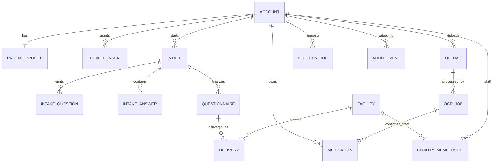

# もしもし問診 — データベース詳細設計書

- 関連文書：`01_要件定義書.md`、`02_システム設計書.md`、`03_機能仕様書.md`、`05_コスト試算表.md`
- 文書ID：MMR-DB-001 / v1.1 / 2026-11-04
- 主要DB：Cloud Firestore Standard（東京 `asia-northeast1`）
- 補助DB：Firebase Realtime Database（シンガポール `asia-southeast1`、非PHI用途に限定）
- 添付ファイル：Cloud Storage for Firebase（東京 `asia-northeast1`）
- 最重要原則：**Firestoreに医療情報の正本を保存。Realtime DBには問診本文・薬剤・病歴・患者ID・宛先を複製しない。**

## 1. 採用の理由とデータ整合性

Firestoreは患者プロフィール・症状回答・問診票・薬剤情報・施設マスタ・送信履歴に利用する。リアルタイムDBは利用者の医学データを格納するDBとしては使わない。Firestoreの文書単位課金に対しRealtime Databaseは保管量・転送量課金である [S01]。RTDBは東京リージョンが用意されておらず、日本国内情報のみを保持する方針との衝突があるため、**サービスの公開稼働状態など個人情報でない値だけ**利用する [S02]。

- Firestore上の書込みはCloud Run Admin SDKを原則とし、PHIはFlutter/Next.jsから直接更新させない。**認証前メール登録**もCloud Runで同意検証後にAdmin SDKを実行し、クライアントにはAdmin SDK/秘密鍵を置かない。
- 同時更新がある箇所ではFirestore transaction、`revision`、idempotency keyを利用。
- 送信済み問診票は不変スナップショットを持つ。患者が後日情報を変更しても「その時点で送信した情報」を改変しない。
- Firestoreは非正規化を必要最小限にとどめ、書込み増幅を測定。
- ドキュメントIDに氏名・メール・電話・生年月日を使わず、UIDまたはランダムIDを利用。
- 個人を識別できる値をレコード・索引・監査用パスに追加するときはデータフロー評価を行う。

## 2. データ分類ラベルと型規則

| 分類 | 略号 | 例 | 保存・アクセス |
|---|---|---|---|
| 公開情報 | PUB | 規約の現在版、公開サービス稼働状態 | 読取りを限定公開可 |
| 事業者業務情報 | OPS | 施設確認状態、内部ジョブID | 職務権限の範囲のみ |
| 個人情報 | PII | 氏名、生年月日、電話、住所 | 本人API・認可済み施設のみ |
| 医療・健康情報 | PHI | 主訴、症状、持病、薬剤、処方箋 | 最も厳格な認可・監査 |
| セキュリティ情報 | SEC | Passkey公開鍵、認証イベント | 認証サーバ専用 |

共通フィールド規約：`createdAt`/`updatedAt` はFirestore `Timestamp`（サーバ時刻）、「日付のみ」はISO8601 `YYYY-MM-DD` の文字列、 `schemaVersion` は文字列、状態は固定enum、所有者は `patientUid`、施設は `facilityId`、金額は整数minor unitまたはDecimal（初期では決済なし）。`null` と未存在、空文字、未回答を混同しない。

## 3. エンティティ関連図（論理モデル）



表記は概念上の関連であり、実際のFirestoreにFK制約はない。Cloud Runが存在・所属・状態の整合性を担保する。

## 4. Firestoreコレクション設計一覧

| No | パス | PHI? | 代表用途 | 主な索引（候補。デプロイ済みは §8 注記・`firebase/firestore.indexes.json` 参照） |
|---|---|---|---|---|
| 01 | `accounts/{uid}` | PII | 認証連携と状態 | accountStatus, createdAt |
| 02 | `patientProfiles/{uid}` | PII/PHI | プロフィール/持病 | uid直接取得のみ |
| 03 | `legalConsents/{consentId}` | PII | 同意履歴 | subjectUid+createdAt |
| 04 | `intakes/{intakeId}` | PHI | 問診進行状況 | patientUid+updatedAt |
| 05 | `intakes/{intakeId}/questions/{questionId}` | PHI | 質問スナップショット | stepIndex |
| 06 | `intakes/{intakeId}/answers/{answerId}` | PHI | 回答原本 | stepIndex |
| 07 | `questionnaires/{questionnaireId}` | PHI | 確定問診票メタ・参照 | patientUid+finalizedAt |
| 08 | `questionnaires/{questionnaireId}/revisions/{revisionId}` | PHI | 不変確定版 | versionNumber |
| 09 | `medications/{medicationId}` | PHI | 服薬情報 | patientUid+currentStatus |
| 10 | `uploads/{uploadId}` | PHI/PII | Storage objectへの参照 | patientUid+createdAt |
| 11 | `ocrJobs/{jobId}` | PHI | 画像抽出進行/候補 | patientUid+createdAt |
| 12 | `facilities/{facilityId}` | OPS | 参加医療機関 | placeId, verificationStatus |
| 13 | `facilityMemberships/{membershipId}` | PII/OPS | 職員と施設権限 | facilityId+status / userUid+status |
| 14 | `facilityInvitations/{invitationId}` | PII/SEC | 招待状態 | facilityId+status |
| 15 | `deliveries/{deliveryId}` | PHI | 送信後の施設宛コピー | facilityId+deliveredAt / senderUid+createdAt |
| 16 | `deliveryAttempts/{attemptId}` | OPS | 配送・通知の技術的リトライ | deliveryId+createdAt |
| 17 | `deletionJobs/{jobId}` | PII/OPS | 退会削除進捗 | executeAfter+status |
| 18 | `auditEvents/{eventId}` | SEC/OPS | 同意/閲覧/配送/権限変更の証跡 | facilityId+occurredAt |
| 19 | `appConfigs/{configId}` | PUB/OPS | 規約・安全設定版 | 直接取得 |
| 20 | `idempotencyKeys/{keyHash}` | OPS | 同じ副作用要求の再実行制御 | expiresAt |
| 21 | `passkeyCredentials/{credentialIdHash}` | SEC | WebAuthn公開鍵など | ownerUid（サーバ専用） |
| 22 | `facilityVerificationRecords/{recordId}` | OPS/PII | 施設真正性の承認証跡 | facilityId+verifiedAt |
| 23 | `registrationOperations/{operationHash}` | SEC/OPS | メール登録の冪等・Auth/Firestore失敗復旧 | expiresAt（TTL）、status |
| 24 | `pushDevices/{deviceId}` | OPS | FCM送信先トークン（通知文言は非PHI固定） | patientUid+status |

`intakes/questions/answers` のようなサブコレクションと、トップレベルの `questionnaires/medications/deliveries` はそれぞれ別の権限・削除対象として管理する。Firestoreの親ドキュメント削除は子コレクションを自動消去しない [S03]。

## 5. コレクションの詳細スキーマ

### 5.1 accounts/{uid}

| フィールド | 型 | 必須 | 例 | 制約 |
|---|---|---|---|---|
| `uid` | string | ○ | firebaseUid | Auth UIDと一致 |
| `accountStatus` | enum | ○ | `active` | `onboarding_pending/active/suspended/pending_deletion/deleted` |
| `onboardingState` | enum | ○ | `completed` | `not_started/legal_pending/profile_pending/completed`。同意版不足時は `legal_pending` 相当で業務API拒否 |
| `emailVerified` | bool | ○ | true | Firebase Authの値とサーバ側で同期 |
| `providers` | string[] | ○ | ["google.com"] | 認証手段の識別子、秘密値は保存しない |
| `lastAuthenticatedAt` | timestamp? | × | - | 更新頻度を抑える |
| `deletionRequestedAt` | timestamp? | × | - | 退会受付時 |
| `deletionScheduledAt` | timestamp? | × | - | 30日後の消去予定 |
| `schemaVersion` | string | ○ | "1" | マイグレーション用 |
| `createdAt`,`updatedAt` | timestamp | ○ | - | serverTimestamp |

患者のプロフィールと健康情報は`accounts`へ混ぜず分離する。運用担当が状態だけを見るケースでPHIに触れないため。メール登録時の最初の作成は `accountStatus=onboarding_pending`、`onboardingState=profile_pending` とし、必須同意確定後にのみ有効な登録とする。Google/PasskeyでFirebase Auth UIDが先行して存在する場合、同意確定までアカウント文書を作成しないか最小状態の `legal_pending` とし、PHIを保存しない。

### 5.2 patientProfiles/{uid}

| フィールド | 型 | 必須 | 制約・備考 |
|---|---|---|---|
| `patientUid` | string | ○ | doc IDと一致 |
| `familyName`,`givenName` | string | ○ | 各1～50字（暫定） |
| `familyNameKana`,`givenNameKana` | string | ○ | カタカナ入力 |
| `birthDate` | string(date) | ○ | YYYY-MM-DD |
| `phoneNumber` | string | ○ | E.164相当への正規化または国内統一形式 |
| `postalCode` | string | ○ | 7桁 |
| `address` | map | ○ | `prefecture`,`city`,`line1`,`line2?` |
| `medicalHistory` | array<map> | × | `conditionText`, `selfReported`, `updatedAt` |
| `allergyStatus` | enum | × | `unknown/no_known/reported`（未登録ならunknown） |
| `locale` | string | ○ | `ja-JP` |
| `accessibilityPreferences` | map | × | fontScale, highContrast; OS設定優先 |
| `updatedAt` | timestamp | ○ | サーバ時刻 |

### 5.3 legalConsents/{consentId}

```json
{
  "subjectUid": "uid_opaque",
  "consentType": "health_data_collection",
  "documentVersion": "2026-11-01",
  "documentHash": "sha256:...",
  "decision": "granted",
  "method": "explicit_checkbox",
  "registrationSource": "email_registration",
  "scope": {"purpose": "medical_intake_preparation"},
  "occurredAt": "<Firestore Timestamp>",
  "revokedAt": null,
  "schemaVersion": "1"
}
```

- `consentType`：`terms_of_service`, `privacy_policy_ack`, `health_data_collection`, `hospital_disclosure`, `optional_analytics`。
- 規約閲覧と同意した事実の区別を明確にする。任意の収集同意は必須同意と分離。
- 施設への個別送信同意（API-029、#219）は **2種類の doc** で管理する（ADR-0028）：
  - `legalConsents/fc_{subjectUid}_{facilityId}` — (uid, facilityId) 単位の同意 **state doc**（`registrationSource: "facility_consent"`）。送信ごとの明示同意で `{merge: true}` upsert し最新 granted 状態へ更新、撤回操作は `revokedAt` を立てる（撤回は終端的で送信経路では戻さない）。配送 tx が read する撤回検知点で、`scope` は `facilityId`/`purpose`/`lastDeliveryId`/`lastConsentId` を保持する。
  - `legalConsents/{autoId}` — 送信固有の **immutable 証跡**（`registrationSource: "delivery_send"`）。`scope` に `facilityId`/`questionnaireId`/`questionnaireRevisionId`/`shareScope`（同意した範囲）/`sentShareScope`（実際に送信した範囲）/`deliveryId`/`facilityConsentId`/`purpose` を保持する。抽象的な一括同意だけでは配送しない。
- いずれも `consentType: "hospital_disclosure"`, `method: "explicit_checkbox"`、`occurredAt` は Firestore サーバ時刻とし、`documentVersion`/`documentHash` はサーバが `appConfigs/publicLegalVersion` で照合した現行値を書く。
- 同意文書はHashと公開版のアーカイブで再現可能にする。
- `registrationSource` は `email_registration/google_onboarding/passkey_onboarding/reconsent/delivery_send/facility_consent`。`occurredAt` はFirestoreサーバ時刻、`documentHash` は**サーバ保存の正式文書版**から決定し、端末時刻・クライアント任意ハッシュで上書きしない。
- `GET /v1/consents` の履歴は `registrationSource` で表示対象を絞る（送信証跡 `delivery_send` は1送信1件の高頻度書き込みのため履歴から除外し、`currentByType` は consentType ごとの最新 granted を解決する）。索引は `firebase/firestore.indexes.json` を参照（#219）。
- メール新規登録は `POST /auth/register` で必須チェック済みの場合だけ Auth `createUser` を呼ぶ。Google/Passkeyの初回同意・改定再同意は `POST /onboarding/consents` に記録。従来の `POST /consents` は提供しない。
- 同意証跡の不存在と未同意を区別する。同意なしのアカウント（特にGoogle/PasskeyでAuth UID先行作成）は業務APIの許可要件を満たさない。

### 5.4 intakes/{intakeId}

| フィールド | 型 | 必須 | 備考 |
|---|---|---|---|
| `patientUid` | string | ○ | 不変、owner |
| `status` | enum | ○ | `draft/safety_check/questioning/review/finalized/archived` |
| `initialSymptomText` | string | ○（初回入力後） | 最大1000字（暫定） |
| `bodyLocations` | string[] | ○ | `left_knee`, `whole_body`など |
| `currentQuestionId` | string? | × | 現在の質問 |
| `questionCount` | int | ○ | 最大12暫定 |
| `revision` | int | ○ | 競合検出 |
| `questionGraphVersion` | string | ○ | 固定質問セット |
| `safetyRulesetVersion` | string | ○ | 安全ルール |
| `aiPolicyVersion` | string | ○ | プロンプト・検証版 |
| `aiEnabledForThisIntake` | bool | ○ | 本番の承認設定に基づく |
| `lastProcessedAt` | timestamp? | × | 外部AI呼出時の識別子を分離 |
| `createdAt`,`updatedAt`,`finalizedAt` | timestamp | 条件 | 状態遷移で更新 |

- `intakes`に質問全文を全て入れず、サブコレクションへ保存。Firestoreのドキュメントサイズ上限も考慮 [S04]。
- AIが出した質問を後から追跡できるよう質問文・選択肢・ルールバージョンをスナップショットとして保存。

#### intakes/{intakeId}/questions/{questionId}

```json
{
  "stepIndex": 4,
  "questionText": "だるさは、いつごろから感じていますか？",
  "topic": "onset_timing",
  "options": [
    {"code":"LT_WEEK","label":"1週間以内"},
    {"code":"ONE_TO_FOUR_WEEKS","label":"1〜4週間前"},
    {"code":"GT_MONTH","label":"1か月以上前"}
  ],
  "generatedBy": "llm",
  "modelVersion": "approved-model-config-id",
  "questionRevision": 2,
  "status": "active",
  "createdAt": "<Timestamp>"
}
```

- `generatedBy` は `fixed_template/llm/fallback`。`modelVersion`にAPIキー・患者内容を含めない。
- `status` は `active/invalidated/answered`。回答編集により分岐が変われば後続を無効化し、再生成。

#### intakes/{intakeId}/answers/{answerId}

| フィールド | 型 | 内容 |
|---|---|---|
| `questionId` | string | 対応する質問 |
| `questionRevision` | int | 表示時の質問版 |
| `stepIndex` | int | 順番 |
| `selectedCodes` | string[] | 設問に存在するコードのみ |
| `freeText` | string? | 患者の原文。空文字を未回答と混同しない |
| `answerState` | enum | `answered/unknown/skipped` |
| `answerSource` | enum | `patient`（初期はこの値のみ） |
| `answeredAt`,`updatedAt` | timestamp | サーバ時刻 |

### 5.5 questionnaires/{questionnaireId} と revisions

```json
{
  "patientUid": "uid_opaque",
  "intakeId": "in_random",
  "status": "finalized",
  "latestRevision": 3,
  "reviewedAt": "<Timestamp>",
  "finalizedAt": "<Timestamp>",
  "createdAt": "<Timestamp>"
}
```

`questionnaires/{id}/revisions/{revId}` はimmutable。例：

```json
{
  "versionNumber": 3,
  "patientUid": "uid_opaque",
  "schemaVersion": "1",
  "chiefComplaint": {"value": "夕方になるとだるい", "source": "patient"},
  "onset": {"value": "約2週間前", "source": "answer:q-004"},
  "frequency": {"value": "日によって異なる", "source": "answer:q-005"},
  "bodyLocations": ["whole_body"],
  "medicalHistorySnapshot": [{"conditionText": "高血圧", "source": "patient_profile"}],
  "medicationSnapshots": [{"medicationId": "med_random", "confirmed": true}],
  "unansweredTopics": ["severity"],
  "rawAnswerSnapshotHash": "sha256:...",
  "summaryReviewConfirmedAt": "<Timestamp>",
  "createdAt": "<Timestamp>"
}
```

- 証跡として必要な生データ参照は保持するが、医療機関へ送るペイロードはユーザーが選択した範囲のスナップショットから作成。
- revisionを上書きせず、修正は新revisionを追加。
- 文書容量が増大する場合は詳細ブロックを子ドキュメントへ分割し、Hashの構築を標準化する。

### 5.6 medications/{medicationId}

| フィールド | 型 | 必須 | ルール |
|---|---|---|---|
| `patientUid` | string | ○ | owner |
| `displayName` | string | ○ | 入力/候補。OCRの確信ではない |
| `genericName` | string? | × | 正規化不能ならnull |
| `strength` | string? | × | 数値と単位の曖昧性を保持 |
| `instructionsText` | string? | × | 画像記載を転記。医療指示を新規生成しない |
| `prescribedAt` | date? | × | 処方日と服薬開始日の混同を避ける |
| `currentStatus` | enum | ○ | `taking/past/not_sure` |
| `confirmationStatus` | enum | ○ | `unconfirmed/confirmed/rejected` |
| `sourceType` | enum | ○ | `manual/prescription_photo/medication_notebook` |
| `uploadId` | string? | × | 元画像への内部参照 |
| `ocrJobId` | string? | × | 抽出処理の証跡 |
| `userConfirmedAt` | timestamp? | × | 確認済み時刻 |
| `createdAt`,`updatedAt` | timestamp | ○ | サーバ時刻 |

同名薬や異なる用量を単純に重複排除しない。服薬中と過去に服薬した薬は患者が明示した状態で保存。

### 5.7 uploads/{uploadId} と ocrJobs/{jobId}

`uploads`：`patientUid`, `storageBucket`, `objectPath`, `objectGeneration`, `mimeType`, `bytes`, `sha256`, `status`, `createdAt`, `expiresAt`, `sourcePurpose`。`objectPath`にはPIIを含めない。

`ocrJobs`：`uploadId`, `patientUid`, `status`, `engine`, `attempt`, `errorCode`, `candidates`（または子コレクション）, `dispatchState`, `createdAt`, `updatedAt`。

- `jobId`（doc ID）は `oj_`+HMAC(server secret, uploadId) の擬名。uploadId をそのまま使わないのは、運営の失敗ジョブ一覧（FR-O04）で個人紐付け識別子が露出しないようにするため。HMAC は決定的なので同一 upload への create-if-absent 重複抑止は維持される。

- OCR全文を長期保存するかは必須ではない。確認後速やかに削除する構成を初期案とする。
- OCR candidateの多いページは `ocrJobs/{id}/candidates/{candidateId}` に分割。
- 処方箋のほかの患者情報が混ざっている可能性を想定し、アップロード前のプレビューを必須とする。

### 5.8 facilities/{facilityId}

| フィールド | 型 | 説明 |
|---|---|---|
| `facilityId` | string | 内部ID、ランダム |
| `legalName` | string | 運営が独立に取得・確認した正式名称 |
| `displayName` | string | サービス参加施設の表示名 |
| `placeId` | string? | Google Places対応キー。規約例外として保存可 [S05] |
| `address` | map | 施設との契約で取得した住所。Placesの無許可長期コピーは不可 |
| `verificationStatus` | enum | `pending/verified/rejected/suspended` |
| `receivingEnabled` | bool | 受付機能ON/OFF |
| `contactChannel` | map | 管理担当者との連絡先、非公開 |
| `verifiedAt` | timestamp? | 審査結果時刻 |
| `verificationRecordId` | string? | 真正性を検証した文書への参照 |
| `receivingDisabledAt` | timestamp? | 受付停止（API-037 運営 / API-049 施設管理者）時刻 |
| `receivingDisabledReason` | string? | 受付停止の理由（運営記録、非公開） |
| `receivingDisabledBy` | string? | 受付を止めた主体 `platform/staff`。未設定は `platform` とみなす。`staff` の停止は施設管理者が再開できるが、`platform` の停止は施設側で再開できない |
| `serviceAgreementVersion` | string | 契約条件 |
| `createdAt`,`updatedAt` | timestamp | 更新日時 |

Places情報と施設自身から得た契約情報を混同しない。Placesの`placeId`が存在しても `verificationStatus=verified` と判断しない。

### 5.8.1 facilityVerificationRecords/{recordId}（施設審査証跡、非PHI）

| フィールド | 型 | 必須 | 説明 |
|---|---|---|---|
| `facilityId` | string | ○ | 対象施設 |
| `verifierUid` | string | ○ | 審査した運営者UID（責任追跡用、API経由では返さない） |
| `decision` | enum? | × | verified/rejected。旧承認証跡の未設定値はverifiedとして読む |
| `checks` | map | ○ | FR-H04の4検証項目 `existence/applicant/receiverContact/location`。承認は全て true |
| `verificationRecordId` | string | ○ | 検証に用いた文書・記録への参照（免許番号・登記確認ID等） |
| `note` | string? | × | 審査メモ |
| `createdAt` | Timestamp | ○ | サーバ時刻 |

- API-036の承認およびAPI-047の却下時に施設doc更新と同一トランザクションで作成する。却下理由はnoteへ記録する。患者情報（PHI）は含めない。API-046は4検証項目・decision・日時とHMAC擬名IDのみを返し、verifierUid/note/verificationRecordId原文は返さない。
- 施設docの `verificationRecordId` から最新証跡を参照できる。

### 5.9 facilityMemberships/{membershipId}

```json
{
  "userUid": "staff_auth_uid",
  "facilityId": "fac_random",
  "role": "facility_clinician",
  "status": "active",
  "mfaEnforced": true,
  "approvedByUid": "admin_auth_uid",
  "createdAt": "<Timestamp>",
  "revokedAt": null
}
```

- `membershipId`は `facilityId_userUid` の連結よりも乱数推奨。照合は複合索引と一意性管理トランザクションで実施。
- 招待時に送信者メールを検証しても本人性の十分条件にはならない。医療機関管理者が所属と担当役割を審査。
- 役割が無効になったらAPIトークンがまだ有効でも即時アクセス拒否。

### 5.10 deliveries/{deliveryId}

| フィールド | 型 | 説明 |
|---|---|---|
| `senderUid` | string | 患者UID（病院UIで生のUIDを露出しない） |
| `facilityId` | string | 固定された宛先 |
| `questionnaireId` | string | 原本への内部参照 |
| `questionnaireRevisionId` | string | 送信した版を確定 |
| `consentId` | string | 本送信の同意証跡（`legalConsents/{autoId}` の送信証跡 doc）への参照。クライアント申告文字列を保存しない（#219） |
| `consentDocumentVersion` | string | 送信時にサーバ照合した第三者提供文書の版 |
| `consentDocumentHash` | string | 同上の文書 hash |
| `facilityConsentId` | string | 同意 state doc（`legalConsents/fc_{uid}_{facilityId}`）への参照 |
| `shareScope` | map | 氏名/薬剤/画像などの同意対象 |
| `patientIdentitySnapshot` | map | 明示的に送信した氏名/連絡先等だけ |
| `patientDisplayName` | string? | 一覧表示・前方一致検索用の非正規化表示名（includeProfile同意時のみ。非同意はnull） |
| `questionnaireSnapshot` | map | 診療所に配達する確定内容。PHI |
| `snapshotSha256` | string | 送信版の同一性検証 |
| `status` | enum | `created/delivered/acknowledged/failed/revoked` |
| `createdAt`,`deliveredAt`,`acknowledgedAt` | timestamp | 必要なもののみ |
| `receivedByStaffUid` | string? | 受領操作の主体 |
| `idempotencyKeyHash` | string | 二重送信防止 |
| `facilityRetentionPolicyVersion` | string | 医療機関との保持条件 |

**患者の原本と病院宛配送物は別のデータ資産。**患者退会によって施設の法的保存対象まで無条件に消去しない。契約と権利行使手続を定める。スナップショットは必要項目だけ含め、フルプロフィールをコピーしない。

### 5.11 deletionJobs/{jobId}

```json
{
  "subjectUid": "uid_opaque",
  "requestedAt": "<Timestamp>",
  "executeAfter": "<Timestamp: 30 days after request>",
  "status": "scheduled",
  "steps": {
    "freeze": "succeeded",
    "intakeSubcollections": "pending",
    "questionnaires": "pending",
    "medications": "pending",
    "uploads": "pending",
    "storageObjects": "pending",
    "authAccount": "pending",
    "residualScan": "pending"
  },
  "attemptCount": 0,
  "lastErrorCode": null,
  "completedAt": null
}
```

- 完了後に主体UIDなどの残存が必要な監査と衝突しないよう、終了記録の内容・匿名化範囲・保管期間を法務と決定。
- バックアップ内のPHIは削除直後に物理消滅するとは限らない。バックアップTTL、復元時のtombstone再適用、独立した施設保管を明示。

### 5.12 auditEvents/{eventId}

- `actorType`（patient/staff/platform/service）
- `actorUidHash`（安定化された監査用HMAC。鍵は別管理、必要性の審査）
- `action`（`INTAKE_FINALIZED`, `DELIVERY_CREATED`, `DELIVERY_VIEWED`, `MEMBERSHIP_REVOKED`, `DELETION_COMPLETED`など）
- `resourceType`, `resourceIdHash`, `facilityId?`, `occurredAt`, `requestId`, `decision`（allow/deny）, `policyVersion`
- **本文・薬剤名・住所・処方箋画像URL・アクセスTokenを保存しない。**
- Data Access監査を有効化する際、サービスのログ、独自監査ログ、診療上の閲覧履歴を区別する。

### 5.13 passkeyCredentials/{credentialIdHash}

`userUid`, `credentialIdEncryptedOrEncoded`, `publicKey`, `signCount`, `rpId`, `deviceFriendlyName`, `createdAt`, `lastUsedAt`, `revokedAt`。WebAuthn challenge本体は短寿命・使い捨ての別領域で管理。署名検証を行う専用サーバ以外の読み書きを拒否。端末の秘密鍵・生体情報を取得しない [S06]。

### 5.14 registrationOperations/{operationHash}（認証前メール登録の復旧台帳）

| フィールド | 型 | 必須 | 説明 |
|---|---|---|---|
| `operationHash` | string | ○ | HMAC(serverSecret, Idempotency-Key + operation namespace)。原値を保存しない |
| `requestHash` | string | ○ | 検証済み要求の同一性確認用の認証付きダイジェスト。パスワード原文/可逆値は禁止 |
| `uid` | string | ○ | **Auth作成前に**サーバが払い出す予定UID。再試行時に同じUIDを使用 |
| `status` | enum | ○ | `reserved/auth_created/consents_committed/enabled/failed/expired` |
| `legalVersionSet` | map | ○ | サーバが承認した文書ID・版。パスワードなし |
| `createdAt`,`updatedAt`,`expiresAt` | Timestamp | ○ | サーバ時刻、24時間の冪等保持期限/TTL対象 |
| `lastErrorClass` | string? | × | ログ用に抽象化したエラー種別。メール・パスワード・本文は禁止 |

- App Check・同意チェック・正式版照合・レート制御は**操作予約前**に完了。メールを同意前にDBへ永続化しない。登録リクエスト中のパスワードはログ/Firestoreに保存しない。
- 同じ `Idempotency-Key` に異なる要求を使った場合は409を返す。パスワードを `requestHash` に使う場合は漏えい・辞書攻撃防止のためサーバ秘密鍵によるHMACを使用し、保持期間を短く制限する。より単純な実装ならパスワード由来の比較値は保存せず登録操作IDの消費と別の照合手続きを使う。
- `expiresAt` 超過は保持期限であり、TTL削除の正確な実行時刻を意味しない。台帳が残っている間は同一キー・同一本文を再開し、`consents_committed`/`enabled` を期限だけで巻き戻さない。期限切れの未commit操作だけ同じUIDで予約を更新する。台帳が物理削除された後は操作とUIDの対応を証明できないため再開を保証せず、既存Authとの競合を409で拒否する。Firestore TTL policyの有効化状態はこのリポジトリ設定だけでは確認できない。
- `consents_committed` からAuthを有効化する前にもtransactionでoperationHash/requestHash/UIDとaccount UID・既知statusを再確認する。Auth再有効化を許すaccountStatusは `onboarding_pending` と `active` のみ。`suspended`/`pending_deletion`/`deleted` は再有効化せずfail-closedとする。Auth有効化後の成功応答・enabled再送は、同じ所有者の `status=enabled` とaccount整合をtransactionで確認した場合に限る。enabled再送は過去の登録結果を返すだけでAuthを再有効化せず、現在Authが利用可能であることは示さない。accountの進行済みstatusは許容し、欠落・不一致・未知値を自動修復しない。Auth有効化後に台帳確定ができなければ409/503で失敗を返すが、Auth側の副作用をロールバックしない。Auth/Firestore横断transactionがないため、事前確認後の外部更新との競合は原子的には防げない。
- Auth作成後のFirestore失敗は単一ACIDではロールバックできない。Authユーザーはまず `disabled=true` として作成し、同意/アカウントcommit後に有効化する。台帳の消失・要求hash/UID不一致・予期しない状態ではcommitを拒否し、作成済みAuthユーザーを自動削除・別操作へ引継がない。未完成UIDはPHI APIで拒否する。安全な担当者確認付き復旧手順は未実装であり、復旧時にパスワード等の認証情報を開示・記録しない。
- 詳細参照：[Firebase Admin: 管理ユーザー作成](https://firebase.google.com/docs/auth/admin/manage-users)、[Firestoreトランザクション](https://firebase.google.com/docs/firestore/manage-data/transactions)。

### 5.15 pushDevices/{deviceId}（FCM送信先、非PHI）

| フィールド | 型 | 必須 | 説明 |
|---|---|---|---|
| `patientUid` | string | ○ | 登録者UID。トークンはアプリインストールに紐づくため、別アカウントが同一トークンを登録した場合は最後の登録者が受信者となる |
| `token` | string | ○ | FCM registration token / FIDベーストークン。送信に必須のため原値保存（通知文言とは別管理） |
| `platform` | enum | ○ | `android/ios/web` |
| `status` | enum | ○ | `active/invalid`。FCMが `registration-token-not-registered` 等を返した場合に `invalid` 化し送信対象から外す |
| `invalidatedReason` | string? | × | 無効化理由の分類コード（`unregistered`/`invalid_token`）。文言やスタックは保存しない |
| `createdAt`/`updatedAt`/`lastSeenAt` | Timestamp | ○ | サーバ時刻 |

- `deviceId` は `pdv_` + `HMAC(serverSecret, "push-device", token)` の決定論的ID。トークン原値を doc id に使わず、同一トークンの再登録は同一docの更新で冪等化する。
- 通知のタイトル・本文はサーバの文言カタログ由来の一般文言のみで、症状・病名・薬剤名・個人情報を含めない（FR-O05、ADR-011/0015）。このコレクション自体にもPHIフィールドを追加しない。
- 患者別の進捗状態はこのコレクションにもRTDBにも保存せず、API応答（`GET /uploads/{id}/processing` 等）で返す（§6.2）。
- 退会時はDeletionWorkerが `patientUid` で一括削除する（stepAuthAccount + residualScan 検証）。

## 6. Realtime Database設計（PHIを保存しない）

公式の利用可能ロケーションは `us-central1`, `europe-west1`, `asia-southeast1` 等であり、東京 `asia-northeast1` は含まれない [S02]。日本国内保管方針と両立する安全側の初期案は次の通り。

```json
{
  "publicOperationalStatus": {
    "api": {"state": "operational", "updatedAtMs": 1793800000000},
    "ocr": {"state": "operational", "updatedAtMs": 1793800000000},
    "aiQuestionService": {"state": "degraded", "updatedAtMs": 1793800000000}
  },
  "operationalCounters": {
    "global": {"queuedJobsApprox": 3, "updatedAtMs": 1793800000000}
  }
}
```

`state` は `operational/degraded/maintenance` の3値。`queuedJobsApprox` は匿名の概数で、患者・施設・個別問診・職員識別子を含めない。公開カウンタは小さな集団の行動を推測できない集約粒度で提供し、集計が少数の場合は表示しない。

### 6.1 RTDBに置いてはいけない例

```text
/presence/{patientUid}
/intake/{intakeId}/latestSymptom
/ocrJobs/{jobId}/medicationNames
/delivery/{deliveryId}/facilityId
/typing/{uid}
```

これらは各パス名もしくは値から個別ユーザー・症状・施設との対応が発生し得る。RTDBへ置きたい場合は法務・データ越境評価と契約を済ませ、要件を改訂する。

### 6.2 患者別の進捗通知の代案

- 初期：Flutter→Cloud Run `GET /uploads/{id}/processing`を指数バックオフ付きで短期ポーリング。
- 代替：認証・認可されたCloud Run SSE / WebSocket、またはFirestore限定購読（Security Rulesと読み取り費用を評価）。
- 短期進捗は最終的な正本ではない。サーバWorkerの冪等なFirestore状態遷移を優先。

## 7. Security Rules（初期の最小権限例）

### 7.1 Firestore Rules

患者・病院のPHI操作はAPIを必須とし、**クライアントSDKの直接読み書きを原則禁止**。Admin SDKはSecurity RulesではなくIAMの保護対象なので、APIで必ず認可する。

```js
rules_version = '2';
service cloud.firestore {
  match /databases/{database}/documents {
    match /appConfigs/publicLegalVersion {
      allow read: if true;
      allow write: if false;
    }
    match /{document=**} {
      allow read, write: if false;
    }
  }
}
```

- 施設情報をクライアントSDKへ直接公開しない。公共情報が必要な場合はAPIを介した公開可能フィールドだけにする。
- 管理SDKがこのRulesをバイパスするため「このルールで全て安全」と解釈しない。

### 7.2 Realtime Database Rules

```json
{
  "rules": {
    ".read": false,
    ".write": false,
    "publicOperationalStatus": {
      ".read": true,
      ".write": false
    }
  }
}
```

- サーバAdmin SDKだけがoperational statusを更新する。公開状態から内部障害や個別アクセスを推測されない粒度にする。
- `operationalCounters`はサーバ内部用として非公開。環境に応じてRTDBルールのテストを必須にする。

### 7.3 Cloud Storage Rules

```js
rules_version = '2';
service firebase.storage {
  match /b/{bucket}/o {
    match /{allPaths=**} {
      allow read, write: if false;
    }
  }
}
```

サーバAPIによる短命の権限発行/アップロード経路を使用し、Firebase Storageルールの直接許可を前提としない。GCS署名URLまたは認可プロキシの実装方式により権限とCORS設定を分ける。アップロード完了通知はクライアント申告ではなくサーバでobject generation/サイズ/hashを検証。

## 8. コンポジットインデックス定義

候補 `firestore.indexes.json`（実際の必要索引はFirestoreエミュレータ・Explainで検証）:

```json
{
  "indexes": [
    {"collectionGroup":"intakes","queryScope":"COLLECTION","fields":[{"fieldPath":"patientUid","order":"ASCENDING"},{"fieldPath":"updatedAt","order":"DESCENDING"}]},
    {"collectionGroup":"questionnaires","queryScope":"COLLECTION","fields":[{"fieldPath":"patientUid","order":"ASCENDING"},{"fieldPath":"finalizedAt","order":"DESCENDING"}]},
    {"collectionGroup":"medications","queryScope":"COLLECTION","fields":[{"fieldPath":"patientUid","order":"ASCENDING"},{"fieldPath":"currentStatus","order":"ASCENDING"},{"fieldPath":"updatedAt","order":"DESCENDING"}]},
    {"collectionGroup":"deliveries","queryScope":"COLLECTION","fields":[{"fieldPath":"facilityId","order":"ASCENDING"},{"fieldPath":"deliveredAt","order":"DESCENDING"}]},
    {"collectionGroup":"deliveries","queryScope":"COLLECTION","fields":[{"fieldPath":"facilityId","order":"ASCENDING"},{"fieldPath":"status","order":"ASCENDING"},{"fieldPath":"deliveredAt","order":"DESCENDING"}]},
    {"collectionGroup":"deliveries","queryScope":"COLLECTION","fields":[{"fieldPath":"senderUid","order":"ASCENDING"},{"fieldPath":"createdAt","order":"DESCENDING"}]},
    {"collectionGroup":"facilityMemberships","queryScope":"COLLECTION","fields":[{"fieldPath":"userUid","order":"ASCENDING"},{"fieldPath":"status","order":"ASCENDING"}]},
    {"collectionGroup":"facilityMemberships","queryScope":"COLLECTION","fields":[{"fieldPath":"facilityId","order":"ASCENDING"},{"fieldPath":"status","order":"ASCENDING"}]},
    {"collectionGroup":"deletionJobs","queryScope":"COLLECTION","fields":[{"fieldPath":"status","order":"ASCENDING"},{"fieldPath":"executeAfter","order":"ASCENDING"}]},
    {"collectionGroup":"legalConsents","queryScope":"COLLECTION","fields":[{"fieldPath":"subjectUid","order":"ASCENDING"},{"fieldPath":"occurredAt","order":"DESCENDING"}]}
  ],
  "fieldOverrides": [
    {"collectionGroup":"intakes","fieldPath":"initialSymptomText","indexes":[]},
    {"collectionGroup":"medications","fieldPath":"instructionsText","indexes":[]}
  ]
}
```

**注意：**本サンプルは設計候補。複合索引・single-field indexing exemption・子コレクション名の衝突は実環境のFirestore CLI/エミュレータで検証し、不必要な自由文・大配列索引を除外する。`idempotencyKeys.expiresAt`等にTTLを利用する場合はTTL deleteが通常の無料delete枠外に課金され得る [S07]。

**実装との対応（Issue #24 で実クエリ照合済み）：**デプロイ対象の正本は `firebase/firestore.indexes.json`。現状は `services/api` の実クエリが存在する索引のみを収録しており、対応クエリ未実装の候補（`intakes` patientUid+updatedAt、`medications` patientUid+currentStatus+updatedAt、`deliveries` facilityId+deliveredAt / facilityId+status+deliveredAt、`facilityMemberships` facilityId+status）は該当API実装時に追加する。運用状態は `infra/firestore/README.md` を参照。

## 9. 一貫性とトランザクション

### 9.1 問診回答の楽観ロック

- クライアントが `expectedRevision` を送る。
- Firestore transactionでintakeを読み、`revision==expectedRevision`、状態が編集可能か確認。
- 当該回答を更新し、必要なら後続questionsをinvalidated化し、新revisionへ更新。
- トランザクション内にVertex/Gemini、Places、OCR等の**外部APIを呼ばない**。外部APIは事前/事後でリトライ可能な処理に分割。

### 9.1.1 メール登録・同意書き込みの整合性

1. 同意検証後、期限付き登録操作にUID/登録キーを予約（パスワードは保存しない）。
2. Admin SDK `createUser(uid, email, password, disabled=true)`。既存UIDは**同じ操作台帳**からの復旧のみ許可し、既存メール別ユーザーへの紐付けを禁止。
3. Firestore transaction内で `accounts/{uid}` と複数 `legalConsents/{consentId}` と登録操作結果をまとめてcommit。安全な同意IDの採番と重複防止を実装。
4. Admin SDKでAuthユーザーを有効化。失敗時は `registrationOperations` を見て再試行できるようにする。
5. API応答201。クライアントはFirebase Client SDKでサインインし、`GET /me` が `profile_pending` と返すことを確認。対象操作のTTLと掃除Jobを設計する。
6. Google/PasskeyはFirebase Auth UIDが既に存在するため `POST /onboarding/consents` が同意・accountsをFirestore transactionで確定する。`Idempotency-Key` と同意版が合致するリトライを冪等化する。

**不変条件：** `legalConsents` の現在有効な必須同意一式と `accounts` が確定しない限り、`active` へ変更できず、問診・画像・病院送信は必ず拒否する。

### 9.2 問診送信の冪等化

```text
keyHash = HMAC(server_secret, uid || idempotencyKey || "deliver")
transaction:
  if idempotencyKeys/{keyHash} exists:
    verify same semantic request hash; return existing deliveryId
  assert sender owns finalized questionnaireRevision
  assert recipient is verified and enabled
  assert exact facility & shareScope consent exists
  create deliveries/{deliveryId} immutable snapshot
  create idempotencyKeys/{keyHash} -> result deliveryId
outside transaction:
  enqueue notification job (may retry)
```

- HMACの鍵ローテーションとTTLを定義。結果返却時に「同じキーだが別payload」の要求を409で拒否。
- `Cloud Tasks`はat-least-onceを想定し、実行前にdelivery状態を読み、既処理なら成功終了。
- 施設の `acknowledged` は状態のみ更新し、送信した医療情報のスナップショットを変更しない。

## 10. 削除・保管・バックアップの設計

### 10.1 保管ライフサイクル（案）

| データ | 通常保管 | 退会申請時 | 30日後の扱い |
|---|---|---|---|
| アカウント・プロフィール | 利用期間 | 利用停止 | 運営のアクティブDBから削除 |
| 下書き/質問/回答 | 利用中・期間設定待ち | 新規編集禁止 | 全子コレクションを再帰削除 |
| 問診票の本人原本 | 利用中・期間設定待ち | 本人から非公開 | 運営の患者原本を削除 |
| 薬剤/元画像/OCR | 規定保管期間 | 更新停止 | DBとGCSを削除 |
| 自院受信票 | 医療機関との契約による | 患者退会を通知するか契約で決定 | 施設独立記録には病院の保存ポリシー適用 |
| アクセス監査ログ | 監査・法務方針 | 必要性評価 | 最小限の非本文証跡を保持可能（法務確認） |
| Firestoreバックアップ/PITR | 設定した保持期間 | - | 有効期限後に消去。復元時は削除再適用 |
| RTDB非PHI状態 | 一時 | 影響なし | 個別患者情報なし |

**重要：**「30日後に全データ削除」は技術上・法的に対象を限定せず保証できない。ユーザー向け規約はアクティブな運営管理データ、バックアップ、監査ログ、医療機関保有記録を分けて記載する。法定保存との整合を専門家レビュー。

### 10.2 削除ワーカーの順序

1. Account statusを `pending_deletion` に変更、ID token失効、利用禁止。
2. Cloud Schedulerが期限到達のdeletionJobを検出してCloud Tasksへ投入。
3. ジョブが排他ロックを取得し、対象の `intakes`, `questionnaires`, `medications`, `uploads`, `ocrJobs`, `legalConsents` を列挙。
4. リンクされたStorage objectはgeneration一致を確認して消去。Storage複製・サムネイル等を含む。
5. Firestore subcollectionの再帰削除。collection group query等で残存を再確認。
6. Firebase Authのアカウントを消去。不可逆な操作のため別途異常復旧経路を持つ。
7. 残存確認、監査証跡の最小化、ジョブ完了。失敗した手順は個別リトライ。
8. 復元時の削除tombstoneの再適用と、バックアップ保管期間後の不可逆消去を管理。

## 11. 運用クエリと課金への影響

| クエリ | 最大件数（初期） | インデックス | 注意 |
|---|---:|---|---|
| 本人問診一覧 | 20 | patientUid+updatedAt | offsetを使わずcursor |
| 本人薬剤一覧 | 100 | patientUid+currentStatus+updatedAt | 必要列だけ返す |
| 病院受信一覧 | 20 | facilityId+deliveredAt | onSnapshot常時全件監視は避ける |
| 病院状態別一覧 | 20 | facilityId+status+deliveredAt | テナント条件必須 |
| 退会対象ジョブ | 100 | status+executeAfter | 分割バッチ/重複排除 |
| 施設職員所属 | 20 | userUid+status | 毎リクエストのキャッシュと即時失効を調整 |

> 表の索引は運用クエリの設計要件。デプロイ済みの定義は `firebase/firestore.indexes.json`
> （API実装済みクエリに対応するもののみ、§8 注記参照）が正本で、一覧は
> `infra/firestore/README.md` の表と一致させる。

FirestoreはドキュメントRead/Write/Deleteだけでなくindex entry reads、ストレージ、ネットワーク転送にも費用が発生する [S08]。セキュリティルールで追加ドキュメントのget/existsを行うと追加readになることがあるが、本設計はPHIをサーバ経由で処理する。

## 12. 移行・拡張パターン

- 電子処方箋/マイナポータル：第三者の認証・認可・同意と監査スキーマを独立拡張。公式API参加資格と契約が確定するまで`sourceType`に仮の外部連携値を作らない。
- FHIR：必要に応じ `questionnaireRevision` → `FHIR QuestionnaireResponse` 等のマッピング層を設計し、Cloud Healthcare APIの導入可否を検証 [S09]。独自項目を無理に標準データとして扱わない。
- 多施設/法人：`facilityOrganizations/{orgId}` と複数facilityの関係を後から追加可能。ただしデータ共有境界は法人/施設/職員の単位で別途定義。
- BigQuery分析：原則匿名集計データのみ。病歴・主訴本文を分析データセットに送らない。
- 病院間の転送・患者代理人機能：属性ベース認可と新たな同意スコープを定義するまで実装しない。

## 13. DBの検証・監査チェックリスト

- [ ] `patientUid` の所有権が全APIのサーバ側で検証される。
- [ ] 病院 `facilityId` はmembershipとdelivery両方で照合される。
- [ ] 退会削除がFirestore多段子コレクション・Storage・Authへ適用される。
- [ ] RTDBにPHI・uid・個別intakeId・deliveryIdが書かれていない。
- [ ] 転送先・モデル・画像処理のリージョンを台帳化した。
- [ ] 不要な文字列や大配列の自動索引が無効化されている。
- [ ] FirestoreのTTL delete/backup/PITR等の追加費用を計上した。
- [ ] 監査ログには問診本文やトークンが含まれていない。
- [ ] FCM通知ペイロード（タイトル/本文/data）が文言カタログ由来の一般文言のみで、症状・病名・薬剤名・個人情報を含まない（FR-O05）。
- [ ] `pushDevices` にPHIフィールドが追加されていない。トークン失効時は `invalid` 化で送信停止できる。
- [ ] DRテストでバックアップからの復元と削除済みデータの再消去を確認。
- [ ] 実患者データを使わない合成データの負荷テストを通過した。

## 14. 参考ソースページ

- [S01] [Firebase：Firestore vs Realtime Database](https://firebase.google.com/docs/database/rtdb-vs-firestore) — 両DBの用途と料金体系。
- [S02] [Firebase：Realtime Database locations](https://firebase.google.com/docs/database/locations) — RTDBリージョン。
- [S03] [Firebase：Cloud Firestore data model](https://firebase.google.com/docs/firestore/data-model) — サブコレクションと親削除時の注意。
- [S04] [Google Cloud：Firestore quotas and limits](https://docs.cloud.google.com/firestore/quotas) — 文書サイズ、無料使用枠。
- [S05] [Google Maps：Places API policies](https://developers.google.com/maps/documentation/places/web-service/policies) — Place ID保存の例外、キャッシュ禁止。
- [S06] [Google for Developers：Passkeys](https://developers.google.com/identity/passkeys) — WebAuthn導入ガイド。
- [S07] [Google Cloud：Firestore pricing](https://cloud.google.com/firestore/pricing) — TTL/backup/PITR課金。
- [S08] [Firebase：Cloud Firestore billing](https://firebase.google.com/docs/firestore/pricing) — Index entry等の料金上の注意。
- [S09] [Google Cloud：Healthcare API pricing](https://cloud.google.com/healthcare-api/pricing) — 将来FHIR等の費用。
- [S10] [Firebase：Realtime Database billing](https://firebase.google.com/docs/database/usage/billing) — ストレージ・帯域課金。
- [S11] [Firebase：App Check custom backend verification](https://firebase.google.com/docs/app-check/custom-resource-backend) — クライアント認証検証。
- [S12] [厚労省：医療情報システム安全管理ガイドライン第7.0版](https://www.mhlw.go.jp/stf/shingi/0000516275_00006.html) — 医療情報の保管・アクセス・監査。
