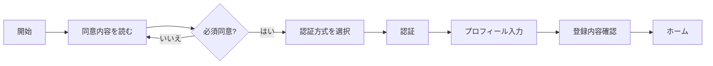
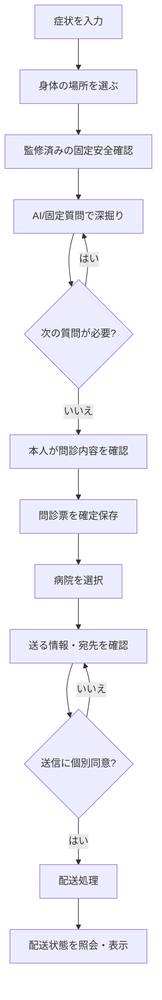
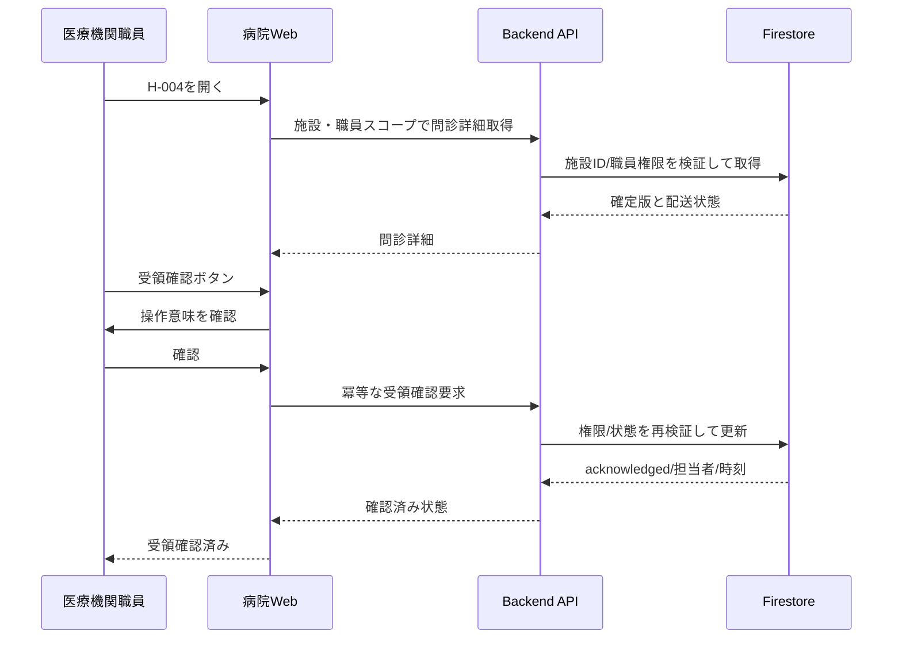

# もしもし問診 — 統合デザインシステム詳細仕様書

> **文書ID** DS-006 ／ **版** v1.0.0-draft ／ **作成日** 2026-11-05 ／ **対象** Flutter（患者向けWeb/iOS/Android）・Next.js（病院職員向けWeb）  
> **サービス名** もしもし問診 ／ **ドメイン** `moshimoshimonshin.com` ／ **設計ステータス** 開発初期の規範仕様・医療/高齢者UXの実地評価前  
> 本書は `01_要件定義書.md`・`02_システム設計書.md`・`03_機能仕様書.md`・`04_DB設計書.md` を参照して作成。画面ID・状態・API/DBの命名は既存文書を優先する。  
> 数値・配色・UI挙動のうち「提案」「暫定」と明記した事項は製品として採用するための**設計初期値**であり、Google/Flutterの公式標準値と混同しないこと。

---

# 0. エグゼクティブサマリー・決定事項

## 0.1 二つのUI、一つのサービス

| 軸 | 患者向けアプリ（Patient Experience / PX） | 医療機関向けWeb（Hospital Workspace / HX） |
|---|---|---|
| 主ユーザー | 高齢者・家族等の利用支援者 | 医療機関の受付・看護師・医師・施設管理者 |
| 最重要タスク | 症状を簡単に伝え、正しく確認して送信 | 正しい患者の問診を安全に探し、読み、受領・処理する |
| 設計言語 | **Material 3 Expressive** を指向したFlutter | **中立・高密度・業務システム**のNext.js/React |
| 印象 | あたたかい・安心・わかりやすい・ゆっくり | 落ち着き・正確・迅速・追跡可能・予測可能 |
| 配置 | 1画面1タスク、1問ずつ、余白多め | 一覧と詳細を並置、検索/絞込、表とフォーム中心 |
| 本文初期サイズ | **20sp**（既存NFR-01と一致） | **14px** 基本、詳細本文16px、最小補助12px |
| タップ目標 | **最小48×48 logical px、主要操作56〜64** | クリック最小32〜36px、タッチ用途44px以上を優先 |
| 色 | 深い青緑＋温かみのある白、注意色は厳密に意味づけ | ネイビー・スレート・白・薄いグレー、状態色は限定使用 |
| 角丸 | 大きめ・やわらかい | 小さめ・規則的 |
| モーション | 意味のある選択/画面遷移に限定してExpressive | 原則控えめ、処理継続・誤操作回避を優先 |
| OS操作 | VoiceOver/TalkBack、文字拡大、戻る対応 | キーボード、スクリーンリーダー、ズーム、一覧操作 |
| 診断・緊急性 | AIの臨床判断のような演出禁止 | 受領と診療対応を混同させない |

## 0.2 デザインの決定階層

1. **安全・法令・プライバシー**：見栄えより優先。注意や危険をデザインで隠さない。
2. **アクセシビリティ**：文字倍率・読み上げ・フォーカス・コントラストを優先。
3. **タスク完了**：患者の理解、施設職員の正確な判断、低い誤操作率。
4. **一貫性**：色/状態/文言/操作が画面をまたいでも同じ。
5. **表現の豊かさ**：上記に反しない範囲だけでMaterial 3 Expressiveを利用。

## 0.3 スコープと境界

- 採用：患者Web/iOS/Android、病院職員Web、施設管理・運営の管理系画面、共通デザイントークン、フォーム、問診票、OCR、病院選択、問診送信、状態表示、同意、退会。
- 対象外：オンライン診療の動画UI、決済、予約確定、音声問診、電子処方箋連携（将来追加時の拡張余地のみ）。
- 本書は診断ロジック、救急トリアージ、法的同意文面、医療情報の保存可否を独自に決定するものではない。医療監修/法務判断を別途経る。

## 0.4 技術上の重要注意（2026-11-05時点）

Flutterは2026年にMaterial/Cupertinoの独立パッケージ化が進み、`material_ui` が標準Material 3 UIの受け皿となった。FlutterチームはMaterial 3 Expressiveの公式実装を進めているが、**Material 3が使えることと、Expressiveの全新規部品が公式実装済みであることは同義ではない**。現行のFlutter SDK、`material_ui`、採用候補のパッケージについて、実装開始時にAPI・更新状況・ライセンス・保守性を再点検する [S01][S02][S03]。

**実装方針**：`material_ui`ベースの標準コンポーネントを最優先し、差分はアプリ内の`Mm*`ラッパーで封じ込める。第三者製Expressiveパッケージは医療サービスのアクセシビリティ・依存リスクを審査せずに全面導入しない。OSのReduced Motionに従う。

---

# 1. ユーザーとデザインの成功条件

## 1.1 患者ペルソナの操作上の前提

- 例：73歳、老眼、軽度難聴、持病あり、薬剤名を覚えていない、症状が断続的、質問が多いと疲れる。
- **文字を読ませすぎない**：本文は短く、重要語を見出し化。「次へ」は常に明示。
- **全部を覚えさせない**：前の回答、現在の進捗、送信内容、薬の確認状態がいつでも閲覧可能。
- **間違いを恐れさせない**：「戻って直せます」を初回に伝える。直せない操作は影響を説明してから確定。
- **専門用語を押し付けない**：「既往歴」ではなく「これまでにかかった病気」。「主訴」ではなく「いちばん困っていること」。
- **不確実性を許す**：「わからない」「覚えていない」「答えたくない」を明示し、推測入力を促さない。
- **聞き取れなかった・読めなかった場合に耐える**：音声やアニメーションだけで意味を伝えない。

## 1.2 病院側ペルソナ

| 役割 | 主なタスク | UI要件 | 権限制約 |
|---|---|---|---|
| 受付 | 新着確認、氏名等で探す、受領済み確認 | 検索・未確認件数・安定したソート | 診療上不要な情報を不用意に表示しない |
| 看護師 | 症状概要・服薬情報・未回答確認 | 要約と原文の区別、薬剤確認状態 | 自施設かつ付与された権限内 |
| 医師 | 患者申告内容と時系列を読む | 原文、選択回答、変更履歴、送信日時 | 医学的な診断をシステムが代行しない |
| 施設管理者 | 職員招待、権限付与、受信停止 | 監査、二段階確認、権限可視化 | 自施設のみ |
| 運営担当 | 施設審査、配送障害、セキュリティ対応 | PHIを原則見せない監視画面 | 運営権限は患者情報の閲覧権を意味しない |

## 1.3 タスクの優先度と品質指標（暫定、測定計画が必要）

| ID | KPI | 初期目標案 | 測定上の注意 |
|---|---|---|---|
| UX-P01 | 初回問診完了率 | 計測開始後に基準を決定 | 年齢・障害別の属性を分析ツールへ無断送信しない |
| UX-P02 | 誤タップによる修正率 | 初期実測比で改善 | 失敗の原因を匿名の観察で収集 |
| UX-P03 | 質問文理解率 | ユーザビリティ試験で90%以上を目標 | 臨床的な理解とUI理解を区別 |
| UX-P04 | 同意理解 | 何を誰に送るか言い直せること | チェック有無だけでは理解を判定しない |
| UX-H01 | 受信一覧から特定票に到達 | 主要タスクを少ない操作で達成 | 権限と施設切替の確認を省略しない |
| UX-H02 | 宛先/対象票取り違え | テストで0件、実運用は継続監視 | 高リスク事象は件数と原因を別途監査 |
| UX-H03 | キーボード完遂率 | 管理画面の主要業務100% | モーダル、テーブル、選択メニューを含む |

---

# 2. デザインアーキテクチャと命名

## 2.1 トークンの4層

```text
Primitive tokens (raw hex / numbers / font families)
  ↓ alias
Semantic tokens (color.surface, color.text.primary, radius.card...)
  ↓ mapping
Platform tokens (patient.flutter.* / hospital.web.*)
  ↓ usage
Components and patterns (MmPrimaryButton / HxDataTable / PatientIntakeFlow)
```

**禁止**：画面コンポーネントにHEXを直接書く、画面ごとに独自の`padding: 17`を使う、API状態をその場の色で判断する。例外はDesign Review記録とコードコメントを必要とする。

## 2.2 命名規約

- 共通トークン：`color.text.primary`、`space.4`、`motion.duration.fast`、`radius.large`。
- 患者専用：`patient.color.primary`、`patient.type.body`、`patient.control.height.primary`。
- 医療機関専用：`hospital.color.surface`、`hospital.table.rowHeight.standard`。
- Flutter Widget：`MmButton`、`MmAnswerCard`、`MmBodyMap`、`MmConsentSection`。
- React Component：`HxDataTable`、`HxStatusBadge`、`HxPatientSummary`、`HxAuditTimeline`。
- コンポーネントの状態：`default/hover/focus/pressed/selected/disabled/loading/error/success`。実際の使用可能状態は部品ごとに制限。
- デザインファイル命名：`PX/P-013/Question/Default/390`、`HX/H-003/Inbox/Error/1440`。

## 2.3 既存システムとの契約

- `intakes.status`：`draft/safety_check/questioning/review/finalized/archived`。
- `deliveries.status`：`created/delivered/acknowledged/failed/revoked`。
- OCRジョブ：`queued/preprocessing/processing/review_required/confirmed/failed_retryable/failed_terminal`。
- **表示用ラベル**と**内部状態値**は別管理。クライアントで勝手に意味の変換をしない。
- 患者には「医療機関に届いた」と「医療機関が確認した」を別表示。`delivered`は診察・予約確定を意味しない。
- 個人情報や診療内容をRealtime Databaseやアナリティクスへ送らないという既存設計の制約をUIイベントにも適用する。

---

# 3. ブランドとデザインの人格

## 3.1 ブランドキーワード

- **やさしい**：責めない、急がせない、取り消せる。
- **しっかり**：曖昧な結果や医療的判断のふりをしない。
- **ととのう**：症状が言葉・時系列・項目になっていく感覚を提供。
- **つながる**：自分の状況が医療機関に届く過程がわかる。

## 3.2 ブランド差別化

- PXは高齢者を「子ども扱い」しない。幼児的なキャラクター・擬人化した病気表現を使わない。
- PXはExpressiveの形状・選択反応・遷移を使うが、**病名を想起させるイラスト演出や過度な喜び表現**は使わない。
- HXは患者画面の丸いカードや大きいアニメーションを持ち込まない。ロゴ/色の連続性にとどめる。
- ロゴは文字ロゴ「もしもし問診」＋オプションの抽象的な対話モチーフ（採用は別途ブランド審査）。医療用の十字や公的機関の紋章に類似させない。

## 3.3 ボイス＆トーン

| 場面 | 推奨 | 避ける |
|---|---|---|
| 患者の日常 | 「どこがつらいですか？」 | 「主訴を入力してください」 |
| 不確かな情報 | 「わからなくても大丈夫です。わかる範囲で選んでください」 | 「正確に回答してください」 |
| OCR | 「写真から読み取った内容です。薬の名前を確認してください」 | 「正しい薬を自動判定しました」 |
| 送信成功 | 「○○クリニックに問診票を送りました」 | 「受診が確定しました」 |
| 送信失敗 | 「まだ送信できていません。もう一度試せます」 | 「エラーが発生しました（500）」 |
| 医療機関 | 「受信日時」「受領確認」「送信者申告」 | 「AIが判定した診断」 |
| 緊急時 | 医療監修済みの短く直接的な固定案内 | 根拠不明の緊急度点数、点滅、煽り |

## 3.4 禁止する表現

- 「大丈夫です」「緊急ではありません」など、AIによる安全性の保証。
- 症状・病歴からAIが病名を推定したように見えるグラフ/バッジ。
- 「先生が確認しました」を`acknowledged`だけから自動表示すること。確認主体・業務意味が証明される場合のみ。
- 医療機関の検索結果を広告・ランキングのように見せて誤誘導すること。
- 薬の効能・服用指示を未監修の生成文で提示すること。

---

# 4. 色彩システム

## 4.1 色の基本戦略

- PX：青緑は安心感と選択可能状態、クリーム系の背景は柔らかさ。白背景と暗い文字で読みやすさを確保。
- HX：明るい無彩色を主体とし、操作・選択・状態のときだけ青や意味色を用いる。
- 状態は**色＋テキスト＋アイコン/形状**で表現し、色だけに意味を持たせない [S07]。
- ブランドのprimary色は「医療的安全」を表す色ではない。「処理済み」や「緊急」にも兼用しない。

## 4.2 患者向けライトモード（推奨案）

| Token | HEX | 用途 | 注意 |
|---|---|---|---|
| `patient.primary` | `#075E5A` | CTA背景・選択中 | 白文字と7.61:1 |
| `patient.onPrimary` | `#FFFFFF` | CTA文字/アイコン | 主要文字 |
| `patient.primaryContainer` | `#C6F1E9` | 選択済み/進捗カード | 長文は置きすぎない |
| `patient.onPrimaryContainer` | `#153A35` | コンテナ文字 | 10.16:1 |
| `patient.surface` | `#FFFBF6` | ページ背景 | 温かみのある中立色 |
| `patient.surfaceCard` | `#FFFFFF` | 入力/一覧カード | 背景との差は境界線で補う |
| `patient.text.primary` | `#1E2933` | 本文・見出し | 背景に対し14.35:1 |
| `patient.text.secondary` | `#536167` | 補助説明 | 背景に対し6.23:1 |
| `patient.border` | `#B8C9C5` | 非装飾的な境界 | 入力状態は追加線で明示 |
| `patient.softTeal` | `#E7F4F0` | チュートリアルの補助領域 | 警告色として使用不可 |
| `patient.focus` | `#174B9A` | キーボードフォーカス | 背景色とのコントラスト試験必須 |
| `patient.overlay` | `#152326` | ダイアログ背面 | アルファ0.50暫定 |
| `patient.link` | `#075E5A` | 下線つきリンク | 色以外の下線/矢印必須 |

**比率について**：記載の数値はこの文書に記載したHEX色の組み合わせをWCAGコントラスト計算式で確認した参考値。実際の透明度、重なり、ダークモード、disabled色、動的配色も含め実装後に再測定すること。

## 4.3 病院向けライトモード（推奨案）

| Token | HEX | 用途 |
|---|---|---|
| `hospital.primary` | `#164C73` | 主ボタン、リンク、選択状態（白文字と9.07:1） |
| `hospital.onPrimary` | `#FFFFFF` | 主ボタン文字 |
| `hospital.canvas` | `#F5F7FA` | アプリのベース背景 |
| `hospital.surface` | `#FFFFFF` | 表、フォーム、パネル |
| `hospital.surfaceSubtle` | `#EFF3F7` | ツールバー、ヘッダー |
| `hospital.text.primary` | `#172B4D` | 見出し・データ（ベース背景と13.14:1） |
| `hospital.text.secondary` | `#42526E` | 補助/メタ情報（ベース背景と7.35:1） |
| `hospital.border` | `#CDD5DF` | 表の区切り・カード境界 |
| `hospital.divider` | `#E2E8F0` | 行区切り |
| `hospital.rowHover` | `#F2F7FC` | ホバー（選択と混同しない） |
| `hospital.rowSelected` | `#E5F1FB` | 明示的選択（左側ライン/checkboxを併用） |
| `hospital.focus` | `#0B5CAD` | 2px以上のフォーカスリング |
| `hospital.sidebar` | `#FFFFFF` | 常時ナビゲーション |
| `hospital.activeNav` | `#E7F1FA` | 現在画面のナビ |

## 4.4 両UI共通の状態色（提案）

| 意味 | 前景 | 背景 | アイコン例 | 必須テキスト |
|---|---|---|---|---|
| 成功/完了 | `#126B45` | `#E8F7EE` | check-circle | 「完了」「確認済み」など具体的状態 |
| 注意/未確認 | `#7A4B00` | `#FFF3D6` | alert-triangle | 「要確認」「未確認」 |
| 失敗/破棄 | `#A21D32` | `#FFF0F2` | x-circle | 「送信失敗」「取消済み」 |
| 情報/処理中 | `#164C73` | `#EAF3FA` | info/clock | 「処理中」「確認待ち」 |
| 中立/不明 | `#42526E` | `#EEF1F4` | help-circle | 「不明」「未回答」 |

- 自動的に意味色が適用されるのは、UI規約にマッピングされた**ドメイン状態**のみ。
- 症状の重さ、疾患候補、薬の危険性などを状態色で推測表示しない。
- 医療機関側の「未受領」や「確認待ち」は優先度に関係なく注意色で煽らない。

## 4.5 ダークモードの位置づけ

- 初期リリースの必須対象はライトモード。将来実装に備えすべてSemantic token化する。
- OSがダークモードのときも意図せず色を反転して読めなくしない。未実装時は**制御されたライトテーマ**を維持。
- ダークモード実装時は新しい色役割・色対比試験・画像/OCRプレビューのガイドを独立レビューする。現時点でライトのHEXを逆転して作らない。
- `patient.primaryContainer`などの意味は維持し、ダーク時の異なるHEXへマッピングする。

---

# 5. タイポグラフィ

## 5.1 字体の選定

- 日本語本文：**Noto Sans JP**を第一候補。端末負荷/ライセンス/読み込みを検証し、OS標準の日本語ゴシックへの適切なフォールバックを用意する。
- Latin/数字：`Inter`を第一候補とし、日本語フォールバックが数字を不自然に混ぜないよう確認。
- Webでは`font-display: swap`等を評価し、文字のレイアウトジャンプと接続性能を測定。
- 不要な極細ウェイト、長文のイタリック、長い英大文字見出しを避ける。
- 薬剤名、年月日、数値、受付時刻は異体字や数字の取り違えがない書体で実機確認。

## 5.2 患者向けのサイズ（初期値）

| Role | sp | 行高倍率目安 | Weight | 使用場面 |
|---|---:|---:|---|---|
| `patient.display` | 30 | 1.30 | 700 | 初回説明の短いタイトル |
| `patient.titleLarge` | 26 | 1.35 | 700 | 問診質問・大見出し |
| `patient.title` | 24 | 1.40 | 700 | 画面タイトル |
| `patient.body` | **20** | **1.60** | 400 | 全般の本文、選択肢 |
| `patient.bodyStrong` | 20 | 1.55 | 600 | 要点・ボタン |
| `patient.support` | 18 | 1.55 | 400 | 補助説明・補助ラベル |
| `patient.caption` | 16 | 1.50 | 400 | 法律文書の補助、処理時刻 |
| `patient.button` | 20 | 1.20 | 700 | CTA内文字 |
| `patient.input` | 20 | 1.50 | 400 | テキスト入力 |

- 原則**16sp未満の患者向け可読文字を作らない**。単なるアイコンや装飾線は対象外。
- 選択肢の文字は必ず改行可能。文字数制限で意味が欠落する省略記号を使用しない。
- アプリ内の文字倍率設定があってもOSのアクセシビリティ文字拡大を上書きしない。
- 200%相当の文字拡大時は、横並びを縦並びに、固定高を可変高にする。
- 単位表記は「mg」「回」「日」などを数値に十分近接させる。`1 mg` と `10 mg` の誤読を防ぐ。

## 5.3 病院向けのサイズ（初期値）

| Role | px/rem | 行高 | Weight | 用途 |
|---|---:|---:|---|---|
| `hospital.pageTitle` | 24px / 1.5rem | 1.35 | 700 | ページ名 |
| `hospital.sectionTitle` | 18px / 1.125rem | 1.45 | 600 | セクション名 |
| `hospital.body` | 14px / 0.875rem | 1.55 | 400 | 表、フィルタ、メタ情報 |
| `hospital.detailBody` | 16px / 1rem | 1.65 | 400 | 問診票・自由記述（可読性優先） |
| `hospital.fieldLabel` | 13px / 0.8125rem | 1.45 | 600 | フォームラベル |
| `hospital.caption` | 12px / 0.75rem | 1.50 | 400 | 時刻、補足、監査ラベル |
| `hospital.metric` | 28px / 1.75rem | 1.20 | 700 | 件数のみ、医療判断には使わない |
| `hospital.button` | 14px / 0.875rem | 1.25 | 600 | 操作 |
| `hospital.tableHeader` | 13px / 0.8125rem | 1.35 | 600 | テーブルヘッダー |

- 問診の本文は一覧の詰まった14pxを流用しない。**詳細画面は16px以上**を基本にする。
- 大量情報が必要でも12px未満を常用しない。隠すより折りたたみや区切りで整理する。
- 数値列は`font-variant-numeric: tabular-nums`。薬剤や症状の原文には不要な字形変換をかけない。
- 200%ズームで水平スクロールが必要になる一覧は、カード型表示/列の優先度変更で代替可能にする。

## 5.4 日本語組版ルール

1. `text-align: justify`を本文に使わない。左揃えを基本。
2. 日本語と英語が混在するラベルは日本語優先。略語は初出で説明。
3. 文末は原則「です・ます」。病院側操作ラベルは簡潔な体言止め可。
4. 連続する強調は避ける。強調は**太字**優先、下線はリンク用に予約。
5. 省略する場合は「全文を見る」アクションを併置。
6. 病院名・人名・薬剤名は文字数で切らず、折り返しまたは全件表示できる導線を提供。
7. 体の左右は**患者本人から見た左右**と必ず明記。

---

# 6. スペーシング・サイズ・配置

## 6.1 基本スケール

| Token | px/dp | 用途 |
|---|---:|---|
| `space.0` | 0 | リセット |
| `space.1` | 4 | アイコンと小ラベル |
| `space.2` | 8 | 密集したデータ区切り |
| `space.3` | 12 | 中程度の隙間 |
| `space.4` | 16 | カード内小区画 |
| `space.5` | 20 | 患者フォーム項目 |
| `space.6` | 24 | 通常セクション間 |
| `space.8` | 32 | PXセクション間 |
| `space.10` | 40 | PX質問と操作間 |
| `space.12` | 48 | 画面内大区切り |
| `space.16` | 64 | ウェルカム系の余白 |

- Flutterではlogical pixel（dp相当）、WebではCSS pxを基準に考える。ただし実画面の縮尺と文字拡大を必ず検証。
- レイアウトは8pxグリッドを主軸とし、4px単位を微調整用とする。

## 6.2 患者画面のレイアウト規則

| 条件 | コンテンツ最大幅 | 左右余白 | カラム |
|---|---:|---:|---|
| 狭いスマートフォン（320〜359） | viewport | 16 | 1 |
| 標準スマートフォン（360〜599） | viewport | 20 | 1 |
| 大型端末/小型タブレット（600〜839） | 640 | 24 | 原則1 |
| タブレット/デスクトップ（840〜） | 720 | 32以上 | 原則1（補助情報は例外） |

- 320pxでも水平スクロールなしで質問・回答・次へを完遂できる。
- **主アクションは画面下部**に設置。ただしキーボードやOSナビゲーション領域との衝突を避ける。
- 下部固定CTAはセーフエリア、キーボード、ズーム、画面読み上げに対応。見出しやフォーカスを隠さない。
- 段階選択では2〜3つの主要選択肢を縦配置し、`わからない/答えたくない`は別の二次操作として配置。
- 長い同意文やOCR候補は縦スクロール可能な通常レイアウトにし、ダイアログ内の二重スクロールを避ける。

## 6.3 病院画面のレイアウト規則

| 条件 | レイアウト | 主要動線 |
|---|---|---|
| ≥1440px | サイドバー240px + メイン + 任意の詳細ペイン | 大量一覧・詳細の並置 |
| 1200〜1439px | サイドバー220px + メイン、詳細は可変 | 標準業務操作 |
| 1024〜1199px | 折畳サイドバー72px + 主要内容 | 表列の優先順位制御 |
| 768〜1023px | ナビドロワー + 1カラム詳細 | 中規模端末 |
| <768px | 1カラム/モバイル代替レイアウト | 機能は削除せず別導線を提供 |

- ブレークポイントは暫定のCSSピクセル。**コンテナ幅とコンテンツ量**で実装を最終調整する。
- H-003一覧はデスクトップ時に検索/フィルタ/表を優先。H-004詳細は読みやすさと出典明示を優先。
- レイアウトの空白を埋めるためだけのKPIカード、グラフ、人物イラストを置かない。

## 6.4 タップ・クリックの物理操作仕様

| 操作 | PX | HX |
|---|---|---|
| 主ボタン | 高さ56〜64、幅は原則全幅 | 高さ36〜40、通常は内容幅 |
| 二次ボタン | 高さ52〜56 | 高さ32〜36 |
| アイコンボタン | 最小48×48 | 36×36以上、タッチ時44×44 |
| 回答カード | 最小72高、複数行で自動拡張 | 該当なし |
| 表行 | 該当なし | 通常44、compact36、comfortable52 |
| チェック/ラジオ | 行全体をタップ可能（最小56） | ラベルを含むクリック領域を確保 |
| 図の部位選択 | 推奨48角以上の対応領域＋リスト代替 | 必要に応じてテキスト代替 |

患者側の48×48はFlutter/OSの推奨を踏まえた**製品内部標準**であり、WCAG 2.2 AAの最小要件24×24 CSS pxと区別する。44×44はWCAGの高度（AAA）基準 [S04][S05]。

---

# 7. 形状・境界線・影・アイコン

## 7.1 形状トークン

| Token | PX | HX | 用途 |
|---|---:|---:|---|
| `radius.xs` | 8 | 2 | 補助部品 |
| `radius.sm` | 12 | 4 | 入力欄/小カード |
| `radius.md` | 16 | 6 | 一般カード |
| `radius.lg` | 24 | 8 | PX主要カード / HXモーダル |
| `radius.xl` | 28 | 10 | PXダイアログ |
| `radius.pill` | 999 | 999 | バッジ/チップ/強調CTA |

- PXのExpressiveな形状モーフィングは、**選択状態をよりわかりやすくする場合だけ**。情報の意味が形状変化だけで伝わる設計は禁止。
- HXは変形しない静的形状。四隅は規則的で業務画面全体に一貫性を持たせる。

## 7.2 影と境界

- `elevation.0`：影なし。標準パネル、病院側表はこれを使用。
- `elevation.1`：軽い浮き上がり。患者カードの選択・軽いボトムバー。
- `elevation.2`：モーダル、オーバーレイ、フォーカス強調。
- `elevation.3`：原則使用しない。過度な浮遊感は医療プロダクトに不適。
- PXは「塗り分け＋境界線」を基本とし、影だけで階層を伝えない。
- HXは1pxの罫線/区切りを優先し、影はポップオーバー等に限定。

## 7.3 アイコン規約

- Outline（通常）、Filled（選択状態）の違いはナビ状態の補助に使える。
- 患者側はアイコンだけの主要アクションを使わず**必ず言語ラベル**を表示。
- 病院側も重要な操作は「受領確認」「職員停止」などの文字を添える。ツールバーのアイコンには可視Tooltip/ARIAラベルを付ける。
- アイコンの基準寸法：PX 24〜28、HX 16〜20、バッジ内14〜16。
- `medical_information`や`healing`系の記号を装飾だけに用いて誤った医療保証を示唆しない。
- 外部リンクは新しいタブかどうかをテキスト/読み上げで伝える。

## 7.4 人体図のアセット仕様

- **本人の左/右**を座標定義で保持。反転時にも保存識別子が変わらない。
- `body_front.svg`、`body_back.svg`と同じ意味のテキスト部位マスターを維持する。
- SVG/CustomPainter部位は適切なタップ領域をもち、選択状態の輪郭＋塗り＋文字ラベルを提供。
- つま先/手指など小部位は拡大ビューか一覧を補助にする。細密部位を小画面で無理に押させない。
- 単一タップで選択、再タップで解除、**複数部位選択**を許容。選択した部位を文字で一覧表示し、削除できるようにする。
- 人体図以外の「部位を一覧から選ぶ」操作で完全に代替可能。
- 性別・体型・障害・手術痕の多様性に配慮し、必要がない限り性別モデルを分けない。人物イラストは中立的な線画を基本。
- 人体図から疾患を推測表示する機能は含めない。

---

# 8. モーション・フィードバック・触覚

## 8.1 モーションの基本原則

1. 処理の因果関係がわかることを最優先。派手な演出を目的にしない。
2. 医療安全上の警告はアニメーションを見逃しても読める固定表示にする。
3. ページ遷移は原則「水平移動＋短いフェード」で戻る方向を示す。動きの大きさは限定する。
4. 非同期処理はUIの進捗と実際の処理状態を対応させる。**偽の0〜100%進捗は禁止**。
5. OSのReduce Motion設定時は形状モーフィング/大きな移動を削減し、フェードまたは即時切替にする。

## 8.2 モーション基準値（公式値ではなく製品提案）

| Token | 時間 | Easing | 用途 |
|---|---:|---|---|
| `motion.instant` | 0ms | - | 安全警告、Reduce Motion |
| `motion.fast` | 100〜150ms | ease-out | hover、focus、選択色 |
| `motion.normal` | 180〜240ms | ease-in-out | カード選択、軽い開閉 |
| `motion.page` | 240〜300ms | ease-out | PX画面遷移 |
| `motion.modal` | 160〜220ms | ease-out | ダイアログ |
| `motion.long` | 350ms以内 | 製品選択 | 教示的な段階アニメーション（必要時のみ） |

- ExpressiveのSpringパラメータは各ライブラリが提供する実装と一致しない可能性があるため、上記は動作上の上限・原則として使用する。
- HXではページ全体のスライド/スケールを行わず、フィルタ・ローディング・メニュー程度の短いトランジションのみ。

## 8.3 ローディング/状態遷移

| 処理 | PXの表示 | HXの表示 | タイムアウト・回復 |
|---|---|---|---|
| API初期読込 | 内容に近いスケルトン＋「読み込み中」 | 表行のスケルトン | 失敗時に再試行ボタン |
| AI質問生成 | 「次の質問を準備しています」＋進捗不定 | 原則対象外 | 一定時間後に固定問診へ切替の説明 |
| OCR処理 | 「画像を読み取っています。終わったら確認できます」 | 該当なし | 途中離脱可、完了後通知 |
| 送信 | 重複実行を防止しつつ「送信中」 | 該当なし | 不明時は`deliveryId`で照会、再送前に状態確認 |
| 病院一覧 | 近隣候補の段階表示 | 受信一覧再取得時の控えめな表示 | フィルタ状態保持 |
| 受領確認 | 該当なし | 行内処理中→成功/失敗 | 競合時に状態再取得 |

- スケルトンに実際の患者名、薬剤名、症状文を擬似的に表示しない。
- スピナーだけではなく説明テキストを追加。スクリーンリーダーには適切に一度伝える（過度な繰返し禁止）。
- HapticsはAndroid/iOSのプラットフォーム規約に沿った軽い選択/完了に限定。警告の唯一の手段にしない。

---

# 9. アクセシビリティ統一規約

## 9.1 適合目標

- Webは**WCAG 2.2 AA相当**を設計・受入の最低目標とする [S05]。
- Flutterはモバイル固有のタッチターゲット、VoiceOver/TalkBack、文字拡大、ランドスケープ、キーボード/スイッチ操作を試験 [S04]。
- 患者側主要操作はAA以上の内部基準（48pxタップ、20sp本文）を用いる。
- 法令適合・認証取得の有無はデザインシステムの完成だけでは証明されない。専門家レビューは別途。

## 9.2 必須検証マトリクス

| 項目 | PX | HX | 試験方法 |
|---|---|---|---|
| テキストコントラスト | 本文4.5:1以上・大文字3:1以上 | 同左 | 全状態の自動/目視検証 |
| 非テキストコントラスト | 3:1以上を目標 | 同左 | 境界・フォーカス・選択 |
| 文字拡大 | OS最大を含む複数段階 | ブラウザ200%/400% reflow | 画面クリッピングなし |
| ターゲット | 基本48px以上 | WCAG AA最低＋可能なら44px | スクリーンショット/自動試験 |
| 色以外の意味 | 状態にアイコン/文字 | 同左 | グレースケール試験 |
| 読み上げ | VoiceOver/TalkBack | NVDA/VoiceOver等 | 主要フロー手動 |
| フォーカス | 遷移後見出しへ | ページ見出し/ダイアログ先頭へ | キーボード試験 |
| 戻る | 回答保持 | 検索条件維持 | E2E |
| エラー | 場所・内容・対処提示 | 同左＋フィールド紐づけ | スクリーンリーダー/再試行 |
| 進捗 | 現在ステップ/残り目安 | 件数/検索条件 | 値の確実性を確認 |
| 時間制限 | 問診操作で不必要な制限なし | セッション制限の予告/再認証 | セキュリティと両立 |
| アニメーション | Reduce Motion対応 | 同左 | OS設定変更 |
| 横幅縮小 | 320px対応 | 表の代替レイアウト | Zoom/リフロー |

## 9.3 スクリーンリーダーの読み上げ設計

- 「次へ」単独ではなく、必要に応じて「次の質問へ進む、ボタン」と読み上げ。
- 回答カードは「夕方、選択されていません、選択肢1/3」のようにラベル/状態/位置を伝える。
- 身体図のタップ領域は「左ひざ、未選択、ボタン」で読み上げ。
- AI質問更新時はページ見出し＋新しい質問を適切にアナウンス。回答を二重に読み上げない。
- OCR候補は「未確認、薬剤名候補、画像から抽出」の順で伝え、確定済みと区別。
- ダイアログは開いた時フォーカスを入れ、閉じた時元の起点へ戻す。
- HXのテーブルは列見出し・行の位置・ソート状態を支援技術に伝達。静的表ならネイティブ`table`を使う [S08][S09]。

## 9.4 フォーカスとキーボード操作

- 視認可能なフォーカスリング（PX: 外側3px推奨、HX: 2px以上）を設定。shadowやborderだけで隠れないようにする。
- 不可視ボタン・オーバーレイ下へのTab移動は禁止。
- モーダル開閉時にフォーカストラップ/復帰、Escで安全に閉じられる場合は対応。破壊的アクションはEscで破棄しない。
- H-003表を独自`role=grid`にする場合、矢印/Enter/F2/Escのフォーカス管理を実装する必要がある。通常の一覧なら`table`を優先 [S08][S09]。
- 不必要な単一文字ショートカットを設けない。ショートカットはテキスト入力中に無効化。

## 9.5 認知的負荷の低減

- 画面タイトルは毎回同じ位置にする。
- 入力例はPlaceholderのみに置かず、ラベルと補足に表示する。
- 必須項目は「必須」の文字を付ける。任意項目は「任意」。
- 新規AI質問は一画面につき原則1つ、3択目安。複数の問いを一文に詰めない。
- 選択した直後に自動遷移せず、**確認できる状態で「次へ」を押す**方式を原則とする。
- 戻ると回答が消える場合は事前告知・確認。通常は消さない。

## 9.6 アクセシビリティ例外の申請

例外が必要なら、`A11Y-EX-0001`番号を発行し、理由・代替手段・影響範囲・対象OS・終了期限・審査担当・回帰試験を記録する。安全上重要な同意/送信/退会導線は例外対象としない。

---

# 10. 共通UIパターンとライティング

## 10.1 ページヘッダー

**PX**：戻る（左）・現在の画面名（中央または左）・「中断して保存」（必要な場合のみ）。下部にステップ情報。  
**HX**：パンくず/施設名・ページ見出し・件数/最終更新・主要操作。施設切替はセキュリティコンテキストを変えるため常に明示。

## 10.2 操作ラベル

| 意味 | PX | HX |
|---|---|---|
| 次へ | 「次へ進む」 | 「次へ」 |
| 決定 | 「これで確認する」 | 「確定」 |
| データ送信 | 「この病院に送信する」 | 「送信」※病院側の同義機能があるときのみ |
| 途中保存 | 「ここまで保存して終わる」 | 「下書き保存」 |
| 受領 | 送信状況の表示のみ | 「受領を確認する」 |
| 削除 | 「退会を申し込む」など影響を説明 | 「職員のアクセスを停止する」 |
| 修正 | 「この回答を直す」 | 「編集」 |
| 不明 | 「わからない」 | 「未確認」※事実上異なる意味を混同しない |

## 10.3 成功・失敗・空状態

- 成功は「何が起きたか」「次に何をするか」「いつか」の順に表示。
- 失敗は技術エラーコードを直接出さず、説明＋再試行/問い合わせ番号。診療データを含むログは画面で露出しない。
- 空状態を「データなし」だけで済ませず、初回・検索該当なし・権限なし・通信失敗・削除済みを区別。
- `401/403/404`の詳細なアクセス拒否理由は情報漏えいを防ぐため表示範囲を制限。
- 受信箱の「0件」は正常状態。重要な未読数を営業風に煽らない。

## 10.4 日付・時刻・数字

- UIの時刻は日本語表示`2026年11月5日 14:30`または密度の高い表で`2026/11/05 14:30`。常に意味が分かるヘッダー/Tooltipを付ける。
- APIのUTC時刻をAsia/Tokyoに変換。`受信日時`と`送信日時`を取り違えない。
- 薬剤の濃度・量・単位は桁区切り/小数表記に配慮し、入力値/画像からの推定値/確定値を分ける。
- 画面に氏名などがある場合はプライバシーを優先し、可視部分を必要最小限にする。

## 10.5 印刷・PDF・共有

- HXの問診詳細の印刷/ダウンロードはMVPでは**禁止または管理者承認制**を暫定推奨。採用時は監査・透かし・権限・監査対象・印刷時の個人情報最小化を仕様化する。
- ブラウザの印刷CSSではナビゲーションを除外し、送信時点の問診票版・出典・施設・生成日時をヘッダーに明記。
- クライアントの`console.log`、analytics、URLクエリ、通知本文、クリップボードへのPHI漏えい禁止。

---

# 11. Flutter / Material 3 Expressive — 実装方針

## 11.1 使用範囲

- 実装対象：Flutter Web、Android、iOS。コードベースは共通だがプラットフォームの動作を強引に統一しない。
- デザイン基盤：Material 3の色・タイプ・シェイプ・状態レイヤー。Expressiveに特有の**強調された階層、動き、個性的な選択表現**を部分的に採用。
- 外部パッケージを選定する前に、公式Material APIとの重複、semantics、タップ領域、テスト容易性、テーマ統一を確認する。
- ラッパーコンポーネントでUIテーマの依存を抽象化し、アプリ各画面に外部Expressive APIを直接ばら撒かない。

## 11.2 Flutter Widgetの優先順位

| 部品 | 第一選択 | Expressive化する場合 | 禁止・要注意 |
|---|---|---|---|
| App構成 | `MaterialApp`、`ThemeData` | ブランドトークン適用 | 全画面で別テーマ定義 |
| ボタン | `FilledButton` / `OutlinedButton` / `TextButton` | 押下反応・角丸の制御 | tapターゲット縮小 |
| 選択 | `Radio` / `SegmentedButton` + 独自AnswerCard | 選択時の控えめなshape変化 | 色だけで選択表示 |
| 問診フォーム | `TextField` / `TextFormField` | 入力支援・大きいLabel | PlaceholderだけのLabel |
| ナビゲーション | `NavigationBar`等 | 選択インジケーター | 多すぎるタブ |
| ダイアログ | `AlertDialog` | 安全な丸み/動き | スクロール二重化 |
| ボトムシート | `showModalBottomSheet` | 選択状態を強調 | 長い規約・詳細票をシートで強制 |
| チップ | `ChoiceChip` / `FilterChip` | 明確な高コントラスト | 小さすぎる選択肢 |
| ローディング | `CircularProgressIndicator`等 | 不定進捗の表現 | 実値のないパーセンテージ |
| SnackBar | `SnackBar` | わかりやすい文言 | 成否をSnackBarのみで伝える |
| 日付 | `DatePicker`相当 | 生年月日用の簡略選択 | 73年前まで月送り強制 |

※ この表は機能カテゴリの概念と既存Material UIの一般APIを示す。実コードでは採用する`material_ui`バージョンのAPI・importを確認する [S02][S03]。

## 11.3 構成ディレクトリ案

```text
apps/patient_flutter/
  lib/
    app/
      app.dart
      routing/
      theme/
        app_theme.dart
        patient_tokens.dart
        component_themes.dart
    design_system/
      foundations/
        colors.dart
        typography.dart
        spacing.dart
        motion.dart
      components/
        mm_button.dart
        mm_answer_card.dart
        mm_question_header.dart
        mm_step_progress.dart
        mm_body_map.dart
        mm_medication_card.dart
        mm_ocr_candidate.dart
        mm_delivery_status.dart
        mm_consent_checkbox.dart
        mm_error_panel.dart
        mm_loading_view.dart
      patterns/
        one_question_layout.dart
        safety_notice.dart
        review_section.dart
        sticky_action_footer.dart
    features/
      onboarding/
      auth/
      profile/
      intake/
      medications/
      hospital_search/
      delivery/
      settings/
```

## 11.4 ライブラリ境界のルール

- `design_system/`はバックエンドやFirestoreの型を直接参照しない。View Modelで状態を解決する。
- バッジは内部enumではなくセマンティックな`StatusVisualModel`（label, icon, tone, accessibleDescription）を受け取る。
- テーマのカラーをサービス層に持ち込まない。
- `Mm*`はUI、`features/*`はデータ取得・状態・入力検証を担当。
- 見た目が全く同じでも違う意味の操作（同意/チェックボックスなど）を1つの曖昧な汎用部品にまとめすぎない。

---

# 12. 患者向けFlutterコンポーネント詳細仕様

## 12.1 MmPrimaryButton / MmSecondaryButton

**用途**：次へ、保存、確認、送信。  
**寸法**：最小高さ56、優先64、横padding24、半径24またはpill（同じ画面内で統一）。  
**構成**：任意の先頭アイコン + 1〜2行以内の文字 + 任意の進捗。  
**状態**：default/pressed/focus/disabled/loading。hoverはWeb利用時のみ。  
**loading**：文言を「送信中…」へ更新し、二重実行防止。ただしネットワークタイムアウト時は状態照会して再試行を案内。  
**disabled**：なぜ押せないかを隣接テキストで説明。無反応のdisabledだけでは不可。  
**a11y**：アクセシビリティラベルと状態、最小48×48、長押し必須にしない。  
**禁止**：破壊的操作と通常CTAを同じ色で並べる。イベント発火直後に「完了」を仮表示する。

## 12.2 MmAnswerCard（最重要）

**用途**：AI/固定質問の回答選択。  
**構造**：

```text
┌──────────────────────────────────┐
│  ◯   夕方ごろ                     │
│       仕事や家事が終わる時間帯     │
└──────────────────────────────────┘
```

- 選択肢は縦方向、原則3件、順序はサーバ提供の意図を尊重。意味が変わる自動並べ替えをしない。
- 既定：白カード＋`patient.border`＋未選択ラジオ。
- 選択：`primaryContainer`＋`onPrimaryContainer`＋選択ラジオ＋太字。選択時の形状/背景の軽い変化は可能。
- 目安：最小高さ72、左右20、選択肢間12、全長は文字に応じて伸縮。
- `selected`は一意、マルチ回答指定の質問では別コンポーネント`MmMultiAnswerCard`を使用。
- 自由記述・不明・回答拒否は本体の選択肢と分離。「その他」を選択すると追加入力が必要になる場合、その理由を示す。
- タップ直後にサーバ送信しても、**選択変更は可能**であり、次画面へは「次へ進む」で移動。
- 連打防止はボタンのみを無効化。カード全体の灰色化で回答を隠さない。
- エラー時は選択を保持し「保存できませんでした。再試行してください」と表示。
- 読み上げ：質問文、選択肢名、選択状態、グループ内位置。

## 12.3 MmQuestionHeader

| 要素 | 仕様 |
|---|---|
| 質問番号 | `質問 3 / 8`のような表示。総数がAI生成で未確定なら`質問 3`のみ |
| タイトル | 最大2〜4行目安、26sp、修辞的な長文を避ける |
| 補足 | 「わかる範囲でお答えください」等固定文 |
| 説明 | 必要なときだけ展開。「詳しく見る」を明示 |
| 音声 | 今回のMVPでは提供しない。音声ボタンのダミー配置禁止 |
| スクロール | 新しい質問になったら見出しを可視位置にし、フォーカスを移す |

## 12.4 MmStepProgress

- `現在の段階：症状を確認中`をテキストで併記。
- 総質問数が変動するため、**固定の100%バーをAI問診に適用しない**。
- ステップで進捗を示す場合：`症状入力 → 質問 → 内容確認 → 病院を選ぶ → 送信`。完了済みと現在を区別。
- `aria`/semanticsの値は表示内容に対応させる。推定残り時間を確約として表示しない。

## 12.5 MmSymptomTextInput

- Label「今、どのようなことで困っていますか？」、例「夕方になるとだるくなり、休みたくなります」。
- 最長1000字（既存仕様の暫定値）。残り字数は入力が上限に近いときに案内。
- フォント20sp、改行可、最小高さ160、画面が狭いときは自動拡張。
- 入力履歴を誤って消さない。保存済み/保存中/未保存を区別。
- パスワードや自動入力用の正確な`autofillHints`を指定。症状入力を検索履歴へ無断保存しない。
- 内容が入力されていない場合に「何もありませんか？」と誘導しない。
- コピー/ペースト操作はOSの標準に従う。貼り付けた文へのAIへの外部送信は必要な同意/承認を満たすときだけ。

## 12.6 MmBodyMap

**レイアウト**：表/裏切替 → 人体図 → 選択中部位チップ → 「一覧から選ぶ」 → 次へ。  
**選択可能部位**（初期候補）：頭、首、胸、腹、腰、背中、肩、上腕、ひじ、手、股関節、太もも、ひざ、すね、足首、足、全身、特定しづらい。左右を保持する部位は別ID。  
**データ**：UIの座標に依存しない`bodyLocations`列挙値、表示名、面、左右、グループを1つのマスターとして管理。  
**a11y**：パーツごとにセマンティクス、キーボード操作、テキスト代替。  
**エラー**：図が描けなくても一覧選択は使える。  
**安全**：体の部位は「痛みの強さ/病名」を示さない。選択した部位は患者が修正可能。

## 12.7 MmSafetyNotice

- **医療監修済みの固定メッセージ**だけを表示。動的LLM文を危険兆候の判断に使わない。
- 通常画面の注意文と、救急相談が必要となる可能性のある固定警告をトーンで区別。
- アイコン＋明示的な見出し＋何をすべきか＋リンク/電話案内の4要素。
- 「症状により、すぐに医療機関へ相談が必要な場合があります」等の正確な文は医療監修待ち。
- 緊急案内はバナーを閉じただけで注意義務が履行されたと見なさない。適切な確認・導線を設ける。
- 赤い点滅や点滅アイコンは禁止。危険兆候の詳細ルールは本書で定義しない。

## 12.8 MmMedicationCard

- **登録内容**：薬剤名、規格/量、服用状態（現在/過去/不明）、登録方法、最終確認日時。
- 名称が不明な場合も「名前がわからない薬」としてリスト化できる。
- 画像から抽出した未確認データは`要確認`を常に表示。確認済みの薬と同じ見た目にしない。
- タップで詳細、編集、画像確認に移動。薬の説明は監修済み出典がある場合のみ。
- 添付画像はリスト内に原本を露出せず、明示的な操作で必要なサイズの画像を表示。
- 質問票へ含めるときは「今回の送信に含む」選択を提示し、一覧の保管と送信は分ける。

## 12.9 MmPrescriptionUpload

- カメラ/ファイル選択の**両方**を明確に提示。Web環境では対応する入力方法だけを提供。
- 撮影前の説明：処方箋が画面内に収まる/光の反射を避ける/文字が読めるようにする。個人情報の写り込みに配慮。
- 撮影後は回転・やり直し・確認・アップロードの4操作。画像を無断で送信しない。
- ローディングは`queued`と`processing`を大きく区別せず自然な日本語に変換。完了後の**本人確認**を必須。
- 「OCRできない」場合に手入力/再撮影を可能にする。

## 12.10 MmOcrCandidateReview

- 一件ごとに認識した薬剤名、規格、原本の該当範囲、編集フィールド、確認ボタン。
- 原本と抽出値を上下/横並びで照合可能。スマホは縦並びが基本。
- 「薬が違います」「読めません」「この薬で合っています」を分ける。
- 低信頼スコアを患者へ確率として表示しない。システム内部のレビュー優先度として使用。
- 薬剤名が似ていても自動的に一つへまとめない。
- 変更前の元データ、ユーザー確定値、確認日時をモデル上区別。
- 自動抽出の候補を確定せずに終了した場合は「未確認」として保存。送信票へ確定薬として載せない。

## 12.11 MmHospitalSearchCard

- **施設名/住所/位置関係/診療科候補/送信対応状況**の順に表示。
- `Google Placesで見つかった`と`もしもし問診に参加・受信可能`を明示的に区別。
- ステータス例：「問診票を送れます」「このアプリからは送信できません」。
- 受診可能・診察可能・予約可能は別の事実。確認できなければ「病院に確認してください」とする。
- 地図が使えない場合もリストで選択できる。地図アイコンだけで送信先を決めさせない。
- 提供元表示・ロゴ表示・キャッシュ条件はGoogle Maps Platformの利用条件に従う（既存システム設計のPlacesポリシー参照）。

## 12.12 MmDeliveryConsentReview

**送信前の最重要コンポーネント。**

1. 宛先の**正式な施設名と住所**を表示。
2. 問診票の版/確定日時と内容を要約表示。
3. `送る項目：氏名・連絡先・問診内容・薬剤情報・画像`を**実際のshareScopeに対応**させ表示。
4. 除外する項目があれば明示する。デフォルト値と追加同意要否は法務確認。
5. 「この病院に、この内容を送信することに同意します」を別個のチェック。
6. チェックがなければ送信を開始しない。サーバでも同意と版の整合を検証。
7. ボタンは「○○病院へ送信する」。短すぎて誤認する場合は本文側の宛先を読み上げへ含める。
8. 二重送信時に同じ結果が得られるよう`Idempotency-Key`運用とUIを一致させる。
9. 送信完了前に画面を閉じた場合は配送状態を再照会できる。
10. 同意履歴/送信結果は本人が後で確認可能。

## 12.13 MmDeliveryStatus

| バックエンド状態 | 患者ラベル案 | 説明文 | Primary action |
|---|---|---|---|
| `created` | 送信を処理しています | まだ病院への到達を確認できません | 状況を確認 |
| `delivered` | 病院に届きました | **受診や予約の確定ではありません** | 送った内容を見る |
| `acknowledged` | 病院側で受領確認されました | 診療を行ったことを意味しません | 送った内容を見る |
| `failed` | まだ送信できていません | ネットワークや受信設定を確認し、再試行できます | 再確認・再試行 |
| `revoked` | 送信を取り下げました | 既に閲覧された情報が自動削除されたことを意味しません | 詳しく見る |

- ステータスの読み替えは厳密にサーバ状態に追随。`created`を「送信成功」としない。
- リトライボタンは同一配送の状態照会/冪等再試行とし、無条件の二重配送を禁止。

## 12.14 MmConsentSection

- 同意文書はタイトル、版、目的、データの種類、提供先、利用期間/削除、詳細リンクを明示。
- チェックボックスは必須/任意の別グループ。**一括同意を必須項目と任意項目で混在させない**。
- 未読の場合のゲート方法は「最後までスクロールしただけで同意した」と扱わず、明示チェック＋送信を基本。
- 既存の登録前同意フロー（P-002）との実装差分：メール認証でサーバ作成前同意を検証する場合もGoogle/Passkeyの必要な後続フローを許容。
- 実際の同意保存はバックエンドの`consentVersion`、`documentHash`、`timestamp`を使用。

## 12.15 MmProfileFieldSet

- 氏名/カナは分割、姓名の例を明示。読み間違えやすい入力は確認ステップを設ける。
- 生年月日は年・月・日を明示的に選べる。カレンダーの月送りのみで遡らせない。
- 電話番号は国番号・入力制限・ハイフン有無の処理を仕様化。数字入力で文字が見えづらくならないこと。
- 住所は郵便番号の補助入力を可能にするが、**候補による自動確定禁止**。ユーザーが確認する。
- 持病は任意。本人が不明でも登録完了できる。
- エラー表示は該当欄の下に表示し、見出し/フォーカス移動でも通知。

## 12.16 MmReviewSection

- 患者の原文とAIが整理した要約を区分し、AI要約に「内容を確認してください」と明示。
- 質問ごとに回答・未回答・変更アクションを用意。
- 薬剤の未確認状態、画像を含めるか、病院へ送信される範囲を一つの要約で確認可能。
- セクションに`修正する`操作を配置し、修正後に戻った際は変更箇所を確認しやすくする。
- 病院の閲覧画面でも**患者の原文 vs 整理された表現**を区別できる構造にする。

## 12.17 MmErrorPanel / MmEmptyState

- エラーの設計構造：`タイトル（起きたこと）` → `短い説明` → `対応ボタン` → `問い合わせ用参照ID（任意）`。
- エラー種：接続できない、保存できない、処理が間に合わない、権限がない、施設が受信不可、画像が読み取れない。
- カスタマーサポートへコピー可能な参照IDにはPHIを埋め込まない。
- 空状態には正常空/検索ヒットなし/下書きなし/削除中/アクセスなしを区別。

## 12.18 MmStickyActionFooter

- PXの主要操作は固定フッターへ置けるが、本文・ボタンが重ならないだけの下余白を確保。
- `SafeArea`、ソフトキーボード、スクリーン回転、テキスト倍率、折りたたみ表示に対応。
- フッターに原則「戻る」と「次へ」の2操作。患者が混乱する3つ以上の同列CTAを置かない。
- フッターが見えないときもスクロールで再表示される位置関係と、画面内の読み上げ順序を保持。

## 12.19 MmDialog（非破壊/破壊）

| 種類 | 表題 | メインアクション | キャンセル |
|---|---|---|---|
| 保存して中断 | 「ここまでの回答を保存しますか？」 | 「保存して終わる」 | 「問診を続ける」 |
| 画像再撮影 | 「写真を撮り直しますか？」 | 「撮り直す」 | 「この写真を使う」 |
| 退会申請 | 「退会を申し込みますか？」 | 「退会を申し込む」 | 「キャンセル」 |
| 送信先変更 | 「送信する病院を変更しますか？」 | 「病院を選び直す」 | 「戻る」 |

- 破壊操作のボタンは色＋動詞で区別し、既定フォーカスを破壊ボタンに置かない。
- ダイアログの消し込み操作で患者データを失わない。必要なら二段階確認。

---

# 13. 患者画面ごとのデザイン仕様

以下の`P-xxx`は既存の`03_機能仕様書.md`に対応する。共通のレイアウト骨格は`MmPatientScaffold`：`AppBar / StepHeading / ScrollableContent / ActionFooter / ErrorSurface`。

## P-001 ウェルカム

- 画面上部：サービスロゴ・短い説明「症状を整理して、医療機関へ伝えるお手伝いをします」。
- 中央：3つの要点「症状を伝える」「内容を確認する」「病院に送る」。イラストは装飾補助。
- 下部：「はじめる」1つを主CTA、「すでに登録している方」は二次導線。
- 「診断や予約をするサービスではありません」を見落とされない位置に表示。
- モバイル320px、表示倍率200%でもCTAと説明を切り捨てない。

## P-002 利用規約・重要事項

- 利用規約/プライバシー/医療情報の取得と利用の説明を**別セクション**で提示。
- 同意と閲覧済みを分離し、異なる目的の同意は別々のチェックにする。
- 事前に同意しない場合は登録処理へ進まない。任意同意を拒んだ場合の必要な導線は残す。
- 法務文言は全文参照可能。要約が原文と矛盾しないよう版管理。
- 認証方式ごとのアカウント作成順はサーバ実装仕様と整合させる。

## P-003 認証方式選択

- `Googleで続ける`、`メールアドレスで続ける`、`パスキーで続ける`（対応時のみ）を縦並び。
- 各方式にメリットを過剰説明せず、エラー時の代替経路を提示。
- Passkey非対応時は押せないダミーを表示せず、適切な案内/代替認証。
- WebView/ブラウザ制約がある場合はOSに応じて説明。

## P-004 メール登録・ログイン

- メール、パスワード、表示/非表示、忘れた場合、入力エラーを明示。
- パスワード管理アプリと自動入力を妨げない。
- セキュリティ上の具体的なアカウント存在判定を画面から漏らさない。
- 成功時は未完了の同意・プロフィール情報を確認して正しい画面へ遷移。

## P-005 Passkey

- 端末の認証UIを主役にする。独自UIで偽の生体認証ダイアログを作らない。
- 「端末の認証機能でログインします」という説明と、キャンセル後の戻る導線。
- パスキーが失われた場合の復旧手段を認証設計に従い表示。

## P-006 プロフィール登録

- 入力を「氏名」「連絡先」「住所」「健康に関する任意情報」に分けたステップ形式（既存仕様と調整）。
- 全フィールドを一画面に詰めない。セクションの進捗と戻るを明示。
- 生年月日、氏名カナ、電話番号の入力支援/確認を重視。
- 持病は「任意」であり、入力を強制しない。

## P-007 ホーム

- 主カードを3枚以下：**問診を始める**、**お薬の確認**、**これまでの問診**。
- 途中の問診がある場合だけ「続きから」をホーム上部に表示。
- 高齢者が迷いがちな長いメニューを出さず、設定は右上の「アカウント」に集約。
- 症状や薬剤をホームに生のまま表示しない（背後からの覗き見防止）。

## P-008 アカウント

- プロフィール、ログイン方法、通知設定、同意履歴、退会を区分。
- 「退会」は通常操作から視覚的に分離し、影響と30日後の削除について事前説明。
- 名前/住所変更は確認・保存状態を区別。通知設定はシステム/医療情報に関わる内容と別扱い。

## P-010 症状入力

- ページタイトル「どんなことで困っていますか？」。
- 大きい自由記述欄、例、文字数サポート、「うまく書けなくても大丈夫です」を提示。
- 問診票の入力中は医療情報が扱われることを短く明示。
- `わからない`の場合でも固定質問への移行可否を要件として検討（暫定）。

## P-011 身体図

- タイトル「つらい場所があれば選んでください」。
- 「前から見た体/後ろから見た体」の切替、本人左右表示、選択した部位の明示。
- `一覧から選ぶ`、`体の場所ではない/わからない`を必ず用意。
- 図のサイズは文字拡大時にレイアウトへ追随し、シートの下に隠れない。

## P-012 安全に関する確認

- 医療監修済みの質問だけを表示し、理解しにくい医療用語を避ける。
- 回答の有無だけで「緊急性なし」と見せない。
- 固定警告が必要になった際は画面遷移に依存せず、わかる文言/適切な相談導線で表示。
- 監修者が定義した応答条件とUI上の分岐をテスト可能な形にする。

## P-013 AI深掘り質問

- `質問見出し` + `選択肢3枚目安` + `わからない/答えたくない` + `戻る/次へ`。
- AIが生成した質問文はスキーマ検証後に表示。文言が長い/不適切な場合は固定文へフォールバック。
- 選択肢が3件を超える場合は特殊UIを検討し、デフォルトでスクロールを隠さない。
- 生成中、回答保存中、生成失敗の状態を分けて表示。
- 文字が意味を持たない抽象アイコン、動く選択肢、偽の緊急度スコアを使わない。

## P-014 問診票レビュー

- 冒頭に「送る前に内容を確認しましょう」。
- セクション：困っている症状／いつから／つらい場所／選択した回答／薬／未回答。
- 元の自由記述とAI整理文を別ラベルにする。
- 各項目の「直す」を明示。画像を含めるかは送信前確認で別途確定。
- 薬剤OCRの未確認候補は赤で危険と断定せず、明瞭な注意色＋「未確認」。

## P-015 問診票確定

- 問診票が保存されるだけで病院へ送信されないなら「保存しました。まだ病院には送っていません」と明示。
- revision固定。後で編集した場合の版を区別。
- CTA「病院を探す」、二次「あとで送る」。

## P-020 薬剤一覧

- セグメント「現在の薬」「過去の薬」「不明」を使用。各項目の`確認済み/未確認`は別次元の情報。
- 「処方箋の写真から追加」「手入力で追加」を分かりやすく配置。
- 削除より服薬状態の変更を優先。過去履歴を意図せず失わない。

## P-021 処方箋アップロード

- カメラ/画像選択/PDFを対応環境に合わせて表示。撮影ガイドは大きく短く。
- 選択したファイル名/サイズ/ページ数、プレビュー、削除/やり直しを明示。
- 個人情報の写り込み・保存先・送信処理について短い説明を設置。

## P-022 OCR処理中

- インジケータ＋「写真を読み取っています」。
- 実際の進捗値がない場合は不定進捗。「あとで確認」から離脱可能。
- リロード後もジョブ状態が復元される。

## P-023 薬剤候補確認

- OCR候補を薬ごとに確認。原本画像へのアクセスは必要時だけ。
- `この内容で登録`、`名前を直す`、`わからない`。用量があいまいな場合は確定強制しない。
- 未確認の薬は未確認ラベルを残し、問診票へ事実として混入させない。

## P-030 病院検索

- 最初は「近くの病院を探す」「住所から探す」の2経路。現在地権限を強制しない。
- 候補は**リスト優先**。地図表示は補助機能。
- 参加施設/送信可能施設の絞込を見つけやすくする。
- 外部Places検索結果について帰属表示を遵守。位置情報が得られない場合も検索可能。

## P-031 病院詳細

- 正式名称・住所・位置・電話・診療科等の確認できる範囲だけ。
- `この病院へ送信できるか`の状態を明示。対応不可なら通常CTAを無効化するだけでなく説明。
- 「診療を受けられる」「予約が取れる」等の未確認の断定禁止。

## P-032 送信前確認・同意

- 宛先施設名・住所を**ページ冒頭と送信ボタン直前**で確認。
- 問診票版、送る情報の項目一覧、別個の同意チェック、送信ボタン。
- 送信同意は初回の一般規約同意とは別。エラーメッセージはデータを失わず再確認できる。
- 施設切替が起きた場合は同意対象を再評価し、古い同意の自動流用禁止。

## P-033 送信結果

- `created`はまだ送信完了ではないことを明記。
- `delivered`、`acknowledged`、`failed`、`revoked`を独立した画面状態として扱う。
- 結果に「受診予約ではない」文言と「送った内容を見る」を配置。
- 後から画面を開いたときは最新の確定状態を取得。

## P-040 退会申請

- 影響範囲、30日後のデータ削除、取消可能期間、医療機関に送信済みの情報の別管理を説明。
- 本人の再認証を求める。破壊アクションは画面最下部に分離。
- 「直ちにすべてのデータが消えます」という誤案内は禁止。

## P-041 退会受付・取消

- 申請日、取消期限、実際の処理の予定、サポート/問い合わせを表示。
- 通常機能へのアクセス停止と申請取消の可否を一致させる。
- 退会処理完了後の表示/再登録は認証要件と合わせて設計。

---

# 14. 患者フローのデザインパターン

## 14.1 初回登録



- P-002の法的同意と認証プロバイダのID発行順序には実装上の違いがあり得る。**未同意ユーザーがサービスを利用できない**ことをサーバで強制。
- 初回オンボーディングは長時間動画や強制スライドを使わない。
- 最初から設定項目をすべて表示せず、目的を小さな段階に分解。

## 14.2 問診から送信



- 問診中のブラウザ戻る・OS戻るは回答を保持。
- 「わからない」「答えたくない」は回答そのものとして明確に保存し、欠損と区別。
- AI障害は固定質問/手入力へ復帰可能にする。画面だけで無限に待たせない。
- 送信時には二度押しで別の配送レコードを作らない。

## 14.3 状態と画面の整合

| DB状態 | 患者UIの主導線 | 編集可否 | 主な表示 |
|---|---|---|---|
| `draft` | 続きから入力 | 可 | 下書き |
| `safety_check` | 安全確認 | 可 | 質問の途中 |
| `questioning` | 質問へ戻る | 可 | 質問 n件目 |
| `review` | 内容の確認 | 条件付き | まとめを確認 |
| `finalized` | 病院選択へ | 確定版は不変 | 送信前の保存済み |
| `archived` | 過去の問診表示 | 原則不可 | 保存/履歴 |

- 状態の読み取り失敗時にローカル情報を無条件に正とせず、サーバと整合確認。
- オフライン時に「オンライン送信できました」と表示しない。

## 14.4 フォーム保存の振る舞い

- 自動保存を採用するなら、「保存中」「保存しました」「保存できません」をUI表示できること。
- PHIをブラウザLocalStorage/IndexedDBへ無条件に平文永続保存しない。
- ローカルの入力内容がサーバと競合した場合、勝手に上書きせず内容/変更時刻を確認させる。
- 途中中断時に戻る導線を残し、ログインセッション切れでも何が失われたか正確に説明。

---

# 15. 医療機関向けWeb — 業務システムとしての設計思想

## 15.1 ビジュアル方針

**目標は「きれいなダッシュボード」ではなく「間違わず仕事が進む業務アプリ」。**

- 視覚：白背景、白/薄グレーのカード、細い区切り、左固定ナビ、規則正しい表。
- 情報：受信日時、状態、患者名、送信先（自院）、担当者、問診内容の原文を正確に配置。
- 操作：キーボードを使う受付業務、複数件の処理、フィルタと検索条件の保持。
- 反応：過度なトランジションなし。最終更新時刻/処理中/失敗を明示。
- 余白：8pxグリッド。患者側より密度を高めるが、薬や症状の長文領域は例外。
- 説明：熟練者が使う画面は1画面に多くの必要情報を配置してよいが、押せないコントロールや意味不明な略語を増やさない。
- 安全：自院のデータであることを常に確認できる。複数施設所属の職員は施設名を強調表示。

## 15.2 情報設計と優先度

| Priority | 情報 | 主な場所 |
|---|---|---|
| P0 | 現在の施設、認証職員、受信結果、操作対象の患者・票 | グローバルヘッダー、一覧/詳細 |
| P0 | 新着/未受領、配送失敗/取消、権限エラー | 受信画面、状態ラベル |
| P1 | 問診確定日時、送信日時、受信日時、版 | 票の詳細・メタ情報 |
| P1 | 患者の申告原文、質問回答、薬剤確認状態 | 票の本文 |
| P1 | 受領担当者と受領時刻 | 監査・詳細の履歴 |
| P2 | 職員管理、施設設定、利用状況 | ナビゲーション/設定 |
| P3 | 高度な統計、可視化、業務分析 | 将来の別モジュール |

## 15.3 何を表示しないか

- KPI風の「AI健康スコア」「リスクスコア」「危険度ランキング」は表示しない。
- ダッシュボードに生の症状・薬剤名・電話番号を一覧プレビューとして大量表示しない。
- 画面上部に「すべて順調」等の臨床的価値判断を置かない。
- 他院の候補や他院の配送状況を業務一覧に混在させない。
- ブラウザのページタイトル/通知テキストに患者の氏名・症状等を露出しない。

---

# 16. 病院Webの情報アーキテクチャ（IA）

## 16.1 ナビゲーションマップ

```text
病院向け管理画面 hospital.moshimoshimonshin.com
├─ ログイン H-001
├─ 施設選択 H-002
└─ ワークスペース（施設コンテキスト必須）
   ├─ 受信問診 H-003
   │  ├─ 未受領
   │  ├─ 受領済み
   │  ├─ すべて
   │  └─ 詳細 H-004
   ├─ 職員管理 H-005 [facility_admin]
   ├─ 施設設定 H-006 [facility_admin]
   ├─ 個人設定（将来）
   └─ ヘルプ / 操作説明 / ログアウト

運営用（別権限・別ナビ領域）
├─ 施設審査 O-001
└─ システム監視 O-002
```

- `H-003`が受付担当者のホーム画面。
- 管理者ではない職員にはH-005/H-006のナビ項目をそもそも表示しない。ただし非表示は認可ではないためバックエンドで拒否。
- 施設が1件のみの職員にはH-002の施設選択をスキップしてよいが、ヘッダーには施設名を常時表示。
- 施設コンテキスト切替時は検索結果・メモリ内データ・キャッシュ・開いていた詳細をクリアする。

## 16.2 ワークスペース全体構造

```text
┌──────────────────────────────────────────────────────────────────────┐
│ もしもし問診 管理画面   [○○クリニック ▼]        [ヘルプ] [職員名 ▼] │ ← 56px
├────────────────┬─────────────────────────────────────────────────────┤
│ 受信問診       │ 受信問診                                            │
│ ───────────    │ [未受領 4] [すべて 128]   最終更新: 14:30          │
│ [受信問診]     │ ┌──────────────────────────────────────────────────┐│
│                │ │ 検索   期間   状態   [絞り込む] [条件を消す]      ││
│ 職員管理       │ ├──────────────────────────────────────────────────┤│
│ 施設設定       │ │ 受信日時 │ 患者氏名 │ 状態 │ 確定日時 │ 操作    ││
│                │ │ 14:28    │ 田中…    │ 未受領│ 14:25   │ 詳細    ││
│ ヘルプ         │ │ 14:21    │ 佐藤…    │ 受領済│ 14:15   │ 詳細    ││
│                │ ├──────────────────────────────────────────────────┤│
│                │ │ 1〜25 / 128 件                  [前へ] [次へ]    ││
│                │ └──────────────────────────────────────────────────┘│
└────────────────┴─────────────────────────────────────────────────────┘
```

※ この図の患者名・件数は**架空のUIサンプル**。実際の患者情報は権限に応じて表示・伏字化する。業務上必要な完全表示の範囲は運用契約で決定。

## 16.3 レイアウト数値

| 要素 | 仕様 |
|---|---|
| 上部ヘッダー | 56px高、スクロールしても原則固定 |
| サイドバー | 240px標準、狭いデスクトップで220px、折畳時72px |
| コンテンツpadding | desktop24px、狭い画面16px |
| パネル | 白背景、1px罫線、角丸6〜8px、影なし |
| ページヘッダー | タイトル24px、説明/パンくず14px、主要操作は右 |
| 検索/フィルタ | 一覧の直上に固定的に配置。過度なモーダル化は避ける |
| 表ヘッダー | 背景`#EFF3F7`、13px・太字、列の意味を明示 |
| 表行 | 通常44px、詳細な改行があれば可変高 |
| 詳細ペイン | desktopでmin480/max720pxを目安に可変 |
| アクション配置 | 受領確認などの主操作を詳細の上部右側と下部に冗長配置する場合、同じ状態を参照 |

## 16.4 業務操作での画面遷移

- 一覧検索→詳細→戻るで、検索語・状態フィルタ・期間・ソート・ページ位置を保持。
- 詳細を開いたことと受領確認は**別操作**。「見ただけで受領済みにする」方式は原則禁止。
- フィルタやソートは状態を視覚的に表示し、未受領件数が変わったときは更新時刻を表示。
- 無限スクロールで状態を失うリスクを避け、標準はページネーション。ページ単位は25件、50件、100件（初期25）。
- サーバサイドソート/フィルタ/ページングで権限制御を一貫させ、全データをブラウザへ送ってから隠す設計は禁止。

---

# 17. 病院Webの主要コンポーネント

## 17.1 HxAppShell

- `Header / Sidebar / Main / Footer(or status bar)`を構成する。
- Headerの施設名は業務コンテキストの証拠として必須。施設切替は確認可能な明示UI。
- ナビ項目のActive stateは背景＋左側のライン＋テキストを組み合わせる。
- Sidebarはサーバ権限によるメニュー出し分け。詳細ページのロールガードはAPI側で実施。
- セッション期限が近い場合は事前に予告。再認証が必要な操作を画面状態で表す。

## 17.2 HxPageHeader

- パンくず → 主題（例：受信問診） → 説明/最終更新 → 主要アクション。
- タイトルは短い名詞。施設名と組み合わせて「どこで何をしているか」を明確にする。
- ページ固有のアクションは右揃え、破壊操作はドロップダウンや確認画面へ分離。

## 17.3 HxDataTable（受信一覧の中核）

| 項目 | 規則 |
|---|---|
| HTML基盤 | 通常は`<table>`、`<thead>`、`<th scope="col">`、`<tbody>`を使用 |
| スクロール | 横が足りない場合は列の優先度を減らす。単純なoverflowのみを最終対応にしない |
| ヘッダー | ソート可能列にボタン＋方向アイコン＋`aria-sort` |
| 行 | 44px、ストライプは原則不要。hoverは薄い青、選択はチェック/左境界を併用 |
| 操作列 | `詳細`を文字で表示。三点メニューだけを唯一の操作にしない |
| ページング | サーバから総件数/次ページカーソル等を取得。ページサイズと移動を明示 |
| フィルタ | URL/状態保存はPHIを含めない。患者名などの検索値はURLに記録しない方針を推奨 |
| ローディング | 表の骨格は保持し、リロードで列幅を大幅に揺らさない |
| 空 | `本日の新着はありません`と`検索条件に一致しません`を区別 |
| 更新 | 取得日時表示。明示更新ボタンを設け、自動更新で選択行を飛ばさない |
| キーボード | Tabでヘッダー操作/詳細に到達可能。選択・ソートがマウス専用にならない |

### H-003 初期カラム

| 列 | 表示例 | サイズ目安 | ソート | 機微性/備考 |
|---|---|---:|---|---|
| 受信日時 | `11/05 14:28` | 140px | 可 | タイムゾーンと年を詳細/Tooltipへ |
| 患者表示名 | `田中 和子` | 160px | 条件付き | 自院権限内のみ。検索結果からのコピーは最小化 |
| 問診ID（表示用） | `Q-20261105-…` | 150px | 不可 | 生のFirestore IDを無加工で露出しない |
| 状態 | `未受領` | 100px | 可 | `created`/`delivered`/`acknowledged`等と整合 |
| 問診確定日時 | `11/05 14:25` | 140px | 可 | 送信日時との混同禁止 |
| 操作 | `詳細を見る` | 116px | 不可 | 権限内のみ |

※ MVPでは選択チェック列・一括受領操作は**導入しないことを推奨**。複数患者の誤操作リスクが高い。必要性確認後に追加する。

## 17.4 HxFilterBar

- 初期フィルタ：期間（今日/7日/30日/指定）、受領状態（未受領/受領済/すべて）、患者氏名（適切な権限制御）。
- 検索は「検索ボタン」またはEnterで実行。文字入力のたびにPHIを含むネットワークリクエストを連発しない。
- 条件適用後はフィルタチップの集合と`条件をすべて解除`を表示。
- 空結果時は条件を残し、再入力を促す。
- 検索フィールドのautocompleteやブラウザ履歴が個人情報を不必要に残さないよう検証する。

## 17.5 HxStatusBadge

| バックエンド`deliveries.status` | 表示ラベル | Tone | 補足 |
|---|---|---|---|
| `created` | 配送処理中 | info | 自院から未参照可能なら受信箱には出さない |
| `delivered` | 未受領 | warning / neutralを業務で決定 | 施設が参照できるが受領確認はまだ |
| `acknowledged` | 受領確認済み | success | 医師の診察完了ではない |
| `failed` | 配送失敗 | danger | 未配送を成功として扱わない。施設画面で見せる範囲を検討 |
| `revoked` | 取下げ | neutral | 取り下げ後の可視性・履歴は契約に従う |

**ステータスラベルの意味はドメイン設計に従う。**「新着」と「未受領」は同じではない。受領したかどうかとは別に、初めて入った時刻を表示できるようにする。

## 17.6 HxPatientIdentityStrip

- 問診詳細の最上部に、**患者表示名／施設名／送信日時／問診票版／受領状態**を統一表示。
- 患者氏名の省略表示をする場合は詳細画面で完全表示が可能な設計にする。
- 似た名前の患者に対する取り違え防止のため、運用に応じて生年月日等の確認フィールドを**必要なときだけ**表示。
- 画像/薬剤/住所を不用意にヘッダーへ載せない。
- 他の票を開いたらidentity stripもデータごと確実に更新。前画面の患者名が一瞬残るキャッシュ表示を禁止。

## 17.7 HxQuestionnaireDetail

```text
┌─ 問診内容 ────────────────────────────────────────────────────────┐
│ 本人が入力した症状                                               │
│ 「夕方になると体が重い感じがします…」                            │
│                                                                  │
│ 質問への回答                                                     │
│ いつごろから：2週間ほど前                                         │
│ 特につらい時間：夕方                                             │
│                                                                  │
│ AIで整理した要約（患者確認済み）                                  │
│ 「2週間前から夕方にだるさ…」                                      │
│                                                                  │
│ 服用薬（本人確認済み/未確認を区別）                                │
│   └─ 薬剤名…　[確認済み]                                         │
│                                                                  │
│ [受領を確認する]   [一覧へ戻る]                                   │
└──────────────────────────────────────────────────────────────────┘
```

- 最初に患者申告原文を提示。AI整理文は必ず**出所と本人確認状態**を明示。
- 問診票は確定時のスナップショット/版を表示し、後続更新で内容がすり替わらないようにする。
- 薬剤画像は原本として扱い、一覧ロード時には取得しない。明示開示、アクセス監査、画面共有時のリスクに配慮。
- 「未回答」は表示を省略せず事実として残す。`答えたくない`と`わからない`を区別。
- 長文は`pre-wrap`相当で改行を保持しつつ、XSS安全なテキストとして描画。
- 問診票のダウンロード/印刷を将来追加する際は別の権限/監査チェックを要する。

## 17.8 HxAuditTimeline

- タイムラインは「送信」「配送」「受領確認」「（許容される場合）取下げ」など**システム上実証できるイベントのみ**。
- 表示時刻は時刻種別とタイムゾーンを明示。
- イベントの主体（施設職員/システム/患者）は権限内で確認できる範囲に限定。
- メッセージ内容が監査ログにPHIを含まないよう管理者画面ではメタデータのみを優先。
- 監査ログはユーザーが自由に編集/削除できるタイムラインではない。

## 17.9 HxConfirmActionDialog

- 対象（施設・氏名・問診IDなど必要最小限）・操作の意味・復元可否を明示。
- 受領確認は「問診票を受領した記録を残します」程度の具体文を使用。
- 破壊/権限変更操作では確認ボタンの動詞を具体化し、必要なら再認証を要求。
- 操作対象が変更された/権限が剥奪された場合は成功させず、最新状態を提示。
- 保存完了の表示はAPIが成功・整合確認された後。

## 17.10 HxDrawer / HxModal

- 汎用の右Drawerは詳細の補助情報・軽い編集に使う。機密性の高い大量の問診内容は独立したH-004ページを優先。
- Modalは狭い用途（短い確認、権限変更）に限定。長い編集画面をModalに押し込めない。
- Esc、フォーカストラップ、閉じたときの復帰、背景スクロール制御に対応。
- Unsaved changesがある場合は安全に離脱確認を行う。

## 17.11 HxField / HxFormSection

| 要素 | 仕様 |
|---|---|
| Label | フィールドの上。必須・任意を文字で明示 |
| 入力高さ | 通常36〜40px。文字拡大時に自然に伸びる |
| 説明 | 入力例と制約を下に記載 |
| エラー | 対象フィールドに`aria-describedby`で紐づけ、赤枠だけで終わらない |
| 保存操作 | 対象領域の右下。編集中/保存中/保存済みを区別 |
| 状態 | readonlyとdisabledを区別。readonly情報は選択/コピー可否を明示 |
| オートコンプリート | 個人情報の残存リスクを踏まえ用途ごとに設定 |

## 17.12 HxNotification / HxToast

- Toastは補助であり、保存/受領の結果は**画面内の持続的状態**として残す。
- 受信の新着通知は件数/時刻だけを基本にして、患者名や症状の生データを通知タイトルへ埋め込まない。
- 同じエラーToastを秒単位で大量表示しない。更新失敗時はインライン表示と明示的な再試行。
- `role="status"`や`aria-live`を適切に使い、データ自動更新で読み上げが暴走しないようにする。

## 17.13 HxRolePermissionTable

- H-005では各職員の表示名、メール（権限内）、ロール、招待状態、最終活動目安、停止状態を表示。
- 権限名は`施設管理者/受信担当/閲覧担当`等、アプリ内のRBAC設定に一致させる。正式なロール名はセキュリティ設計で確定。
- ロール変更は旧→新を確認。現在ログイン中の管理者が唯一の管理権限を失う操作を必要に応じて防止。
- 招待メール誤送信を防ぐため宛先/施設名を確認。
- 無効化はサーバ側即時適用・既存セッションの失効確認を必要とする。

## 17.14 HxFacilitySettingsForm

- 施設名、登録済み所在地、受信可否、問い合わせ窓口、職員への通知設定等を区分。
- 正式名/住所のように第三者の信頼に関わる項目は自己申告だけでは変更不可。再審査フローへ誘導。
- `受信停止`は新規配送を止める意味を説明。すでに受信した問診票を隠す操作ではない。
- 受信再開は管理者のみ、理由・日時・操作主体が監査に残る。

## 17.15 HxSystemErrorBoundary

- ページ全体/部分コンポーネントを区別し、部分的な外部API失敗でUI全体を破壊しない。
- 重大な権限切れは`ログインし直す`を提示。元の病院/患者IDを不適切に次画面へ持ち越さない。
- エラーには無害な参照IDを付与し、個人情報を含むstack trace/JSONレスポンスを画面表示しない。

## 17.16 HxSearch / HxDateRangePicker

- 日付選択は日付フォーマットとタイムゾーンを明示。週単位/当日/任意期間を利用可能。
- 手入力では`YYYY/MM/DD`等の形式を明示し、不正な日付を黙って補正しない。
- キーボードのみで開閉/選択/取消可能。
- 検索語と期間条件は施設切替でリセット。患者名をパーマリンク/共有URLに混ぜない。

---

# 18. 病院画面ごとの詳細仕様

## H-001 職員ログイン

**主目的**：施設職員だけが医療機関管理画面へ入ること。

- ロゴは控えめ。余計なマーケティング要素・大きなイラストなし。
- フォームは最大幅420px程度、中央寄せ。ログインID・パスワード/SSO・MFAを実際の採用方式に従い表示。
- パスワード表示切替、再設定導線、入力ミスの対応。アカウント存在可否は不用意に公開しない。
- MFAの有無/強制はセキュリティ設計に従う。ローカル開発用スキップが本番へ混入しないこと。
- ユーザーが既に認証済みでも施設所属の検証完了前に受信画面を表示しない。
- ブラウザの戻るで認証済みPHI画面が表示されないよう履歴とキャッシュ方針を検証する。

## H-002 施設選択

- 施設名/所在地/自分の役割をカード/リストで表示。
- 所属がない場合は`所属施設がありません`と問い合わせ先を表示。勝手に一般施設検索へ飛ばさない。
- 似た名前の施設は所在地/識別補助を併記。
- 切替時は以前の施設のテーブル/問診詳細のキャッシュを破棄。
- 選択確定後に施設名をヘッダーへ表示。

## H-003 受信問診一覧

### レイアウト

```text
Breadcrumb: ホーム / 受信問診
Page title: 受信問診
Subhead: ○○クリニックへの送信分だけを表示しています

[未受領 4]  [受領確認済み 63]  [すべて 67]
[患者氏名・表示用IDで検索] [受信日: 今日 ▼] [検索]
[クリア]                                         [再読み込み]

Table: 受信日時 | 患者 | 問診ID | 状態 | 確定日時 | 詳細
Footer: 1〜25件 / 67件 | [前へ] [次へ] | 1ページ25件
```

### 画面状態

| 状態 | 表示 |
|---|---|
| 初期ロード | スケルトン（ヘッダー/表の位置固定） |
| 成功・データあり | 検索/フィルタ/行操作を有効 |
| 成功・0件 | `受信した問診票はありません` |
| 検索該当0件 | `条件に合う問診票はありません。検索条件を変更してください` |
| 権限なし | アクセス不可。別施設の有無などを漏らさない |
| APIエラー | `一覧を取得できませんでした`＋再試行 |
| 更新中 | 現表示を残してインラインで「更新中」 |
| 同時編集 | 詳細に進む前/処理前に必要な状態を再照会 |

### 操作規約

1. 行の右端「詳細を見る」または明確な行リンクでH-004へ移動。
2. `delivered`の行は「未受領」表示、`acknowledged`は「受領確認済み」。
3. 表に症状概要を載せるかは**初期は非表示**。職種と業務で必要なら最小化・権限審査後に追加。
4. 初期ソートは`受信日時の降順`。ソート条件を画面に示す。
5. 更新頻度は業務要件・費用を見て決定（例：手動更新、数十秒ごとのサーバポーリング）。患者情報をRTDBへ複製しない。
6. ソート/フィルタはサーバ処理。別施設情報が混入しない認可試験を最優先。
7. PDF出力/一括エクスポートは初期非搭載。

## H-004 問診詳細

### コンテンツ構造

1. ヘッダー：施設名、問診ID、患者表示名、受信状態、戻る。
2. 概要ストリップ：送信日時、確定日時、問診票版、送信項目。
3. セクションA：患者が書いた原文（他の情報より優先）。
4. セクションB：固定/AI深掘りの質問と回答、部位選択、未回答。
5. セクションC：AI整理文（患者確認済みであることを明記）。
6. セクションD：薬剤（現在/過去/不明、OCR確認済み/未確認）。
7. セクションE：画像添付（含まれる場合のみ、明示操作で表示）。
8. セクションF：配送・受領のイベント履歴。
9. フッター：`受領を確認する`（条件を満たすとき）、`一覧へ戻る`。

### 重大な安全規約

- 受領確認ボタンは**開いただけでは作動しない**。
- 送信内容は自施設宛のimmutable snapshotを表示し、患者の後からの編集で変わらない。
- `答えたくない`は不明や未回答と別に表示。
- 受領済み/取下げ済みの扱いはサーバ側ルールに従う。
- 将来の診療録連携時も「患者の申告」「AIの整理」「医師の所見」はデータレイヤーを混ぜない。

### 状態別操作

| 現状態 | `受領を確認する` | 実行後 |
|---|---|---|
| `delivered` | 権限があれば有効 | `acknowledged`をAPIで確認して反映 |
| `acknowledged` | 無効/非表示 | 担当者・時刻を表示 |
| `created` | 不可 | まだ受信扱いにしない |
| `failed` | 不可 | 配送失敗、受信箱へ通常表示しない |
| `revoked` | 条件に従い不可/履歴のみ | 過去に閲覧された事実を偽らない |

## H-005 職員管理

- メインは職員テーブル。列：職員名、メール、ロール、状態、招待日/最終更新、操作。
- 招待モーダル：メール、ロール、自施設名、送信前確認。
- ロール変更：付与前後の権限差を表示。更新中は二重押下防止。
- 停止：停止対象が誰かを明示、再確認、監査ログ。
- 権限なし：ページへのリンクを表示せず、直URLはバックエンドで拒否。
- 表示職員名やメールの無断コピー・一括ダウンロード機能は初期不採用。

## H-006 施設設定

- 概要（施設情報）→受信可否→通知設定→監査/問い合わせの各セクション。
- 受信停止/再開は影響範囲（新規の問診票送信に影響）と理由を明示。
- 正式施設名・所在地変更は審査が必要な場合のルールをサーバで強制。
- 施設名や住所を編集してもGoogle Places側の施設情報が直ちに変わると誤解させない。
- 医療機関の契約/保存ポリシーの可視化は将来の拡張ポイント。

## O-001 運営施設審査

- 医療機関の申請記録、本人/施設確認、審査者、審査状態の管理。
- **患者の問診本文は表示しない**。施設と職員の認証・書類だけを原則扱う。
- 操作ボタン：承認/差し戻し/却下。選択した施設を明示し二重確認。
- 審査結果・理由・履歴は改ざんを前提としないログで追跡。

## O-002 運営障害・セキュリティ監視

- 機能軸：配送失敗数、ジョブ遅延、権限拒否急増、APIエラー、監査イベント監視。
- 項目は匿名化/仮名化された処理IDとメタ情報中心。
- PHIを運営担当者が常時閲覧できる作りにはしない。
- 障害の重要度ラベルは臨床的危険度と別の「システム運用上の優先度」。
- 問診票の診療内容を運営のエラー確認用としてコピペさせない。

---

# 19. 病院Web — 追加業務フロー規約

## 19.1 受領確認のシーケンス



- ボタンの単なる見た目変更を成功判定として使わない。
- 同じ受領確認を二重送信しても業務上の不整合を起こさない。
- 異なる職員による競合や施設切替はAPI側で判定し、画面を更新。

## 19.2 受信箱の更新ルール

- 新着到着によって一覧の並びが変わった場合、現在閲覧している行を自動で飛ばさない。
- 取得失敗後も**前回取得内容であることを明示**。古い一覧を最新と見せない。
- 「最終更新: 14:30」は画面表示時刻ではなく、実際の成功取得時刻を表示。
- ポーリング中に職員の検索入力を上書きしない。
- 病院側の通知には患者識別子/病名が含まれないようにする。

## 19.3 セッションと施設切替

- セッション失効時はPHIを覆い隠す/再認証へ導く。ブラウザの戻る/進むで再露出しないことを検証。
- 認証状態が不明な間に機微データを一瞬レンダリングしない。
- 施設切替後の全画面は新施設コンテキストで再取得。
- 操作時の施設IDはURLや画面状態だけを信用せず、サーバ側のメンバーシップと再照合。

## 19.4 大量データ・性能

- 通常表は25件/ページを初期値とし、50/100件への変更は性能と職員の業務量を測定して提供。
- 一覧に原本画像や問診全文を事前ロードしない。
- 絞込/ソートはサーバ側で実行。PII含有キーワードをTelemetryへ送らない。
- 現在表示している施設/ユーザーに許されたデータだけをAPIが返す。

---

# 20. デザイントークンの機械可読表現

## 20.1 一元管理原則

- 最初に`tokens/source.json`のトークンを定義し、生成スクリプトでDart/TypeScript/CSSへ変換する。
- JavaScriptとDartで同じHEXを二重手書きしない。
- 患者と病院の異なるUI体系を`color`や`spacing`の別テーマで管理。**共通トークンは意味や単位が等しいもののみ共有**。
- 色彩差分のPRではコントラスト自動テストと主要画面のビジュアル差分を必須にする。
- 生成されたファイルを直接編集しない。ソーストークン変更→生成→CIの順にする。

## 20.2 ソースJSONの例（抜粋）

以下は設計案。実際のトークン生成ツール/形式（W3C Design Tokens Community Group互換等）は実装開始時に固定する。

```json
{
  "$schema": "https://json-schema.org/draft/2020-12/schema",
  "meta": {
    "product": "moshimoshi-monshin",
    "version": "1.0.0-draft",
    "warning": "Illustrative token source, not a complete DTCG schema"
  },
  "primitive": {
    "color": {
      "teal900": "#075E5A",
      "teal100": "#C6F1E9",
      "ink900": "#1E2933",
      "ink700": "#536167",
      "warm50": "#FFFBF6",
      "blue900": "#164C73",
      "slate950": "#172B4D",
      "slate700": "#42526E",
      "slate50": "#F5F7FA",
      "green700": "#126B45",
      "amber900": "#7A4B00",
      "red800": "#A21D32"
    }
  },
  "patient": {
    "color": {
      "primary": "{primitive.color.teal900}",
      "onPrimary": "#FFFFFF",
      "primaryContainer": "{primitive.color.teal100}",
      "textPrimary": "{primitive.color.ink900}",
      "textSecondary": "{primitive.color.ink700}",
      "surface": "{primitive.color.warm50}"
    },
    "type": {
      "bodySp": 20,
      "titleSp": 24,
      "questionSp": 26,
      "captionSp": 16
    },
    "control": {
      "minTouchDp": 48,
      "primaryHeightDp": 56,
      "answerMinHeightDp": 72
    }
  },
  "hospital": {
    "color": {
      "primary": "{primitive.color.blue900}",
      "onPrimary": "#FFFFFF",
      "canvas": "{primitive.color.slate50}",
      "textPrimary": "{primitive.color.slate950}",
      "textSecondary": "{primitive.color.slate700}"
    },
    "type": {
      "bodyPx": 14,
      "detailPx": 16,
      "pageTitlePx": 24
    },
    "table": {
      "rowHeightPx": 44,
      "compactRowHeightPx": 36,
      "pageSizeDefault": 25
    }
  },
  "space": {
    "1": 4,
    "2": 8,
    "3": 12,
    "4": 16,
    "5": 20,
    "6": 24,
    "8": 32,
    "10": 40,
    "12": 48
  }
}
```

**注意**：上記の`$schema`は汎用JSON Schema URIであり、トークン専用スキーマの検証をしているわけではない。ソース例が完成済みDTCG準拠データであると主張しない。採用時に専用schema・単位・alias解決ルールを別途確定する。

## 20.3 トークン変更の影響範囲

| 変更 | 必須レビュー |
|---|---|
| `patient.primary` | ボタン、選択、リンク、フォーカス・コントラスト |
| `patient.type.body` | 1画面1質問、固定CTA、長い薬剤名、320px画面 |
| `hospital.table.rowHeight` | 画面密度、キーボード操作、ズーム |
| `status.warning` | 未確認薬、配送状態、エラーとの区別 |
| `radius` | スクロール枠、フォーカスリング、タップ領域 |
| `motion` | Reduced Motion、読み上げ、画面遷移中のフォーカス |

---

# 21. Flutter実装例（コンセプトコード）

> **実装上の留保**：Flutter/`material_ui`の具体APIは採用バージョンで確認する。以下はトークン・コンポーネント分離とアクセシビリティの考え方を示すもので、既存アプリに無変更で貼ればすべて動くことを保証しない。

## 21.1 テーマ設定

```dart
// lib/app/theme/app_theme.dart
// Flutter 3.47 + material_ui 系を想定した概念的な例。
import 'package:material_ui/material_ui.dart';

abstract final class MmPatientColor {
  static const primary = Color(0xFF075E5A);
  static const onPrimary = Color(0xFFFFFFFF);
  static const primaryContainer = Color(0xFFC6F1E9);
  static const onPrimaryContainer = Color(0xFF153A35);
  static const surface = Color(0xFFFFFBF6);
  static const ink = Color(0xFF1E2933);
}

ThemeData buildPatientTheme() {
  final colors = ColorScheme.fromSeed(
    seedColor: MmPatientColor.primary,
    brightness: Brightness.light,
  ).copyWith(
    primary: MmPatientColor.primary,
    onPrimary: MmPatientColor.onPrimary,
    primaryContainer: MmPatientColor.primaryContainer,
    onPrimaryContainer: MmPatientColor.onPrimaryContainer,
    surface: MmPatientColor.surface,
    onSurface: MmPatientColor.ink,
  );

  return ThemeData(
    useMaterial3: true,
    colorScheme: colors,
    scaffoldBackgroundColor: MmPatientColor.surface,
    textTheme: const TextTheme(
      headlineMedium: TextStyle(
        fontSize: 26,
        fontWeight: FontWeight.w700,
        height: 1.35,
      ),
      titleLarge: TextStyle(
        fontSize: 24,
        fontWeight: FontWeight.w700,
        height: 1.4,
      ),
      bodyLarge: TextStyle(fontSize: 20, height: 1.6),
      bodyMedium: TextStyle(fontSize: 18, height: 1.55),
    ),
    filledButtonTheme: FilledButtonThemeData(
      style: FilledButton.styleFrom(
        minimumSize: const Size.fromHeight(56),
        padding: const EdgeInsets.symmetric(
          horizontal: 24,
          vertical: 16,
        ),
        shape: RoundedRectangleBorder(
          borderRadius: BorderRadius.circular(24),
        ),
        textStyle: const TextStyle(
          fontSize: 20,
          fontWeight: FontWeight.w700,
        ),
      ),
    ),
  );
}
```

- 実コードでは`ColorScheme`のすべての意味色・高コントラスト・ダークモード・フォーカス色を追加し、テーマの整合性試験を行う。
- フォントの実際の表示サイズはOSのTextScalerを使う。`MediaQuery.copyWith(textScaler: TextScaler.noScaling)`のような拡大抑止は禁止。
- 標準Material部品とExpressive独自部品をラッパーで切り替え、M3Eパッケージ変更の影響を局所化する。

## 21.2 選択回答カード

```dart
import 'package:material_ui/material_ui.dart';

class MmAnswerCard extends StatelessWidget {
  const MmAnswerCard({
    super.key,
    required this.text,
    required this.selected,
    required this.onPressed,
  });

  final String text;
  final bool selected;
  final VoidCallback onPressed;

  @override
  Widget build(BuildContext context) {
    final colors = Theme.of(context).colorScheme;
    return Semantics(
      button: true,
      selected: selected,
      label: text,
      child: Material(
        color: selected ? colors.primaryContainer : colors.surface,
        shape: RoundedRectangleBorder(
          side: BorderSide(
            color: selected ? colors.primary : colors.outline,
            width: selected ? 2 : 1,
          ),
          borderRadius: BorderRadius.circular(20),
        ),
        child: InkWell(
          excludeFromSemantics: true,
          onTap: onPressed,
          borderRadius: BorderRadius.circular(20),
          child: ConstrainedBox(
            constraints: const BoxConstraints(minHeight: 72),
            child: Padding(
              padding: const EdgeInsets.symmetric(
                horizontal: 20,
                vertical: 16,
              ),
              child: Row(
                children: [
                  Icon(
                    selected ? Icons.radio_button_checked
                             : Icons.radio_button_unchecked,
                    color: selected ? colors.primary : colors.onSurface,
                    size: 28,
                  ),
                  const SizedBox(width: 16),
                  Expanded(
                    child: Text(
                      text,
                      softWrap: true,
                      style: Theme.of(context).textTheme.bodyLarge,
                    ),
                  ),
                ],
              ),
            ),
          ),
        ),
      ),
    );
  }
}
```

- 実装時はRadioGroup/選択肢の連続読み上げ・キーボードフォーカス・disabled時の説明・WebでのTab/Enter/Space動作を追加検証。
- 子Widgetが選択状態を二重読み上げしないこと、`Semantics`が有効な形で樹に存在することをテストする。
- 上記は「選択カードの見た目」を示す抜粋。**単一選択の集合としての正しいアクセシビリティ操作**は画面コンテナ側で実装・試験する。

## 21.3 画面スキャフォールドの基本構造

```dart
class MmOneQuestionLayout extends StatelessWidget {
  const MmOneQuestionLayout({
    super.key,
    required this.title,
    required this.content,
    required this.onBack,
    required this.onNext,
  });

  final String title;
  final Widget content;
  final VoidCallback onBack;
  final VoidCallback? onNext;

  @override
  Widget build(BuildContext context) {
    return Scaffold(
      appBar: AppBar(title: const Text('もしもし問診')),
      body: SafeArea(
        child: Column(
          children: [
            Expanded(
              child: SingleChildScrollView(
                padding: const EdgeInsets.all(20),
                child: Column(
                  crossAxisAlignment: CrossAxisAlignment.start,
                  children: [
                    Text(
                      title,
                      style: Theme.of(context).textTheme.headlineMedium,
                    ),
                    const SizedBox(height: 32),
                    content,
                  ],
                ),
              ),
            ),
            Padding(
              padding: const EdgeInsets.all(16),
              child: Row(
                children: [
                  OutlinedButton(
                    style: OutlinedButton.styleFrom(
                      minimumSize: const Size(88, 56),
                    ),
                    onPressed: onBack,
                    child: const Text('戻る'),
                  ),
                  const SizedBox(width: 12),
                  Expanded(
                    child: FilledButton(
                      onPressed: onNext,
                      child: const Text('次へ進む'),
                    ),
                  ),
                ],
              ),
            ),
          ],
        ),
      ),
    );
  }
}
```

**注意**：高倍率/320px時に「戻る」「次へ」が横に収まらなければ縦スタックへ切替える必要がある。また、入力キーボード表示・画面回転・スクロール時の見出しフォーカスは別途実装する。コード例はレイアウト概念であり完成品ではない。

---

# 22. 病院Web実装例（Next.js/TypeScript/CSS）

## 22.1 ディレクトリ案

```text
apps/hospital_web/
  src/
    app/
      (auth)/login/page.tsx
      (workspace)/facilities/page.tsx
      (workspace)/inbox/page.tsx
      (workspace)/inbox/[deliveryId]/page.tsx
      (workspace)/staff/page.tsx
      (workspace)/settings/page.tsx
    components/
      design-system/
        hx-button.tsx
        hx-field.tsx
        hx-data-table.tsx
        hx-status-badge.tsx
        hx-dialog.tsx
        hx-empty-state.tsx
        hx-facility-switcher.tsx
      inbox/
        received-intake-table.tsx
        intake-detail-view.tsx
        delivery-audit-timeline.tsx
    styles/
      tokens.css
      globals.css
    lib/
      auth/
      api/
      view-models/
      schemas/
    tests/
```

- Reactコンポーネント内部でFirebase Admin SDKを呼ばない。Server Component/Route Handler/Backendを経由し、適切な認証と施設スコープを検証。
- PHIを静的生成ページ、共有Cache、`generateMetadata`、OG画像、検索エンジン向け情報に混入させない。
- `no-store`等のキャッシュ制御、ブラウザ履歴、リバースプロキシCDNのキャッシュを総合的に点検。

## 22.2 CSS Variables

```css
:root {
  --hx-color-primary: #164c73;
  --hx-color-on-primary: #ffffff;
  --hx-color-canvas: #f5f7fa;
  --hx-color-surface: #ffffff;
  --hx-color-surface-subtle: #eff3f7;
  --hx-color-text: #172b4d;
  --hx-color-text-muted: #42526e;
  --hx-color-border: #cdd5df;
  --hx-color-divider: #e2e8f0;
  --hx-color-focus: #0b5cad;
  --hx-color-row-hover: #f2f7fc;
  --hx-color-row-selected: #e5f1fb;

  --hx-space-1: 0.25rem;
  --hx-space-2: 0.5rem;
  --hx-space-3: 0.75rem;
  --hx-space-4: 1rem;
  --hx-space-6: 1.5rem;
  --hx-radius-control: 0.25rem;
  --hx-radius-panel: 0.5rem;
  --hx-header-height: 3.5rem;
  --hx-sidebar-width: 15rem;
}

body {
  margin: 0;
  color: var(--hx-color-text);
  background: var(--hx-color-canvas);
  font-family: Inter, 'Noto Sans JP', system-ui, sans-serif;
  font-size: 0.875rem;
  line-height: 1.55;
}

.hx-panel {
  background: var(--hx-color-surface);
  border: 1px solid var(--hx-color-border);
  border-radius: var(--hx-radius-panel);
}

:where(button, a, input, select, textarea):focus-visible {
  outline: 2px solid var(--hx-color-focus);
  outline-offset: 2px;
}

.hx-data-table {
  width: 100%;
  border-collapse: collapse;
}

.hx-data-table th {
  font-size: 0.8125rem;
  font-weight: 600;
  text-align: left;
  background: var(--hx-color-surface-subtle);
}

.hx-data-table th,
.hx-data-table td {
  padding: 0.75rem 1rem;
  border-bottom: 1px solid var(--hx-color-divider);
  vertical-align: middle;
}

.hx-data-table tbody tr:hover {
  background: var(--hx-color-row-hover);
}

@media (prefers-reduced-motion: reduce) {
  *, *::before, *::after {
    scroll-behavior: auto !important;
    animation-duration: 0.01ms !important;
    transition-duration: 0.01ms !important;
  }
}
```

- 実サービスではこのCSSをデザイントークン生成物から出力し、値を単一管理。
- `prefers-reduced-motion`設定により必要な進捗状態まで消えないよう、**動きではないテキスト/ラベル**を残す。

## 22.3 ステータス表示モデル

```ts
type DeliveryStatus =
  | 'created'
  | 'delivered'
  | 'acknowledged'
  | 'failed'
  | 'revoked';

type StatusTone = 'info' | 'warning' | 'success' | 'danger' | 'neutral';

type VisualStatus = {
  label: string;
  description: string;
  tone: StatusTone;
};

export const deliveryStatusVisual: Record<DeliveryStatus, VisualStatus> = {
  created: {
    label: '配送処理中',
    description: 'まだ自施設への到達を確認できていません',
    tone: 'info',
  },
  delivered: {
    label: '未受領',
    description: '受信済み・職員の受領確認はまだです',
    tone: 'warning',
  },
  acknowledged: {
    label: '受領確認済み',
    description: '病院側で受領確認されました',
    tone: 'success',
  },
  failed: {
    label: '配送失敗',
    description: '配送が完了していません',
    tone: 'danger',
  },
  revoked: {
    label: '取下げ',
    description: '取下げ済みです。既存の閲覧履歴は別管理です',
    tone: 'neutral',
  },
};
```

- `delivered`を`acknowledged`と混同しないのが目的。
- 一覧の初期取得は自施設へ到達済みのデータを対象にするため、`created/failed`をすべての職員へ常時表示する必要はない。
- 不明な状態値をクライアントで成功にフォールバックしない。UI仕様の変更が必要な新状態はビルドテストを失敗させる。

## 22.4 受信一覧のHTML構造例

```tsx
import Link from 'next/link';

type Row = {
  deliveryId: string; // opaque ID; no patient name in the URL
  receivedAtIso: string;
  receivedAtText: string;
  displayName: string;
  questionnaireDisplayId: string;
  statusLabel: string;
};

export function ReceivedIntakeTable({ rows }: { rows: Row[] }) {
  return (
    <table className="hx-data-table">
      <caption className="sr-only">この施設に届いた問診票の一覧</caption>
      <thead>
        <tr>
          <th scope="col">受信日時</th>
          <th scope="col">患者表示名</th>
          <th scope="col">問診ID</th>
          <th scope="col">状態</th>
          <th scope="col">操作</th>
        </tr>
      </thead>
      <tbody>
        {rows.map(row => (
          <tr key={row.deliveryId}>
            <td>
              <time dateTime={row.receivedAtIso}>
                {row.receivedAtText}
              </time>
            </td>
            <td>{row.displayName}</td>
            <td>{row.questionnaireDisplayId}</td>
            <td>{row.statusLabel}</td>
            <td>
              <Link href={`/inbox/${encodeURIComponent(row.deliveryId)}`}>
                詳細を見る
              </Link>
            </td>
          </tr>
        ))}
      </tbody>
    </table>
  );
}
```

- これは静的な表構造の**概念例**。`sr-only`のCSS、空状態、ソート、ページング、状態アイコン、施設権限検証、エラー表示は別途実装する。
- サーバ側では毎回、deliveryIdと認証職員・施設との関係を検証する。IDの推測しづらさは認可の代わりにならない。
- 動的テーブルを`div`で模造しない。編集/セル移動が必要になった場合だけWAI-ARIA Gridパターンへ移行する [S08][S09]。

---

# 23. フォーム・セキュリティ・医療安全のUX契約

## 23.1 データ分類と表示

| データ | 患者向け | 病院向け | UI上の禁止事項 |
|---|---|---|---|
| 氏名 | 自分の情報確認 | 必要な業務権限内で表示 | 通知・Analytics・URLへ書かない |
| 症状自由記述 | 入力・確認・修正 | 自院宛の確定版を表示 | ダッシュボードの無制限プレビュー禁止 |
| AI整理文 | 本人が内容を確認 | 原文と明確に分離して表示 | 医師所見や確定診断として扱わない |
| 薬剤情報 | 確認済み/未確認を区別 | 同じ区別を保持 | OCR候補を確定済みとして表示しない |
| 処方箋画像 | 明示操作でプレビュー | 許可された場合だけ明示開示 | URLの無期限公開・自動ダウンロード禁止 |
| 位置情報 | 本人の許可後に検索 | 必要な場合でも最小限 | デフォルトで外部分析へ送信しない |
| 職員所属 | 該当なし | 施設切替で明示 | 他院コンテキストの残存禁止 |

## 23.2 認証/同意UIの順序

- 必須文書への同意は登録前に表示し、バックエンドで有効な同意の保存が確認されるまでは利用開始不可。
- Google/Passkeyでアカウントが先に作成される必要がある場合でも`onboarding_pending`として保護し、利用規約未同意のユーザーへ医療機能を開放しない。
- `利用規約への同意`と`医療機関への個別送信同意`は別イベント。
- 初回同意で送信先病院を一括包括同意した扱いにしない。
- パスワード再設定/退会などセキュリティ上重要な操作にブランドの「楽しさ」を優先しない。

## 23.3 注意・警告の階層

| レベル | 見た目 | 運用 |
|---|---|---|
| Informational | 青/中立の情報面 | 説明や手順、医療安全の判断はしない |
| Confirmation | 軽い緑/確認済みラベル | 事実上の処理完了を示すのみ |
| Caution | 黄系・明示的な確認理由 | 未確認薬/未送信等の注意喚起 |
| Error | 赤系・再試行導線 | 保存・配送失敗などの事実 |
| Safety-critical | **監修された専用警告UI** | 医療の相談/緊急対応の固定案内。モデル生成禁止 |

- 緊急性の高い事態に見えるUIを乱用しない。逆に本当に重要な監修済みの警告が他のバナーに埋もれないようにする。
- 「危険/安全」「重症/軽症」をUIだけで判断する機能は実装対象外。

## 23.4 エラーコードと患者向け文言のマッピング例

| API error | PX | HX |
|---|---|---|
| `validation_error` | 「入力した内容を確認してください」＋該当欄 | 「入力形式を確認してください」 |
| `unauthorized` | 「もう一度ログインしてください」 | 「セッションの確認が必要です」 |
| `forbidden` | 「この操作は利用できません」 | 「この操作を行う権限がありません」 |
| `conflict` | 「内容が更新されました。もう一度確認してください」 | 「他の操作で状態が変わりました。再読込してください」 |
| `rate_limited` | 「少し時間をおいてからお試しください」 | 「操作回数の上限に達しました」 |
| `service_unavailable` | 「今は利用できません。あとでもう一度お試しください」 | 「サービスへ接続できません。再試行してください」 |
| `delivery_unavailable` | 「この病院には今送れません」 | 「受信設定または配送状態を確認してください」 |

- コード名は概念。既存のAPI仕様書に正式なエラー値がある場合はそちらに揃える。
- 技術的なエラーと医療上の危険を混ぜない。

## 23.5 監査の見せ方

- 送信や受領確認のイベント発生時は「処理時刻/対象/結果」をUI上で確認できるようにする。
- 誰が閲覧したかの詳細を患者に表示するかは事業/法務/施設契約で決定。実装前に勝手に可視化しない。
- 障害調査用のトレースIDはPHIや患者UIDを生で埋め込まない。
- UIの試験用イベントがGA4/Crashlyticsへ症状文や処方箋画像を送らないことを確認する。

---

# 24. テスト・デザインQA・自動化

## 24.1 テストの4層

1. **トークン検証**：HEX形式、参照循環、contrast、サイズのレンジ、未使用トークンをチェック。
2. **コンポーネント単体**：各状態、入力、フォーカス、セマンティクス、ローディング、エラー。
3. **画面/フロー**：画面ID別の正常・異常・認証・復帰・文字拡大。
4. **実地評価**：70代を含むユーザーによる操作試験、病院職員による業務シミュレーション、医療/法務レビュー。

## 24.2 Flutter 自動アクセシビリティテスト例

公式のFlutter Accessibility Guideline APIを利用する [S12]。

```dart
import 'package:flutter_test/flutter_test.dart';
import 'package:your_app/app.dart';

void main() {
  testWidgets('patient home follows accessibility guidelines', (tester) async {
    final semantics = tester.ensureSemantics();
    await tester.pumpWidget(const PatientTestApp());
    await tester.pumpAndSettle();

    await expectLater(tester, meetsGuideline(androidTapTargetGuideline));
    await expectLater(tester, meetsGuideline(iOSTapTargetGuideline));
    await expectLater(tester, meetsGuideline(labeledTapTargetGuideline));
    await expectLater(tester, meetsGuideline(textContrastGuideline));

    semantics.dispose();
  });
}
```

- これは対象アプリのテスト用Widget`PatientTestApp`を作った場合の例。実機での手動テストを代替しない。
- 見かけ上48pxのボタンでもSemantics領域が小さい場合は不合格。
- Flutter WebのSemanticsツリーの有効化挙動も必ず検証。Webスクリーンリーダーが初回操作から利用できるよう適切に設定する [S13]。

## 24.3 Webテスト基盤（推奨）

- `eslint` + `eslint-plugin-jsx-a11y`（Next.jsの推奨経路）で静的チェック [S11]。
- `@axe-core/playwright`等を用いた自動a11y監査を検討。ただし自動検出だけでWCAG適合を宣言しない。
- PlaywrightによるE2E：施設ログイン、一覧検索、詳細表示、受領確認、失効/権限なし。
- Chromium/Firefox/WebKitの主要ブラウザで動作を検証。
- PCではキーボードのみ、画面拡大200%/400%、スクリーンリーダーを試験。
- 画面幅を縮めた時に水平スクロールが残る表は、列の優先度/カード表示で代替可能か判断。
- 誤施設表示、キャッシュ残存、受領二重実行、患者名のURL露出をセキュリティ試験に含める。

## 24.4 Flutterビジュアル回帰マトリクス

| Case ID | 画面 | OS/Viewport | 条件 |
|---|---|---|---|
| PX-V01 | P-007 | Android 360×800 | 通常・大文字 |
| PX-V02 | P-010 | iOS 390×844 | キーボード表示・自由記述長文 |
| PX-V03 | P-011 | Android 320×640 | 体前面/背面・左右・テキスト代替 |
| PX-V04 | P-013 | iOS 390×844 | 3択・2行以上・200%文字拡大 |
| PX-V05 | P-014 | Web 1280×800 | 長い要約・未回答・画像なし |
| PX-V06 | P-023 | Android 360×800 | OCR不明・薬剤未確認・原本照合 |
| PX-V07 | P-032 | iOS 390×844 | 宛先・同意なし・同意あり |
| PX-V08 | P-033 | Web 375×812 | `created/delivered/failed` |
| PX-V09 | P-040 | iOS 320×640 | 退会の長文・再認証・中断 |
| PX-V10 | 共通 | Android/iOS | Reduce Motion、高コントラスト、横画面 |

## 24.5 病院ビジュアル回帰マトリクス

| Case ID | 画面 | Viewport | 条件 |
|---|---|---|---|
| HX-V01 | H-001 | 1440×900 | MFA初期・エラー・ロック |
| HX-V02 | H-002 | 1280×800 | 同名の施設複数・所属0件 |
| HX-V03 | H-003 | 1440×900 | 25件/ソート/フィルタ/未受領 |
| HX-V04 | H-003 | 1024×768 | ナビ折畳・表縮小・検索 |
| HX-V05 | H-003 | 768×900 | 代替レイアウト・0件・再取得失敗 |
| HX-V06 | H-004 | 1440×900 | 長い原文・OCR未確認薬・受領確認 |
| HX-V07 | H-004 | 1280×900 | 取下げ済み・権限不足・ロック |
| HX-V08 | H-005 | 1440×900 | 招待、変更、停止、競合 |
| HX-V09 | H-006 | 1440×900 | 受信停止/再開と確認 |
| HX-V10 | 共通 | 320/400%ズーム | キーボード/スクリーンリーダー/フォーカス |

## 24.6 高齢者ユーザビリティ試験の実施案

**テスト目的**：速度だけでなく、理解・安心感・自己修正のしやすさを測る。

- 対象：ターゲット層に近い高齢者、視力低下のある人、スマホ習熟度の異なる人。人数と選定方法はUX調査計画として決定。
- 実施：架空症状・架空薬・架空病院データのシナリオを利用。実症状の詳細を収集しない。
- タスクA：症状を自由記述→身体図→3択→内容確認。
- タスクB：名前不明の薬を画像から登録→認識候補を修正。
- タスクC：送信先を選択→送る項目を理解→同意→送信結果を理解。
- タスクD：戻って回答を修正、通信エラー時に再試行、途中保存。
- 観測：誤タップ、助けを求めた回数、読み上げの必要、画面を戻った回数、送信確認の言い直しの可否。
- 倫理：試験参加者に医療助言が提供されると誤解させず、個人の医療情報を記録しない。

## 24.7 病院職員の実地試験案

- 受付職員に架空の受信票を探してもらい、適切な票に到達できるかを確認。
- 姓名が似ている患者を模したデータで取り違えリスクを確認。
- 自院以外の情報が表示されないことを、施設切替と別施設所属で確認。
- 受領確認と単なる閲覧の意味を職員が理解しているか確認。
- キーボードで検索→フィルタ→詳細→受領→戻るを完遂できるか確認。
- 権限不足やセッション期限切れ時に誤認なく復旧できるか確認。

## 24.8 コンポーネントの受入基準

| ID | 必須項目 | 合格条件 |
|---|---|---|
| DS-AC01 | トークン利用 | ハードコードされたHEX/寸法が例外登録以外にない |
| DS-AC02 | コントラスト | 対象コンビネーションでWCAG AA基準を満たす |
| DS-AC03 | 最小ターゲット | PX主要操作48px以上、HX AA相当を満たす |
| DS-AC04 | 文字拡大 | 全必須UIが200%で機能喪失なし。PXはOS最大も試験 |
| DS-AC05 | 識別可能性 | statusが色だけでなくテキストで識別可能 |
| DS-AC06 | ラベル | 主要フォーム・操作が読み上げ可能 |
| DS-AC07 | フォーカス | キーボード操作で順序が適切、覆われない |
| DS-AC08 | エラー復旧 | 失敗時に入力を保持し次の操作が明確 |
| DS-AC09 | 同意 | 送信先/送信範囲/同意対象が一致 |
| DS-AC10 | 医療安全 | 診断断定・緊急否定・未確認薬の確定表示なし |
| DS-AC11 | 受領表示 | deliveredとacknowledgedの表示が異なる |
| DS-AC12 | 他院データ | UI状態変更・URL直アクセスで越境表示なし |
| DS-AC13 | ログ漏えい | PHIをAnalytics/Crashlytics/URL/consoleに出さない |
| DS-AC14 | 情報の出所 | 原文・AI要約・本人確認状態を区別 |
| DS-AC15 | Reduced Motion | 動きを抑えても情報/操作を失わない |

---

# 25. UI部品管理・デザインガバナンス

## 25.1 各コンポーネントのドキュメントテンプレート

```markdown
# Component: MmAnswerCard

- ID: PX-COMP-002
- Owner: UI Lead
- Stage: Draft / Review / Approved / Deprecated
- Purpose:
- Target Users:
- Props:
- Variants:
- States:
- Dimensions:
- Tokens:
- Semantics / ARIA:
- Keyboard & Pointer:
- Content Rules:
- Empty / Error:
- Security / Privacy:
- Dependencies:
- Golden Test:
- Unit Test:
- Screenshot reference:
- Figma frame reference:
- Known limitations:
- Version / Changelog:
```

## 25.2 Storybook/Widgetbook相当の利用

- WebはStorybookなどで`Hx*`の各状態を単独で確認し、実データを使わないデモを用意する。
- FlutterはWidgetbook等のコンポーネントカタログ導入を検討。採用するライブラリはバージョン/保守状況を評価。
- 全コンポーネントに少なくともDefault、Disabled、Focus、Loading、Error、200%文字拡大を準備（適用されない状態はN/A）。
- 読み上げの動作はカタログだけでなく実画面で試験。

## 25.3 Design Reviewフロー

```text
UX要件・画面ID確認
      ↓
トークン/パターンから部品を選択
      ↓
Figma等で画面デザイン（複数状態を作成）
      ↓
アクセシビリティ/医療安全/セキュリティレビュー
      ↓
Flutter/Next.js実装
      ↓
Golden/Screenshot/Widget/E2E/a11yテスト
      ↓
UX実地確認・医療監修（該当画面）
      ↓
Design Owner承認・リリース
```

## 25.4 バージョン規則

- `MAJOR`：意味トークンや操作パターンの非互換変更（例：送信確認フローの再設計）。
- `MINOR`：互換性のあるコンポーネント追加/バリエーション追加。
- `PATCH`：コンポーネントの安全な調整/文言の修正。
- 医療安全に関わる文言変更はPATCHでも医療監修/関連E2E再検証を必須。
- Figmaトークン、Dart生成物、CSS生成物の版を揃える。

## 25.5 ファイル・ブランチ・PRルール案

- プルリクには「影響画面ID」「トークン変更」「a11y結果」「セキュリティ/PHI影響」「変更前/変更後キャプチャ」を含める。
- 機微な実データの画面キャプチャをPRへ添付しない。合成データを使用。
- デザイン変更とAPI/DB変更の間に状態マッピング差分があるときは合同レビュー。
- PHIや法的同意の画面はUXだけでマージ判断をしない。

## 25.6 リポジトリ構造案

```text
packages/
  design_tokens/
    source/
      global.json
      patient.json
      hospital.json
      status.json
    generated/
      dart/
      css/
      ts/
    scripts/
      build_tokens.*
      validate_contrast.*

apps/
  patient_flutter/
  hospital_web/

docs/
  design-system/
    06_デザインシステム.md
    components/
    patterns/
    decisions/
    accessibility/
    review-checklists/
```

---

# 26. ページ実装のDefinition of Done（DoD）

## 26.1 全画面共通

- [ ] 画面IDに紐づく仕様・受入条件がある。
- [ ] 画面タイトルと戻る導線が明示されている。
- [ ] 正常/初期/ローディング/空/エラー/権限なしを設計している。
- [ ] 色・文字・間隔がデザイントークンに従う。
- [ ] 大文字/縮小端末/スクリーンリーダーで操作可能。
- [ ] 本文内容とButtonラベルがわかりやすい日本語である。
- [ ] PHIがログ/URL/分析へ漏れない。
- [ ] API結果に基づいた画面状態になっている。
- [ ] ローディングが成功を先取りして見せない。
- [ ] デザインレビューとE2Eが完了している。

## 26.2 Flutter専用

- [ ] `Mm*`共通部品を再利用している。
- [ ] `TextScaler`を妨げず、主ボタン48px以上のターゲットがある。
- [ ] iOS/Androidの戻る/入力/キーボードで破綻しない。
- [ ] Semanticsのラベル、状態、順番が正しい。
- [ ] 320px/高倍率で本文・CTAが重ならない。
- [ ] BodyMapがテキスト入力経路で代替可能。
- [ ] 未確認OCRを確定扱いしない。
- [ ] `delivered`は診療/予約確定と表現しない。

## 26.3 病院Web専用

- [ ] 自施設名が常時わかり、施設切替で以前のデータが残らない。
- [ ] 一覧の検索・ソート・ページングと権限がサーバ側で連動する。
- [ ] キーボード操作で主要業務を完遂できる。
- [ ] 読み上げとテーブル列見出しが正しい。
- [ ] 受領の操作と閲覧が分かれている。
- [ ] 問診原文・AI要約・薬剤の確認状態を区別している。
- [ ] 権限剥奪やセッション切れ時にPHIが再表示されない。
- [ ] 200%ズームと狭画面で必須機能が失われない。

---

# 27. 未確定事項・要意思決定リスト

**ここにある項目は設計を進めるための推奨初期値であり、ユーザーがすでに承認した決定ではない。**

| ID | 項目 | 現時点の推奨 | 決定者・確認方法 | 影響 |
|---|---|---|---|---|
| D-01 | ロゴ/ブランドの最終意匠 | 青緑・対話モチーフ案 | 事業責任者・デザイナー | ブランド資産 |
| D-02 | Flutter Expressive実装パッケージ | 公式`material_ui`優先、独自ラッパー | 技術責任者、依存/セマンティクス試験 | 保守性 |
| D-03 | M3E独特のシェイプ・モーション量 | 患者選択だけ控えめに採用 | 高齢者UX試験 | 認知負荷 |
| D-04 | ダークモード | ライト固定でMVP、拡張可能なトークン | 事業/UX | 工数・色彩 |
| D-05 | 患者向けフォント | Noto Sans JP + system fallback | デバイス実機試験 | 読みやすさ/容量 |
| D-06 | 既存認証・同意の画面順序 | 法務同意の保存完了前は機能不可 | Auth/法務担当 | セキュリティ |
| D-07 | AIの最大質問数 | 現行仕様の最大12を暫定採用 | 医療監修/UX | フロー |
| D-08 | 読み上げ支援の優先順位 | OS標準スクリーンリーダー優先 | UX/アクセシビリティ | 患者体験 |
| D-09 | 人体図の粒度と資産 | 中立線画・テキスト部位一覧を同時提供 | 医療監修/デザイン | a11y/医療安全 |
| D-10 | 高齢者の補助者による操作 | MVPは本人操作を前提。代理操作は権限制度として別設計 | 法務/事業 | 権限・プライバシー |
| D-11 | 病院側の診療従事者の役割 | 受付・閲覧・管理者を仮定 | 医療機関ヒアリング | RBAC/UI |
| D-12 | H-003検索対象 | 患者名と表示用IDを暫定候補 | セキュリティ/医療機関 | プライバシー |
| D-13 | 未受領件数の定義 | `delivered`かつ未`acknowledged` | 業務担当 | 状態/通知 |
| D-14 | 受領確認操作の証拠力 | 受領ログであり診察完了ではない | 医療機関契約・法務 | 誤認防止 |
| D-15 | 病院側モバイル操作 | レスポンシブで主要操作を提供 | 病院現場調査 | 工数/端末 |
| D-16 | 印刷・PDF出力 | MVP非採用を推奨 | 医療機関/法務/セキュリティ | PHI管理 |
| D-17 | 問診画像を病院へ送る規約 | 送信範囲を個別選択し同意 | 法務/医療監修 | 同意・UI |
| D-18 | 同意文言 | 監修済みの正式版で確定 | 法務/医療監修 | リリース可否 |
| D-19 | 利用環境の対象ブラウザ | 現行Chrome/Safari/Edge中心、最新版を検証 | 技術責任者 | QA |
| D-20 | 医療機関テストの環境 | 架空患者/架空薬剤データを採用 | 事業/医療機関 | 安全/UX |

---

# 28. 要件・画面・デザイン規約トレーサビリティ

| 既存要件/画面 | 適用規約 | 検証 |
|---|---|---|
| NFR-01 大きな文字 | 5、6、9、24章 | 20sp、TextScaler、画面実機 |
| NFR-02 1画面1意思決定 | 11〜14章 | P-013主要選択肢/戻る/次へ |
| NFR-03 中断・修正 | 12〜14章 | 自動保存/戻る/E2E |
| NFR-04 医療安全 | 3、10、12、23章 | 固定警告/禁止表現レビュー |
| NFR-05 施設RBAC | 15〜19、23章 | 越境防止、施設切替、権限試験 |
| NFR-11 監視 | 10、23章 | PHI漏えいなし、無害イベント |
| NFR-14 対応環境 | 6、11、22章 | Web/iOS/AndroidとHX Web |
| P-002 同意 | 12.14、13章 | 必須/任意分離と保存確認 |
| P-010/P-011 症状・人体図 | 12.5/12.6、13章 | テキスト代替/実機 |
| P-012/P-013 質問 | 12.2/12.7、13〜14章 | 動的質問/安全固定質問 |
| P-020〜P-023 薬剤OCR | 12.8〜12.10、13章 | OCR候補の確認 |
| P-030〜P-033 病院/配送 | 12.11〜12.13、13〜14章 | 宛先/同意/状態の一致 |
| P-040/P-041 退会 | 12.19、13章 | 再認証/取消期限/削除説明 |
| H-001〜H-002 認証/施設 | 16〜18章 | 所属確認/MFA/施設切替 |
| H-003 受信一覧 | 17.3〜17.5、18章 | テーブル/検索/ソート/分離 |
| H-004 問診詳細 | 17.6〜17.9、18章 | 原文/要約/薬剤区分/受領確認 |
| H-005/H-006 管理 | 17.13〜17.14、18章 | 権限変更/受信停止 |
| O-001/O-002 運営 | 18、23章 | PHI最小化・監査 |

---

# 29. 参照ソースページ（公式・一次資料）

下記は2026-11-05に内容/所在を確認した公式資料。**本書の色・サイズ・配色・レイアウト数値の多くは、これらの文書に記載された公式定数ではなく「もしもし問診」固有の設計提案**である。

| ID | 資料 | 参照用途 |
|---|---|---|
| [S01] | [Material Design — Building with Material 3 Expressive](https://m3.material.io/blog/building-with-m3-expressive) | Expressiveの公式コンセプト。サイトはJavaScript要件があり、当環境では本文の直接取得に制約 |
| [S02] | [Flutter Blog — Material and Cupertino decoupling are here (2026-09-09)](https://flutter.dev/blog/decoupling-material-cupertino) | `material_ui`独立パッケージ化・Expressive公式実装の進捗 |
| [S03] | [Flutter Docs — Material component widgets](https://docs.flutter.dev/ui/widgets/material) | FlutterのMaterial 3コンポーネントとパッケージ経路 |
| [S04] | [Flutter Docs — UI design & styling / Accessibility](https://docs.flutter.dev/ui/accessibility/ui-design-and-styling) | 文字拡大・コントラスト・タップ領域 |
| [S05] | [W3C — WCAG 2.2](https://www.w3.org/TR/WCAG22/) | AA基準、文字、色、キーボード、ズームなど |
| [S06] | [W3C — Understanding 2.5.8 Target Size (Minimum)](https://www.w3.org/WAI/WCAG22/Understanding/target-size-minimum) | AAの24×24 CSS px（例外あり）の正確な位置づけ |
| [S07] | [W3C — Understanding 1.4.1 Use of Color](https://www.w3.org/WAI/WCAG22/Understanding/use-of-color) | 色だけで状態を伝えない原則 |
| [S08] | [W3C WAI-ARIA APG — Table Pattern](https://www.w3.org/WAI/ARIA/apg/patterns/table/) | 静的/通常テーブルのアクセシビリティ |
| [S09] | [W3C WAI-ARIA APG — Grid Pattern](https://www.w3.org/WAI/ARIA/apg/patterns/grid/) | インタラクティブな表のキーボード操作 |
| [S10] | [TanStack Table — Column Filtering Guide](https://tanstack.com/table/v8/docs/guide/column-filtering) | サーバサイドフィルタ/ページングの設計参考 |
| [S11] | [Next.js Learn — Improving Accessibility](https://nextjs.org/learn/dashboard-app/improving-accessibility) | `eslint-plugin-jsx-a11y`による静的検証 |
| [S12] | [Flutter Docs — Accessibility testing](https://docs.flutter.dev/ui/accessibility/accessibility-testing) | Flutterのa11y自動テストと検査ツール |
| [S13] | [Flutter Docs — Web accessibility](https://docs.flutter.dev/ui/accessibility/web-accessibility) | Flutter WebのSemanticsとスクリーンリーダーの対応 |
| [S14] | [Material Design — Motion](https://m3.material.io/styles/motion/overview) | モーション設計の参照。サイトはJavaScript要件あり |
| [S15] | [W3C — Understanding Resize Text](https://www.w3.org/WAI/WCAG21/Understanding/resize-text) | 200%拡大時に機能と内容を失わないこと |
| [S16] | [Flutter Docs — Accessibility release checklist](https://docs.flutter.dev/ui/accessibility) | 実機、読み上げ、コントラスト、操作 |
| [S17] | [Material Design for Flutter](https://docs.flutter.dev/ui/design/material) | FlutterにおけるMaterial Designの公式案内 |

## 29.1 参照するプロジェクト内部文書

- `01_要件定義書.md` — ペルソナ、Must/Should、NFR、責任範囲。
- `02_システム設計書.md` — 技術構成、認証/施設分離、AI安全、PHI保存/削除。
- `03_機能仕様書.md` — P/H/O画面ID、API規約、業務状態、受入テスト。
- `04_DB設計書.md` — `intakes`・`questionnaires`・`medications`・`deliveries`等の状態と権限。
- `05_コスト試算表.md` — 画像/LLM/Places/Firestoreの費用制約。UX設計が再取得回数に及ぼす影響。

---

# 30. 実装開始時の順序（推奨）

1. **トークン基盤**：PX/HX色・文字・余白・状態表示を決定し、単一ソース管理。
2. **PXコンポーネント**：`MmPrimaryButton`、`MmAnswerCard`、`MmQuestionHeader`、`MmOneQuestionLayout`、`MmConsentSection`。
3. **PX代表画面**：P-013→P-014→P-032→P-033を先に実装してコアフローのUXと医療安全を評価。
4. **PXの周辺画面**：人体図、処方箋OCR、病院検索、認証/プロフィール、アカウント管理。
5. **HXシェル/テーブル**：`HxAppShell`、`HxDataTable`、`HxStatusBadge`、H-003→H-004。
6. **HX管理**：H-001/H-002、職員管理、施設設定、運営管理。
7. **全画面a11y/実地試験**：高齢者、受付職員、アクセシビリティ、法務/医療安全を統合検証。
8. **正式リリース判定**：未確定事項の決定記録・テスト結果・医療監修・権限/セキュリティ評価を揃える。

**最終原則**：患者画面は「安心して症状を言葉にできる」、病院画面は「必要な情報を正確に見つけて扱える」。両者の見た目を無理に揃えず、**状態・情報の意味と安全性だけを厳密に共有する**。
